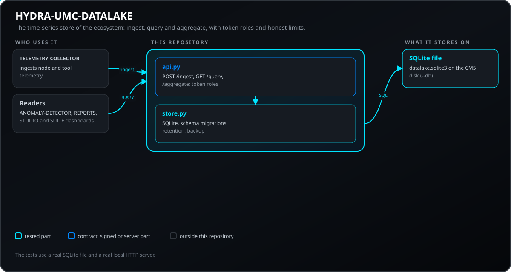
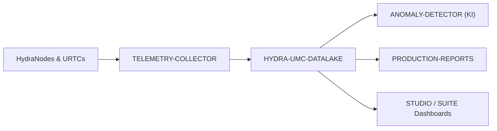
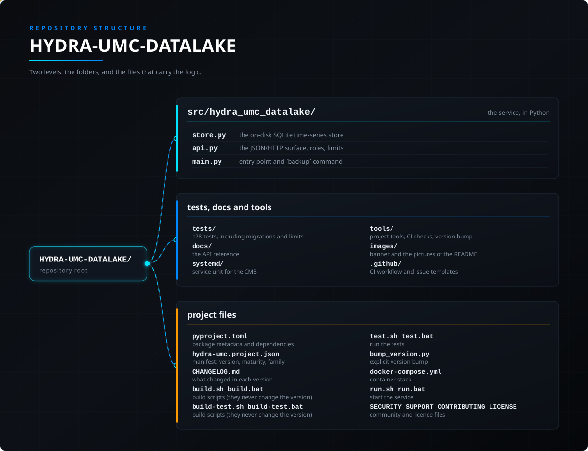

<!-- =============================================================================
HYDRA-UMC-DATALAKE - Time-series data lake
Copyright (C) JuanenRac (Electro Hobby 3D) <electrohobby3d@gmail.com>
GPL-3.0-or-later - see LICENSE
============================================================================= -->

<p align="center">
  
</p>

# 🗄️ HYDRA-UMC-DATALAKE

<p align="center"><a href="README.md">🇺🇸 English</a> | <a href="README_spa.md">🇪🇸 Español</a> | <a href="README_fra.md">🇫🇷 Français</a> | <a href="README_ita.md">🇮🇹 Italiano</a> | 🇩🇪 <b>Deutsch</b> | <a href="README_zho.md">🇨🇳 简体中文</a> | <a href="README_jpn.md">🇯🇵 日本語</a> | <a href="README_por.md">🇵🇹 Português</a></p>

### 📊 Skalierbarer Zeitreihenspeicher für industrielle Roboterdaten

<p align="center">
  
  
  
  
  
  
</p>

---

> **Stand von Sicherheit (Safety) und Security:** Dieses Ökosystem ist kein zertifiziertes Sicherheitssystem. Es gibt noch keinen Hardware-E-STOP-Pfad, keine von der Firmware durchgesetzten Grenzen oder Verriegelungen und keinen verifizierten Bewegungsbefehl; Firmware-Images werden mit CRC32 und einem HMAC-SHA256 mit gemeinsamem Schlüssel geprüft, nicht mit einer asymmetrischen Signatur; TLS und gegenseitiges TLS sind optional und standardmäßig aus; noch keine eigene Platine wurde bestückt oder getestet. Lesen Sie die [Sicherheitsbasis](https://github.com/JuanenRac/HYDRA-UMC-DOCS/blob/main/docs/SECURITY_BASELINE.md) und das [Bedrohungsmodell](https://github.com/JuanenRac/HYDRA-UMC-DOCS/blob/main/docs/THREAT_MODEL.md), bevor Sie sich für die Sicherheit einer Person auf eine Aussage hier verlassen.

---

## 📋 Auf einen Blick

| | |
|---|---|
| Version | `0.1.9` |
| Reifegrad | Funktionsfähig |
| Tests | 118 (`python -m pytest -q tests`) |
| Technik | Python / sqlite3 / http.server (ThreadingHTTPServer) / pytest |
| Ziel | Der Raspberry Pi CM5 einer HYDRA-UMC-Zelle |
| Auf echter Hardware | Noch nicht: für diese Version ist kein Lauf auf echter Hardware vermerkt |

**Springe zu:** [Überblick](#-überblick) · [Architektur](#-architektur) · [Funktionen](#-funktionen) · [Sicherheit und Schutz](#-sicherheit-und-schutz) · [Schnittstellen](#-schnittstellen) · [Konfiguration](#-konfiguration) · [Schnellstart](#-schnellstart) · [Tests](#-tests) · [Fehlerbehebung](#-fehlerbehebung) · [Struktur des Repositorys](#-struktur-des-repositorys) · [Verwandte Projekte](#-verwandte-projekte)

## 🚦 Projektstatus

Jede Zeile ist ein Teil dieses Repositorys, und die Ampel sagt, wie weit er heute ist. Sie beruht auf dem, was das Repository zeigen kann (Tests, Builds, Läufe), nicht auf dem, was geplant ist.

🟢 Fertig und überprüft · 🟡 Funktioniert, mit bekannten Grenzen · 🟠 Teilweise fertig oder noch nicht überprüft · 🔴 Nicht gemacht oder funktioniert nicht

| Bereich | Stand | Was das hier bedeutet |
|---|---|---|
| Software | 🟡 | Funktioniert für seinen Hauptzweck; die Ehrlichkeitsprüfung oben nennt, was noch fehlt |
| Tests | 🟢 | 118 automatische Tests, bei jeder Änderung ausgeführt |
| Echte Hardware | 🔴 | Noch nicht: für diese Version ist kein Lauf auf echter Hardware vermerkt |
| Dokumentation | 🟢 | README in acht Sprachen, bei jeder Änderung gegen das Manifest geprüft |

## 🎯 Überblick

**HYDRA-UMC-DATALAKE** ist der aktuelle Zeitreihenspeicher der Fabrik. Er bietet ein echtes SQLite-gestütztes Repository für normalisierte Telemetrie des Ökosystems, einschließlich Motorströmen, Gelenkwinkeln, Sensormesswerten und KI-Inferenzprotokollen.

Er bildet die Softwaregrundlage für Analysen, vorausschauende Wartung und Produktionsberichte. Die aktuelle SQLite-Implementierung ist lokal getestet; ein externer InfluxDB-/TimescaleDB-Einsatz bleibt eine künftige Infrastrukturentscheidung und wird nicht als bereits laufende Funktion behauptet.

## 🧩 Rolle in HYDRA-UMC

**HYDRA-UMC-DATALAKE** ist der Ort, an dem die Telemetrie des Ökosystems liegt: Der Collector schreibt hinein, der Anomaliedetektor, die Produktionsberichte und die Dashboards lesen daraus. Er hat keine eigene Robotiklogik und steuert nie eine Maschine.

## 🏛️ Architektur

<p align="center">
  
</p>

<details>
<summary>Textversion des Diagramms (Mermaid)</summary>



</details>

**Warum es so gebaut ist**

* **Warum es der Integrations-Elternteil, kein Gleichrangiger, seiner 3 Kinder ist.** HYDRA-UMC-TELEMETRY-COLLECTOR, HYDRA-UMC-ANOMALY-DETECTOR und HYDRA-UMC-PRODUCTION-REPORTS lesen/schreiben alle denselben zugrunde liegenden Zeitreihenspeicher - diesen Speicher an einem Ort (diesem Repo) zu besitzen vermeidet 3 unabhängige, potenziell divergierende Schema-Entscheidungen.
* **Warum sqlite3 heute, noch nicht InfluxDB/TimescaleDB.** Eine externe Datenbank bleibt eine mögliche langfristige Deployment-Entscheidung, doch ihr Betrieb ist echte Infrastrukturarbeit und nichts, das ungefragt behauptet oder ergänzt werden sollte. Der `TimeSeriesStore` in `src/hydra_umc_datalake/store.py` ist heute ein echter, ACID-konformer, abfragbarer Zeitreihenspeicher (Pythons stdlib-`sqlite3`), kein Platzhalter, und bleibt hinter seiner eigenen Klasse, sodass ein zukünftiges Backend den HTTP-Vertrag ohne Neuschreiben ersetzen kann.
* **Warum eine einzige schmale "lange" Tabelle (source/kind/field/timestamp/value) statt einer Spalte pro Telemetriefeld.** Das eigene `Sample.Fields` von HYDRA-UMC-TELEMETRY-COLLECTOR ist offen (jeder Feldname, jede Quelle kann neue melden) - ein schmales Schema akzeptiert sie alle ohne Migration, zum echten Preis einer Zeile pro Feld pro Sample statt einer Zeile pro Sample.
* **Warum `aggregate()` echtes SQL-Zeit-Bucketing macht, nicht nur rohes `query()`.** Ein Dashboard oder Bericht, der nach "durchschnittlicher Motortemperatur pro Minute in der letzten Woche" über Millionen roher Zeilen fragt, braucht echtes Downsampling durch die Datenbank, nicht roh abgerufen und im Anwendungscode gemittelt - die Bucket-Grenzen von `aggregate()` sind deterministisch (am `start` der Abfrage selbst ausgerichtet), sodass dieselbe Abfrage über dieselben Daten immer dieselben Bucket-Grenzen zieht.
* **Wie sich das in das restliche Ökosystem einfügt.** Der Integrations-Elternteil der Data-&-Analytics-Familie. HYDRA-UMC-TELEMETRY-COLLECTOR schreibt hinein, was Produzenten an den Collector schicken (noch schickt nichts im Ökosystem Daten, der Speicher einer echten Installation beginnt also leer), und HYDRA-UMC-ANOMALY-DETECTOR sowie HYDRA-UMC-PRODUCTION-REPORTS lesen die gespeicherte Telemetrie zurück.
* **Warum die Schema-Versionierung SQLites eigenes `PRAGMA user_version` nutzt, keine handgestrickte Tabelle.** SQLite bietet bereits genau diesen echten Mechanismus (eine Ganzzahl im Datei-Header) - eine parallele Buchführungstabelle wäre nur eine zweite, potenziell abweichende Quelle der Wahrheit für denselben Sachverhalt.
* **Warum die Aufbewahrung opt-in pro `(kind, field)` ist, kein globaler Standard.** Ein Speicher mit Dutzenden echter Telemetrie-Serien sollte nicht die Aufbewahrungsannahme eines Betreibers stillschweigend auf jede Serie anwenden lassen - `apply_retention()` fasst immer nur eine Serie an, der explizit über `set_retention_policy()`/`POST /retention` eine Richtlinie zugewiesen wurde.
* **Warum die Wiederholungsidentität `(source, kind, field, timestamp)` lautet.** Der normalisierte Telemetrievertrag besitzt keine Sequenz-/Ereignis-ID; ein exakt wiederholter Punkt wird deshalb als unsichere Netzwerkwiederholung behandelt und mit deterministischem Last-Write-Wins-Verhalten zusammengeführt. Das verhindert verzerrende Duplikate in Zählungen und Aggregaten, ohne historische Daten global destruktiv zu bereinigen. Sendet der Produzent eine `sequence` (der Telemetrie-Collector tut das), gehört sie zur Identität, `(source, kind, field, timestamp, sequence)`: Zwei verschiedene Messwerte derselben Millisekunde sind zwei Punkte, und nur eine Wiederholung derselben Sequenz ersetzt sich selbst.
* **Warum `/stats/range` ein neuer Endpunkt ist statt `/stats` zu erweitern.** Die bestehende Form von `/stats`, `{"sampleCount": <int>}`, ist bereits echt und getestet - Felder hinzuzufügen wäre ein echter, breaking Change ohne Grund, wenn ein zweiter, additiver Endpunkt nichts kostet.

## ✨ Funktionen

* 🗄️ **SQLite-gestützter Speicher:** Echter, ACID-konformer Zeitreihenspeicher auf Datenträger mit Pythons stdlib-`sqlite3`. *(implementiert)*
* 📊 **Einheitliches Datenschema:** Normalisierte Long-Form-Telemetrie (`source/kind/field/timestamp/value`) für HYDRA-UMC- und URTC-Quellen. *(implementiert)*
* 🔍 **Deterministische Abfragen:** Ergebnisse werden nach Timestamp und stabilen Tie-Breakern geordnet; begrenzte Lesevorgänge lehnen nicht-positive Limits ab. *(implementiert)*
* 🔁 **Idempotente Wiederholungen:** Die erneute Zustellung eines Punkts `(source, kind, field, timestamp)` ersetzt seinen Wert (letzte Schreiboperation gewinnt) und verhindert aufgeblähte Duplikate durch Wiederholungen. *(implementiert)*
* 🧬 **Reversible Schema-Migrationen:** Echte, getestete `migrate_up()`/`migrate_down()`, nachverfolgt über SQLites eigenes `PRAGMA user_version` - eine veröffentlichte Migration nie bearbeiten, stattdessen eine neue hinzufügen. *(implementiert)*
* 🕐 **Explizite UTC-Zeitstempel:** `GET /stats/range` meldet die echten ältesten/neuesten Daten sowohl als rohe ms als auch als explizite UTC-ISO-8601-Strings. *(implementiert)*
* 🗑️ **Validierte Aufbewahrung:** Pro Serie opt-in wählbare Aufbewahrungsfenster (`GET`/`POST /retention`, `POST /retention/apply`) - ein nicht-positives Fenster wird rundweg abgelehnt. *(implementiert)*
* 🔐 **Zugriffskontrolle und begrenzte Lesezugriffe:** optionale Bearer-Tokens je Rolle (`ingest`, `admin` für die Retention-Routen, die Historie löschen, `read`); ein Bind außerhalb von Loopback wird ohne die ersten beiden abgelehnt. Eine Abfrage ist begrenzt (`limit` höchstens 200000, ein Aggregat höchstens 100000 Buckets), ein Zeitstempel in Sekunden oder aus der Zukunft wird abgewiesen, und die Historie einer Serie ohne eigene Retention-Richtlinie kann durch eine Standardrichtlinie begrenzt werden. *(implementiert)*
* 📚 **Seiten, Stapel, Katalog und Sicherung:** ein langer Verlauf wird seitenweise gelesen (`cursor`, angekündigt im Header `X-Next-Cursor`), ein Fenster `[start, before)` zählt seinen Randpunkt nicht doppelt, `POST /ingest/batch` speichert viele Messwerte in einer Transaktion, `GET /series` listet das Gespeicherte auf und `hydra-umc-datalake backup` schreibt eine konsistente Kopie und behält die neuesten. *(implementiert)*

## 🔒 Sicherheit und Schutz

| Bedrohung | Abwehr | Wo |
|---|---|---|
| Anonyme Schreibzugriffe | Drei Token-Rollen (`ingest`, `admin`, `read`), in konstanter Zeit verglichen (`hmac.compare_digest`), mindestens 16 Zeichen; eine Rolle ohne Token ist nur auf einer Loopback-Adresse offen, und eine Nicht-Loopback-Adresse ohne Token braucht `--allow-anonymous` | `api.py`, `main.py` |
| Ein riesiger Body, ein riesiger Stapel, ein langsamer Client | Ein Body über 1 MiB bekommt `413`, ein Stapel hat höchstens 1000 Messwerte (`--max-batch-samples`) und eine Anfrage wird höchstens 15 Sekunden gelesen | `api.py` |
| Eine volle Platte und absurde Zeitstempel | Schreibzugriffe enden mit einem ehrlichen `507` unter 64 MiB frei (nie einem `500`); ein Zeitstempel vor 100 000 000 000 ms oder mehr als 5 Minuten in der Zukunft wird abgelehnt (`--max-future-skew-seconds`, `0` schaltet das ab) | `api.py` |
| Eine Abfrage, die den Speicher auffrisst | Höchstens 200 000 Zeilen pro Abfrage, 100 000 Buckets pro Aggregation und 100 000 Serien | `store.py` |

**Was er nie tut:** er steuert nie einen Roboter, und Erfassung und Analyse liegen in anderen Repositories.

## 🔌 Schnittstellen

Eine einfache JSON/HTTP-Schnittstelle (`http.server` der Standardbibliothek, kein Framework) standardmäßig auf `127.0.0.1:8095`. Die vollständige Referenz ist `docs/API.md`.

| Topic oder Route | Was es trägt |
|---|---|
| `POST /ingest`, `POST /ingest/batch` | eine Messung oder einen Stapel schreiben (Rolle `ingest`) |
| `GET /query`, `/aggregate`, `/series`, `/stats`, `/stats/range` | Messwerte, Aggregate, die Serienliste und Statistiken lesen (Rolle `read`) |
| `GET /retention`, `POST /retention`, `POST /retention/apply` | die Aufbewahrungsrichtlinie lesen, setzen und anwenden (Rolle `admin`) |
| `GET /health` | lebt der Dienst |

## ⚙️ Konfiguration

| Variable | Standard | Was sie festlegt |
|---|---|---|
| `--db` | `datalake.sqlite3` | die SQLite-Datei (`:memory:` ist nicht dauerhaft) |
| `--addr`, `--port` | `127.0.0.1`, `8095` | worauf gelauscht wird |
| `--token`, `HYDRA_UMC_DATALAKE_TOKEN` | kein Token | ein Token für jede Rolle, mindestens 16 Zeichen |
| `HYDRA_UMC_DATALAKE_INGEST_TOKEN`, `_ADMIN_TOKEN`, `_READ_TOKEN` | nicht gesetzt | ersetzen den gemeinsamen Token für eine Rolle |
| `--allow-anonymous` | nein | nötig für eine Nicht-Loopback-Adresse ohne Token |
| `--default-retention-days`, `--max-future-skew-seconds`, `--max-batch-samples` | `0`, `300`, `1000` | Standard-Aufbewahrung (`0` = keine), Zukunftsabweichung in Sekunden (`0` = aus), Messwerte pro Stapel |

Der Container-Stack (`docker-compose.yml`) benennt seine Token anders (zum Beispiel `DATALAKE_TOKEN`); im Container werden sie zur obigen Variable.

## 🚀 Schnellstart

Benötigt Python 3.11 oder neuer; der Code nutzt nur die Standardbibliothek.

```bash
bash run.sh        # Linux, macOS (run.bat on Windows)
python -m hydra_umc_datalake.main --db datalake.sqlite3 --token "$(openssl rand -hex 16)"
curl http://127.0.0.1:8095/health
```

Die Datenbank mit dem Befehl `backup` kopieren, zum Beispiel `hydra-umc-datalake backup --dest /backups --keep 7` (`--keep 0` behält alle Kopien).

## 🧪 Tests

118 automatische Tests laufen mit `python -m pytest -q tests`; `python tools/build_test.py` kompiliert nur jedes Modul. Sie nutzen eine echte SQLite-Datei und einen echten lokalen HTTP-Server, keine Hardware und kein äußeres Netz.

| Testdatei | Tests | Was sie abdeckt |
|---|---|---|
| `test_store.py`, `test_migrations.py`, `test_sequence_identity.py`, `test_pages_batch_backup.py` | - | der Speicher, die Schema-Migrationen, Sequenzen, Seiten, Stapel und Sicherungen |
| `test_api.py`, `test_access_and_limits.py` | - | die Routen über echtes HTTP, die Token-Rollen und jede Grenze |

Die CI führt `HYDRA_UMC_CI=1 python tools/ci_validate.py` aus; das prüft das Manifest, die Dokumente, die acht READMEs und die Bilder.

## 🏗️ Build und Veröffentlichung

Erfordert Python >= 3.10. Ein echter, abfragbarer Zeitreihenspeicher mit
HTTP-API, nicht nur ein Skelett, das sich importieren lässt.

```bash
# Linux/macOS
./build.sh
./run.sh --port 8095

# Windows
build.bat
run.bat --port 8095
```

`build` erstellt/aktiviert eine lokale `.venv`, installiert das Paket
(editierbar, mit Dev-Extras) darin, prüft den Import und führt die echte
Testsuite (`pytest`) aus. `run` startet die HTTP-API und reicht jedes Flag
weiter (`--addr`, `--port`, `--db`).

```bash
# Ein Sample einspeisen (dieselbe normalisierte Form wie HYDRA-UMC-TELEMETRY-COLLECTORs eigenes Sample)
curl -X POST localhost:8095/ingest \
  -d '{"sourceId":"robot-1","kind":"motor_temp","timestamp":1700000000000,"fields":{"value":42.5}}'

# Es wieder abfragen
curl "localhost:8095/query?sourceId=robot-1"

# Auf 1-Minuten-Buckets über einen echten Zeitraum herunterrechnen
curl "localhost:8095/aggregate?kind=motor_temp&field=value&bucketMs=60000&start=0&end=1800000000000&agg=avg"

curl localhost:8095/stats
```

```bash
python -m pytest tests/ -v   # store.py (insert/query/aggregate,
                              # einschließlich von Hand nachrechenbarer
                              # Bucketing-Mathematik) und api.py (echte
                              # HTTP-Roundtrips gegen einen echten
                              # ThreadingHTTPServer auf einem ephemeren Port)
```

Um dieses Projekt zusammen mit seinen drei Kindern (Telemetry-Collector, Anomaly-Detector, Production-Reports) als Geschwisterverzeichnisse zu starten:

```bash
TELEMETRY_COLLECTOR_TOKEN='a-secret-of-16-or-more-characters' \
DATALAKE_TOKEN='another-secret-of-16-or-more-characters' \
ANOMALY_TOKEN='a-third-secret-of-16-or-more-characters' docker compose up --build
```

Die Compose-Datei startet die vier Dienste wirklich (jeder mit einem expliziten Befehl), veröffentlicht jeden Port nur auf `127.0.0.1` und weigert sich zu starten ohne `TELEMETRY_COLLECTOR_TOKEN`, `DATALAKE_TOKEN` oder `ANOMALY_TOKEN` (Geheimnisse von mindestens 16 Zeichen, die dann die Ingest-Routen des Collectors, die Schreib- und Verwaltungsrouten des Datalake und die Routen des Detektors verlangen). Die Daten liegen in benannten Volumes, `docker compose down` behält sie also. `python tools/verify_compose.py` prüft die Struktur der Datei ohne Docker.

## 🩺 Fehlerbehebung

| Du siehst | Weil | Tu |
|---|---|---|
| `401` / `403` | Der Token fehlt, ist zu kurz oder hat die falsche Rolle | Sende den Token der richtigen Rolle (`ingest` schreibt, `read` liest, `admin` darf alles) |
| `413` | Der Body ist größer als 1 MiB | Sende kleinere Stapel (`--max-batch-samples`) |
| `507` | Weniger als 64 MiB Platte sind frei | Platz schaffen oder die Aufbewahrungsrichtlinie anwenden (`POST /retention/apply`) |
| a time stamp is refused | Er liegt vor 100 000 000 000 ms oder mehr als 5 Minuten vor der Uhr | Die Uhr des Senders richtig stellen oder `--max-future-skew-seconds` erhöhen |

## 📂 Struktur des Repositorys

<p align="center">
  
</p>

<details>
<summary>Textversion des Baums</summary>

```text
HYDRA-UMC-DATALAKE/
├── src/hydra_umc_datalake/
│   ├── store.py                                 der SQLite-Zeitreihenspeicher auf der Platte
│   ├── api.py                                   die JSON/HTTP-Schnittstelle, Rollen, Grenzen
│   └── main.py                                  Einstiegspunkt und Befehl `backup`
├── tests/                                       118 Tests, mit Migrationen und Grenzen
├── docs/                                        die API-Referenz
├── systemd/                                     Dienst-Unit für den CM5
├── tools/                                       Build- und Testläufer, Versionserhöhung, CI-Prüfer, README- und Bildgeneratoren samt Prüfungen
├── images/                                      Banner und die Bilder der README
├── .github/                                     CI-Workflow und Issue-Vorlagen
├── pyproject.toml                               Paketmetadaten und Abhängigkeiten
├── hydra-umc.project.json                       Manifest: Version, Reifegrad, Familie
├── CHANGELOG.md                                 was sich in jeder Version geändert hat
├── build.sh build.bat                           Build-Skripte (ändern die Version nie)
├── build-test.sh build-test.bat                 Build-Skripte (ändern die Version nie)
├── test.sh test.bat                             führen die Tests aus
├── bump_version.py / bump_manifest_version.py   ausdrückliche Versionserhöhung
├── docker-compose.yml                           Container-Stack
├── run.sh run.bat                               den Dienst starten
└── SECURITY.md SUPPORT.md CONTRIBUTING.md CODE_OF_CONDUCT.md LICENSE LICENSE.md
```

</details>

## 🗺️ Roadmap und bekannte Grenzen

**Bekannte Grenzen heute**

* **Phase 1:** Hochdurchsatz-Ingestion und Indexierung des Datalakes für historische Analysen.
* **Phase 2:** Edge-Kompression des Telemetrie-Collectors und sichere Übertragungsprotokolle.
* **Phase 3:** Anomalieerkennung mittels unüberwachtem Lernen und Motorvibrationsanalyse.
* **Phase 4:** Integration mit Grafana für erweiterte Echtzeit-Visualisierung und Automatisierung von Produktionsberichten.

## 🌍 Sprachen

Diese README und die Dokumente des Repositorys gibt es in acht Sprachen: Englisch, Spanisch, Deutsch, Französisch, Italienisch, Japanisch, Chinesisch und Portugiesisch (Portugal). Sie entstehen gemeinsam, und die CI prüft, dass die acht Dateien dieselben Abschnitte und dieselben Links haben. Dieses Repository hat weder eine eigene Oberfläche noch einen eigenen Meldungskatalog, es gibt also keine Oberflächentexte zu übersetzen.

## 🔗 Verwandte Projekte

Dieses Projekt ist Teil des HYDRA-UMC-Robotik-Ökosystems desselben Autors (JuanenRac / Electro Hobby 3D). Gut zu wissen, da eine Anfrage eigentlich eines dieser Projekte betreffen könnte statt dieses Repositorys.

**Untergeordnete Projekte** — jedes davon schreibt in oder liest aus dem eigenen Speicher dieses Data Lakes
- **[HYDRA-UMC-TELEMETRY-COLLECTOR](https://github.com/JuanenRac/HYDRA-UMC-TELEMETRY-COLLECTOR)** — echte CAN/WebSocket-Ingestion-Pipeline in DATALAKE, mit Sequenz-Deduplizierung.
- **[HYDRA-UMC-ANOMALY-DETECTOR](https://github.com/JuanenRac/HYDRA-UMC-ANOMALY-DETECTOR)** — echter FFT- + statistischer Basislinien-Anomaliedetektor mit Drift-Überwachung.
- **[HYDRA-UMC-PRODUCTION-REPORTS](https://github.com/JuanenRac/HYDRA-UMC-PRODUCTION-REPORTS)** — echte OEE-/Verfügbarkeitsberechnung über den DATALAKE-Verlauf, mit reproduzierbarem CSV-Export.

**Direkt verwandt**
- **[HYDRA-UMC-SERVER](https://github.com/JuanenRac/HYDRA-UMC-SERVER)** — das reale Headless-Backend (REST/WebSocket), mit dem jeder Steuerungsclient tatsächlich spricht; die Quelle der Logs/Telemetrie, die dieses Projekt aufnimmt.
- **[HYDRA-UMC-DASHBOARD-AI](https://github.com/JuanenRac/HYDRA-UMC-DASHBOARD-AI)** — Smart-Summaries- und Anomaly-Highlighting-Panels über DATALAKE/ANOMALY-DETECTOR, mit einem ehrlichen statistischen Fallback; berechnet seine Smart Summaries direkt aus der eigenen Abfrage-/Aggregat-Historie dieses Data Lakes.

**Ebenfalls Teil des Ökosystems**

*Kern-Hardware & Plattform*
- **[HYDRA-UMC](https://github.com/JuanenRac/HYDRA-UMC)** — der Entwurf des Motherboards des Roboterarms: CM5-Host + Dual-Core-STM32H745, gedacht zur Koordination von bis zu 8 Werkzeugarmen über CAN-OTA/SPI-OTA (Firmware in einer frühen Phase; noch keine bestückte Platine).
- **[HYDRA-UMC-OS](https://github.com/JuanenRac/HYDRA-UMC-OS)** — reproduzierbare Raspberry-Pi-OS-Produktschicht für den CM5: schreibgeschützter Agent, validierte Konfiguration/Profile, WiFi-Ersteinrichtung.
- **[HYDRA-UMC-SDK](https://github.com/JuanenRac/HYDRA-UMC-SDK)** — der gemeinsame JSON-Schema-Vertrag und die Software-Auftragsschranke, gegen die jede Bridge ihre Befehle validiert (keine zertifizierte Sicherheitsfunktion).
- **[HYDRA-UMC-CONNECTOR-HUB](https://github.com/JuanenRac/HYDRA-UMC-CONNECTOR-HUB)** — deklaratives Adapter-Manifest-Register und Validator für Konnektoren externer Maschinen; erweitert die eigene Vertragsidee des SDK auf externe Maschinen, ohne die Industrie-Gateway-Projekte zu ersetzen.

*Kern-Backend & Clients*
- **[HYDRA-UMC-STUDIO](https://github.com/JuanenRac/HYDRA-UMC-STUDIO)** — Web-Steuerungs-Dashboard mit Echtzeit-3D-Visualisierung mehrerer Roboter.
- **[HYDRA-UMC-SUITE](https://github.com/JuanenRac/HYDRA-UMC-SUITE)** — Desktop-Schwarmleitstand (PySide6) für mehrere Server gleichzeitig, verpackt als eigenständige ausführbare Datei.
- **[HYDRA-UMC-ANDROID-CONTROL](https://github.com/JuanenRac/HYDRA-UMC-ANDROID-CONTROL)** — native Android-Steuerungs-App mit biometrischem Login und einer gekoppelten Wear-OS-Begleit-App.
- **[HYDRA-UMC-IOS-CONTROL](https://github.com/JuanenRac/HYDRA-UMC-IOS-CONTROL)** — iOS/iPadOS-Steuerungs-App (Flutter) mit Echtzeit-WebSocket-Synchronisierung.
- **[HYDRA-UMC-DSI](https://github.com/JuanenRac/HYDRA-UMC-DSI)** — native Touch-UI für das eingebaute 7"-DSI-Touchscreen, direkt auf dem CM5 eingebettet.
- **[HYDRA-UMC-EDITOR-URDF](https://github.com/JuanenRac/HYDRA-UMC-EDITOR-URDF)** — grafischer Desktop-URDF-Ersteller/-Editor, der fertige Modelle in STUDIOs eigenen Katalog überträgt.
- **[HYDRA-UMC-EDITOR-STL](https://github.com/JuanenRac/HYDRA-UMC-EDITOR-STL)** — Desktop-STL-Modelleditor, der echte Teile im selben Modellkatalog transformiert/ersetzt/entfernt/hinzufügt, den auch HYDRA-UMC-EDITOR-URDF bearbeitet.
- **[HYDRA-UMC-BRIDGE-AMR](https://github.com/JuanenRac/HYDRA-UMC-BRIDGE-AMR)** — Koordinationsschranke für AGV-/AMR-Flotten über einen VDA-5050-MQTT-Publisher (nur gegen eine emulierte Flotte getestet).
- **[HYDRA-UMC-BRIDGE-CNC](https://github.com/JuanenRac/HYDRA-UMC-BRIDGE-CNC)** — High-Level-Koordinator für CNC-Zellen mit GRBL-Status-/Steuerbyte-Zugriff (nur gegen einen Emulator getestet).
- **[HYDRA-UMC-BRIDGE-DROIDS](https://github.com/JuanenRac/HYDRA-UMC-BRIDGE-DROIDS)** — Koordinationsschranke für laufende/humanoide Droiden, mit einem Boston-Dynamics-Spot-Befehlssender (nur gegen einen Emulator getestet).
- **[HYDRA-UMC-BRIDGE-LASER](https://github.com/JuanenRac/HYDRA-UMC-BRIDGE-LASER)** — Koordinator für Laserzellen, liest 3 Schlüssel-/Gehäuse-/Verriegelungs-GPIO-Signale (nur gegen einen simulierten Chip getestet; kann keinen Laser scharfschalten oder auslösen).
- **[HYDRA-UMC-BRIDGE-OPENPNP](https://github.com/JuanenRac/HYDRA-UMC-BRIDGE-OPENPNP)** — sicherer High-Level-Koordinator für den Leiterplattenfluss von OpenPnP Pick-and-Place.
- **[HYDRA-UMC-BRIDGE-PRINTER3D](https://github.com/JuanenRac/HYDRA-UMC-BRIDGE-PRINTER3D)** — sichere Koordinationsschranke für Moonraker/Klipper-3D-Drucker, mit echten gesicherten Job-Befehlen.
- **[HYDRA-UMC-BRIDGE-ROS2](https://github.com/JuanenRac/HYDRA-UMC-BRIDGE-ROS2)** — Koordinator mit einem träge importierten rclpy-ROS-2-Transport (noch nicht gegen eine ROS-2-Installation ausgeführt).
- **[HYDRA-UMC-BRIDGE-UAV](https://github.com/JuanenRac/HYDRA-UMC-BRIDGE-UAV)** — Koordinationsschranke für kameraausgestattete UAVs, mit einem MAVLink-Befehlssender (nur gegen einen Emulator getestet).

*URTC-Werkzeugplattform*
- **[URTC](https://github.com/JuanenRac/URTC)** — Firmware für die physische Universal-Robot-Tool-Controller-Platine, 25+ Werkzeugprofile über CAN-Bus.
- **[URTC-FLASHER](https://github.com/JuanenRac/URTC-FLASHER)** — Desktop-GUI-Flash-Tool für URTC-Platinen, CAN-OTA plus Full-Chip-SWD/JTAG.
- **[URTC-TESTER](https://github.com/JuanenRac/URTC-TESTER)** — Desktop-Live-CAN-Bus-Diagnosetool für URTC-Platinen, ein Panel pro Werkzeugprofil.
- **[URTC-WEB-STUDIO](https://github.com/JuanenRac/URTC-WEB-STUDIO)** — browserbasierte Alternative zu URTC-TESTER über die Web-Serial-API, ohne lokale Installation.
- **[URTC-GATEWAY](https://github.com/JuanenRac/URTC-GATEWAY)** — Gateway vor dem CAN-Bus von URTC: Liste erlaubter Kennungen, Ratenbegrenzung und Sitzungsschlüssel; Software auf dem Computer getestet, noch nicht an einem echten Bus.

*Vision-KI-Knoten (Hailo-8)*
- **[HYDRA-UMC-VISION-NODE](https://github.com/JuanenRac/HYDRA-UMC-VISION-NODE)** — Integrationsknoten für die Hailo-8-Vision-Pipeline, mit einer echten stufenweisen Hardware-Bereitschaftsprüfung.
- **[HYDRA-UMC-DETECTION-HEF](https://github.com/JuanenRac/HYDRA-UMC-DETECTION-HEF)** — echte Registry für kompilierte Modelle mit Hailo-Architektur-/Prüfsummen-Safe-Load-Verifizierung.
- **[HYDRA-UMC-VISION-STREAMER](https://github.com/JuanenRac/HYDRA-UMC-VISION-STREAMER)** — echter GStreamer-Pipeline- + MediaMTX-Konfigurationsgenerator mit einer echten HailoRT-Integrationsschranke.
- **[HYDRA-UMC-VISUAL-SERVOING-API](https://github.com/JuanenRac/HYDRA-UMC-VISUAL-SERVOING-API)** — Position-Based-Visual-Servoing-Korrekturgesetz mit Freigabe abhängig vom Zonenstatus; noch keine Posenschätzung per Kamera.
- **[HYDRA-UMC-SAFETY-ZONES](https://github.com/JuanenRac/HYDRA-UMC-SAFETY-ZONES)** — v0-Logik für Zonenverletzung, Kalibrierungsaktualität und E-STOP-Anforderung, die Objektpositionen aus einer Datei nimmt; kein Detektor speist sie, und noch kein physischer E-STOP ist angeschlossen.

*Kognitiver KI-Knoten (Hailo-10)*
- **[HYDRA-UMC-COGNITIVE-NODE](https://github.com/JuanenRac/HYDRA-UMC-COGNITIVE-NODE)** — Integrationsknoten für die Hailo-10-Cognitive-Pipeline (LLM-/VLA-/Sprach-Orchestrierung).
- **[HYDRA-UMC-VLA-ENGINE](https://github.com/JuanenRac/HYDRA-UMC-VLA-ENGINE)** — echte Aktions-Token-Kodierung/-Dekodierung und Trajektoriengenerierung für ein Vision-Language-Action-Modell.
- **[HYDRA-UMC-VOICE-UI](https://github.com/JuanenRac/HYDRA-UMC-VOICE-UI)** — echtes Sprach-Frontend (VAD + Intent-Parser) mit einem begrenzten, bestätigungsgesicherten Watch-Relay.
- **[HYDRA-UMC-SEMANTIC-PLANNER](https://github.com/JuanenRac/HYDRA-UMC-SEMANTIC-PLANNER)** — echte regelbasierte Aufgabenzerlegung und semantische Fehlerbehebung über MCU-Fehlercodes.
- **[HYDRA-UMC-DOCS-QA](https://github.com/JuanenRac/HYDRA-UMC-DOCS-QA)** — echte, nur auf der Standardbibliothek basierende TF-IDF-Dokumentensuche über die eigenen Markdown-Dokumente dieses Ökosystems.
- **[HYDRA-UMC-LOCAL-TECHNICIAN](https://github.com/JuanenRac/HYDRA-UMC-LOCAL-TECHNICIAN)** — lokaler, richtlinien-gesteuerter KI-Wartungstechniker für das Ökosystem selbst - beobachtet, diagnostiziert und schlägt Korrekturen vor; die zwei höchsten Risikostufen sind absichtlich noch nicht implementiert.

*Orchestrierung & Schwarm*
- **[HYDRA-UMC-ORCHESTRATOR](https://github.com/JuanenRac/HYDRA-UMC-ORCHESTRATOR)** — Integrationsknoten mit einem echten gRPC/Protobuf-Health-Report-Vertrag und einer Missions-Zustandsmaschine.
- **[HYDRA-UMC-JOB-DISPATCHER](https://github.com/JuanenRac/HYDRA-UMC-JOB-DISPATCHER)** — echte prioritätsbasierte Job-Queue mit Deduplizierung, über eine echte HTTP-API.
- **[HYDRA-UMC-NODE-HEALING](https://github.com/JuanenRac/HYDRA-UMC-NODE-HEALING)** — echter gRPC-basierter Flotten-Health-Watchdog mit Retry/Backoff und Identitäts-Mismatch-Erkennung.
- **[HYDRA-UMC-PATH-PLANNER-3D](https://github.com/JuanenRac/HYDRA-UMC-PATH-PLANNER-3D)** — echter RRT-basierter 3D-Pfadplaner mit echter Hindernis-/Arbeitsraum-Kollisionsvalidierung.
- **[HYDRA-UMC-SWARM-SYNC](https://github.com/JuanenRac/HYDRA-UMC-SWARM-SYNC)** — echte CRDT-LWW-Element-Map-Zustandssynchronisation, eigenschaftsgetestet auf Multi-Zellen-Konvergenz.

*Digitaler Zwilling & Simulation*
- **[HYDRA-UMC-TWIN](https://github.com/JuanenRac/HYDRA-UMC-TWIN)** — Integrationsknoten für die Digital-Twin-Engine, mit einem echten Versionskompatibilitäts-Sync-Vertrag.
- **[HYDRA-UMC-HIL-BRIDGE](https://github.com/JuanenRac/HYDRA-UMC-HIL-BRIDGE)** — Hardware-in-the-Loop-Router mit einer Software-Kollisionsverriegelung zwischen Simulation und echter Hardware (ohne echte Hardware getestet).
- **[HYDRA-UMC-PHYSICS-REPLICA](https://github.com/JuanenRac/HYDRA-UMC-PHYSICS-REPLICA)** — echte Vorwärtskinematik und Gelenkgrenzenvalidierung über eine echte URDF-Teilmenge.
- **[HYDRA-UMC-SYNTHETIC-DATA-GEN](https://github.com/JuanenRac/HYDRA-UMC-SYNTHETIC-DATA-GEN)** — echter prozeduraler 2D-Szenengenerator mit YOLO/COCO-Annotationsexport.

*Industrie-Gateway*
- **[HYDRA-UMC-GATEWAY-INDUSTRIAL](https://github.com/JuanenRac/HYDRA-UMC-GATEWAY-INDUSTRIAL)** — Integrationsknoten, der zu Industrieprotokollen weiterleitet, mit einer echten Befehls-Allowlist-/Backpressure-Schicht.
- **[HYDRA-UMC-OPCUA-SERVER](https://github.com/JuanenRac/HYDRA-UMC-OPCUA-SERVER)** — echter OPC-UA-Adressraum, verifiziert mit einer echten Binärprotokoll-Client-Session.
- **[HYDRA-UMC-MQTT-BROKER](https://github.com/JuanenRac/HYDRA-UMC-MQTT-BROKER)** — echter MQTT-Broker mit optionaler Pro-Client-Authentifizierung und Topic-ACLs.
- **[HYDRA-UMC-MTCONNECT-ADAPTER](https://github.com/JuanenRac/HYDRA-UMC-MTCONNECT-ADAPTER)** — echte MTConnect-`/probe`- und `/current`-XML-Endpunkte mit Degraded-Mode-Ausgabe.

*Ergänzende Tools & Ökosystembetrieb*
- **[HYDRA-UMC-TOOL-CLI](https://github.com/JuanenRac/HYDRA-UMC-TOOL-CLI)** — Flotten-CLI mit einem echten, stabilen Exit-Code-Vertrag, ein echter Live-Client der eigenen API von HYDRA-UMC-SERVER.
- **[HYDRA-UMC-WATCH](https://github.com/JuanenRac/HYDRA-UMC-WATCH)** — WearOS-Begleit-App mit haptischen Alarmmustern und einem Sprach-Relay zum gekoppelten Telefon (noch nicht auf einer physischen Uhr ausgeführt).
- **[URTC-SMART-RACK](https://github.com/JuanenRac/URTC-SMART-RACK)** — Firmware für ein Platinenmontagegestell mit echter Werkzeug-ID-Dekodierung und Smart-Idle-Vorheizlogik.
- **[URTC-VISION-TOOL](https://github.com/JuanenRac/URTC-VISION-TOOL)** — Firmware plus ein echter Python-Vision-Begleiter für einen Thermal-/RGB-Inspektionswerkzeugkopf.
- **[HYDRA-UMC-UPDATER](https://github.com/JuanenRac/HYDRA-UMC-UPDATER)** — administratives Desktop-Tool, das jedes Repository in diesem Ökosystem entdeckt, klont und aktualisiert.
- **[HYDRA-UMC-OS-REBUILDER](https://github.com/JuanenRac/HYDRA-UMC-OS-REBUILDER)** — Windows/Linux-Desktop-Tool, das ein flashbereites CM5-Image baut, vorgeladen mit den aktuellsten Versionen des Ökosystems, mit Ersteinrichtungs-Konfiguration für WLAN/Benutzer/SSH im Stil von Raspberry Pi Imager.
- **[HYDRA-UMC-OPS-AGENT](https://github.com/JuanenRac/HYDRA-UMC-OPS-AGENT)** — Wartungsvorfall-Koordinator: eine Edge-Rolle mit niedrigem Privileg sammelt einen bereinigten Inventar-/Gesundheits-Snapshot, eine Control-Plane-Rolle rendert ihn schreibgeschützt und bittet einen KI-Anbieter um einen Diagnosevorschlag - wendet nie einen Patch an und stellt nie etwas bereit.
- **[HYDRA-UMC-DEV-SERVER](https://github.com/JuanenRac/HYDRA-UMC-DEV-SERVER)** — reproduzierbarer Entwicklungshost (Raspberry Pi 5 / CM5), der den Quellcode des Ökosystems vorhält und begrenzte Build-/Test-Aufgaben über eine dauerhafte Warteschlange ausführt; eine dedizierte Entwicklerrolle, ausdrücklich kein operativer CM5.

## 📚 Dokumentation

Hier steht mehr:

* [docs/API.md](docs/API.md) - jede Route, ihre Rolle, ihre Grenzen und ihre Fehler
* [Sicherheitsgrundlage des Ökosystems](https://github.com/JuanenRac/HYDRA-UMC-DOCS/blob/main/docs/SECURITY_BASELINE.md)
* [Bedrohungsmodell des Ökosystems](https://github.com/JuanenRac/HYDRA-UMC-DOCS/blob/main/docs/THREAT_MODEL.md)
* [Änderungsprotokoll dieses Repositorys](CHANGELOG.md)
* [Lizenz dieses Repositorys](LICENSE.md)

## 🤝 Mitwirken und Community

* Führe vor einem Pull Request `HYDRA_UMC_CI=1 py -3 tools/ci_validate.py` (oder `HYDRA_UMC_CI=1 python3 tools/ci_validate.py`) aus: Es muss `CI_VALIDATION=PASS` ausgeben. Führe dafür nicht `build.sh` oder `build.bat` aus; Bauen ist keine Prüfung.
* Die acht READMEs entstehen aus einer einzigen Quelle in HYDRA-UMC-DOCS; bearbeite sie nicht von Hand. Ändere die Quelle und schreibe sie mit `tools/make_readmes.py` neu.
* Behaupte in einer README nichts, was nicht gelaufen ist: Schreibe „simuliert“ oder „nicht auf Hardware erprobt“, wo das stimmt.
* Siehe [CONTRIBUTING.md](CONTRIBUTING.md), den [Verhaltenskodex](CODE_OF_CONDUCT.md), [SECURITY.md](SECURITY.md) und [SUPPORT.md](SUPPORT.md).

## 👤 AUTOR

**JuanenRac (Electro Hobby 3D)** · electrohobby3d@gmail.com

## 📜 LIZENZ

GPL-3.0-or-later - [LICENSE](LICENSE).
