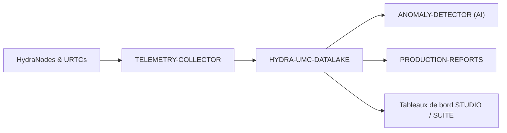

<!-- =============================================================================
HYDRA-UMC-DATALAKE - Time-series data lake
Copyright (C) JuanenRac (Electro Hobby 3D) <electrohobby3d@gmail.com>
GPL-3.0-or-later - see LICENSE
============================================================================= -->

<p align="center">
  
</p>

# 🗄️ HYDRA-UMC-DATALAKE

<p align="center"><a href="README.md">🇺🇸 English</a> | <a href="README_spa.md">🇪🇸 Español</a> | 🇫🇷 <b>Français</b> | <a href="README_ita.md">🇮🇹 Italiano</a> | <a href="README_deu.md">🇩🇪 Deutsch</a> | <a href="README_zho.md">🇨🇳 简体中文</a> | <a href="README_jpn.md">🇯🇵 日本語</a> | <a href="README_por.md">🇵🇹 Português</a></p>

### 📊 Stockage de séries chronologiques évolutif pour les données robotiques industrielles

<p align="center">
  
  
  
  
  
  
</p>

---

> **État de la sûreté et de la cybersécurité :** cet écosystème n'est pas un système de sécurité certifié. Il n'existe pas encore de chaîne d'E-STOP matérielle, ni de limites ou de verrouillages imposés par le firmware, ni de commande de mouvement vérifiée ; les images de firmware sont contrôlées par CRC-32 et une signature Ed25519, et une compilation de version refuse les clés de développement publiées (les têtes d'outil et les cartes d'extension derrière le relais utilisent encore les chargeurs d'URTC, qui prennent un HMAC-SHA256 à clé partagée au lieu d'une signature) ; TLS et TLS mutuel sont optionnels et désactivés par défaut ; aucune carte propre n'a encore été assemblée ni testée. Lisez la [base de sécurité](https://github.com/JuanenRac/HYDRA-UMC-DOCS/blob/main/docs/SECURITY_BASELINE.md) et le [modèle de menaces](https://github.com/JuanenRac/HYDRA-UMC-DOCS/blob/main/docs/THREAT_MODEL.md) avant de vous fier à une affirmation d'ici pour la sécurité d'une personne.

---

## 📋 En un coup d'œil

| | |
|---|---|
| Version | `0.2.0` |
| Maturité | Fonctionnel |
| Tests | 128 (`python -m pytest -q tests`) |
| Technologie | Python / sqlite3 / http.server (ThreadingHTTPServer) / pytest |
| Cible | Le Raspberry Pi CM5 d'une cellule HYDRA-UMC |
| Sur matériel réel | Pas encore : aucune exécution sur du matériel réel n'est consignée pour cette version |

**Aller à :** [Présentation](#-présentation) · [Architecture](#-architecture) · [Fonctionnalités](#-fonctionnalités) · [Sécurité et protection](#-sécurité-et-protection) · [Interfaces](#-interfaces) · [Configuration](#-configuration) · [Démarrage rapide](#-démarrage-rapide) · [Tests](#-tests) · [Dépannage](#-dépannage) · [Structure du dépôt](#-structure-du-dépôt) · [Projets liés](#-projets-liés)

## 🚦 État du projet

Chaque ligne est une partie de ce dépôt et le feu dit où elle en est aujourd'hui. Elle est écrite d'après ce que le dépôt peut montrer (tests, compilations, exécutions), pas d'après ce qui est prévu.

🟢 Fait et vérifié · 🟡 Fonctionne, avec des limites connues · 🟠 À moitié fait ou pas encore vérifié · 🔴 Pas fait ou ne fonctionne pas

| Domaine | État | Ce que cela veut dire ici |
|---|---|---|
| Logiciel | 🟡 | Fonctionne pour son usage principal ; la vérification d'honnêteté ci-dessus liste ce qui manque encore |
| Tests | 🟢 | 128 tests automatiques, exécutés à chaque modification |
| Matériel réel | 🔴 | Pas encore : aucune exécution sur du matériel réel n'est consignée pour cette version |
| Documentation | 🟢 | README en huit langues, vérifié par rapport au manifeste à chaque modification |

## 🎯 Présentation

**HYDRA-UMC-DATALAKE** est le stockage actuel de séries chronologiques de l'usine. Il fournit un référentiel réel adossé à SQLite pour la télémétrie normalisée générée par l'écosystème, notamment les courants moteurs, angles d'articulation, lectures de capteurs et journaux d'inférence IA.

Il est la base logicielle des analyses, de la maintenance prédictive et des rapports de production. L'implémentation SQLite actuelle est testée localement ; un déploiement externe InfluxDB/TimescaleDB reste une décision d'infrastructure future, et non une fonction prétendue déjà en service.

## 🧩 Rôle dans HYDRA-UMC

**HYDRA-UMC-DATALAKE** est l'endroit où l'on garde la télémétrie de l'écosystème : le collecteur y écrit, et le détecteur d'anomalies, les rapports de production et les tableaux de bord y lisent. Il n'a aucune logique de robot et ne commande jamais une machine.

## 🏛️ Architecture

<p align="center">
  
</p>

<details>
<summary>Version texte du diagramme (Mermaid)</summary>



</details>

**Pourquoi il est construit ainsi**

* **Pourquoi c'est le parent d'intégration, pas un pair, de ses 3 enfants.** HYDRA-UMC-TELEMETRY-COLLECTOR, HYDRA-UMC-ANOMALY-DETECTOR et HYDRA-UMC-PRODUCTION-REPORTS lisent/écrivent tous le MÊME entrepôt de séries temporelles sous-jacent - posséder cet entrepôt à un seul endroit (ce dépôt) évite 3 décisions de schéma indépendantes et potentiellement divergentes.
* **Pourquoi sqlite3 aujourd'hui, pas encore InfluxDB/TimescaleDB.** Une base externe reste un choix possible à long terme, mais son exploitation est un véritable travail d'infrastructure, pas quelque chose à déclarer ou ajouter sans demande. Le `TimeSeriesStore` de `src/hydra_umc_datalake/store.py` est aujourd'hui un entrepôt de séries temporelles réel, ACID et interrogeable (`sqlite3` de la stdlib Python), pas un placeholder, et reste derrière sa propre classe afin qu'un backend futur puisse le remplacer sans réécrire le contrat HTTP.
* **Pourquoi une seule table "longue" et étroite (source/kind/field/timestamp/value), pas une colonne par champ de télémétrie.** Le propre `Sample.Fields` de HYDRA-UMC-TELEMETRY-COLLECTOR est ouvert (n'importe quel nom de champ, n'importe quelle source peut en signaler de nouveaux) - un schéma étroit les accepte tous sans migration, au prix réel d'une ligne par champ par échantillon plutôt qu'une ligne par échantillon.
* **Pourquoi `aggregate()` fait un vrai regroupement SQL par temps, pas juste `query()` en brut.** Un tableau de bord ou un rapport demandant « température moyenne du moteur par minute sur la dernière semaine » sur des millions de lignes brutes a besoin d'un vrai sous-échantillonnage fait par la base de données, pas récupéré en brut puis moyenné dans le code applicatif - les limites des buckets d'`aggregate()` sont déterministes (alignées sur le `start` de la requête elle-même), donc la même requête sur les mêmes données trace toujours les mêmes limites de bucket.
* **Comment cela s'intègre au reste de l'écosystème.** Le parent intégrateur de la famille Data & Analytics. HYDRA-UMC-TELEMETRY-COLLECTOR y écrit ce que les producteurs envoient au collector (rien dans l'écosystème n'envoie encore de données : le magasin d'un vrai déploiement commence donc vide), et HYDRA-UMC-ANOMALY-DETECTOR et HYDRA-UMC-PRODUCTION-REPORTS relisent sa télémétrie stockée.
* **Pourquoi le versionnement de schéma utilise le `PRAGMA user_version` propre à SQLite, pas une table faite maison.** SQLite fournit déjà exactement ce mécanisme réel (un entier dans l'en-tête du fichier) - une table de suivi parallèle ne serait qu'une seconde source de vérité, potentiellement divergente, pour le même fait.
* **Pourquoi la rétention est opt-in par `(kind, field)`, pas une valeur par défaut globale.** Un entrepôt avec des dizaines de séries de télémétrie réelles ne devrait pas avoir l'hypothèse de rétention d'un opérateur appliquée silencieusement à chaque série - `apply_retention()` ne touche jamais qu'une série ayant explicitement reçu une politique via `set_retention_policy()`/`POST /retention`.
* **Pourquoi l'identité de retry est `(source, kind, field, timestamp)`.** Le contrat de télémétrie normalisé n'a pas d'identifiant de séquence/événement ; un point exactement répété est donc traité comme un retry réseau incertain et consolidé selon une règle déterministe de dernière écriture gagnante. Cela empêche les doublons de fausser les comptes et agrégats sans nettoyage destructif global des données historiques. Quand le producteur envoie une `sequence` (le collecteur de télémétrie le fait), elle fait partie de l'identité, `(source, kind, field, timestamp, sequence)` : deux lectures différentes de la même milliseconde sont deux points, et seul un retry de la même séquence se remplace lui-même.
* **Pourquoi `/stats/range` est un nouvel endpoint plutôt qu'une extension de `/stats`.** La forme existante de `/stats`, `{"sampleCount": <int>}`, est déjà réelle et testée - lui ajouter des champs serait un changement réel et cassant sans raison, alors qu'un second endpoint additif ne coûte rien.

## ✨ Fonctionnalités

* 🗄️ **Stockage adossé à SQLite :** Stockage de séries chronologiques réel, ACID et sur disque avec `sqlite3` de la stdlib Python. *(implémenté)*
* 📊 **Schéma de données unifié :** Télémétrie normalisée au format long (`source/kind/field/timestamp/value`) pour les sources HYDRA-UMC et URTC. *(implémenté)*
* 🔍 **Requêtes déterministes :** Les résultats sont ordonnés par horodatage et critères de départage stables ; les lectures bornées refusent les limites non positives. *(implémenté)*
* 🔁 **Gestion idempotente des retries :** Renvoyer un point `(source, kind, field, timestamp)` remplace sa valeur (dernière écriture gagnante), évitant que les retries gonflent les doublons. *(implémenté)*
* 🧬 **Migrations de schéma réversibles :** `migrate_up()`/`migrate_down()` réelles et testées, suivies via le `PRAGMA user_version` propre à SQLite - ne jamais modifier une migration déjà publiée, en ajouter une nouvelle. *(implémenté)*
* 🕐 **Horodatages UTC explicites :** `GET /stats/range` rapporte les données réelles les plus anciennes/récentes à la fois en ms brutes et en chaînes ISO 8601 UTC explicites. *(implémenté)*
* 🗑️ **Rétention validée :** Fenêtres de rétention par série, opt-in (`GET`/`POST /retention`, `POST /retention/apply`) - une fenêtre non positive est rejetée d'emblée. *(implémenté)*
* 🔐 **Contrôle d'accès et lectures bornées :** jetons bearer optionnels par rôle (`ingest`, `admin` pour les routes de rétention qui effacent l'historique, `read`) ; un bind non local est refusé sans les deux premiers. Une requête est bornée (`limit` au plus 200000, un agrégat au plus 100000 buckets), un horodatage en secondes ou du futur est refusé, et l'historique d'une série sans politique de rétention propre peut être conservé par une politique par défaut. *(implémenté)*
* 📚 **Pages, lots, catalogue et sauvegarde :** un long historique se lit page par page (`cursor`, annoncé dans l'en-tête `X-Next-Cursor`), une fenêtre `[start, before)` ne compte pas deux fois son point limite, `POST /ingest/batch` enregistre plusieurs échantillons dans une seule transaction, `GET /series` liste ce qui est stocké et `hydra-umc-datalake backup` écrit une copie cohérente et garde les plus récentes. *(implémenté)*

## 🔒 Sécurité et protection

| Menace | Défense | Où |
|---|---|---|
| Écritures anonymes | Trois rôles de jeton (`ingest`, `admin`, `read`) comparés en temps constant (`hmac.compare_digest`), 16 caractères au minimum ; un rôle sans jeton n'est ouvert que sur une adresse loopback, et une adresse non loopback sans jetons exige `--allow-anonymous` | `api.py`, `main.py` |
| Un corps énorme, un lot énorme, un client lent | Un corps de plus de 1 MiB reçoit `413`, un lot contient au plus 1000 échantillons (`--max-batch-samples`) et une requête est lue pendant 15 secondes au plus | `api.py` |
| Un disque plein et des horodatages absurdes | Les écritures s'arrêtent avec un `507` honnête sous 64 MiB libres (jamais un `500`) ; un horodatage antérieur à 100 000 000 000 ms ou à plus de 5 minutes dans le futur est refusé (`--max-future-skew-seconds`, `0` le désactive) | `api.py` |
| Une requête qui dévore la mémoire | Au plus 200 000 lignes par requête, 100 000 paquets par agrégation et 100 000 séries | `store.py` |

**Ce qu'il ne fait jamais :** il ne commande jamais un robot, et l'ingestion et l'analyse vivent dans d'autres dépôts.

## 🔌 Interfaces

Une interface JSON/HTTP simple (le `http.server` de la bibliothèque standard, sans framework) sur `127.0.0.1:8095` par défaut. La référence complète est `docs/API.md`.

| Topic ou route | Ce qu'il porte |
|---|---|
| `POST /ingest`, `POST /ingest/batch` | écrire un échantillon ou un lot (rôle `ingest`) |
| `GET /query`, `/aggregate`, `/series`, `/stats`, `/stats/range` | lire échantillons, agrégats, la liste des séries et les statistiques (rôle `read`) |
| `GET /history` | une série pour un client historien : dans les deux ordres, avec curseur de page et, avec `bounds=1`, les valeurs juste en dehors de la fenêtre (rôle `read`) |
| `GET /retention`, `POST /retention`, `POST /retention/apply` | lire, fixer et appliquer la politique de rétention (rôle `admin`) |
| `GET /health` | le service est-il vivant |

## ⚙️ Configuration

| Variable | Par défaut | Ce qu'elle définit |
|---|---|---|
| `--db` | `datalake.sqlite3` | le fichier SQLite (`:memory:` n'est pas durable) |
| `--addr`, `--port` | `127.0.0.1`, `8095` | où écouter |
| `--token`, `HYDRA_UMC_DATALAKE_TOKEN` | pas de jeton | un jeton pour tous les rôles, 16 caractères au minimum |
| `HYDRA_UMC_DATALAKE_INGEST_TOKEN`, `_ADMIN_TOKEN`, `_READ_TOKEN` | non défini | remplacent le jeton partagé pour un rôle |
| `--allow-anonymous` | non | obligatoire pour une adresse non loopback sans jetons |
| `--default-retention-days`, `--max-future-skew-seconds`, `--max-batch-samples` | `0`, `300`, `1000` | rétention par défaut (`0` = aucune), décalage vers le futur en secondes (`0` = désactivé), échantillons par lot |
| `--max-request-body-bytes`, `--request-timeout-seconds` | `1048576`, `15` | plus grand corps de requête en octets (un corps plus grand reçoit `413`), secondes pendant lesquelles une connexion muette est gardée pendant la lecture d'une requête |

La pile de conteneurs (`docker-compose.yml`) nomme ses jetons autrement (par exemple `DATALAKE_TOKEN`) ; dans le conteneur ils deviennent la variable ci-dessus.

## 🚀 Démarrage rapide

Nécessite Python 3.10 ou plus récent ; le code n'utilise que la bibliothèque standard.

```bash
bash run.sh        # Linux, macOS (run.bat on Windows)
python -m hydra_umc_datalake.main --db datalake.sqlite3 --token "$(openssl rand -hex 16)"
curl http://127.0.0.1:8095/health
```

Copiez la base avec la commande `backup`, par exemple `hydra-umc-datalake backup --dest /backups --keep 7` (`--keep 0` garde toutes les copies).

## 🧪 Tests

128 tests automatiques s'exécutent avec `python -m pytest -q tests` ; `python tools/build_test.py` ne fait que compiler chaque module. Ils utilisent un vrai fichier SQLite et un vrai serveur HTTP local, sans matériel ni réseau extérieur.

| Fichier de tests | Tests | Ce qu'il couvre |
|---|---|---|
| `test_store.py`, `test_migrations.py`, `test_sequence_identity.py`, `test_pages_batch_backup.py` | - | le magasin, les migrations de schéma, séquences, pages, lots et sauvegardes |
| `test_api.py`, `test_access_and_limits.py`, `test_history.py` | - | les routes en vrai HTTP, les rôles de jeton et chaque limite |

La CI exécute `HYDRA_UMC_CI=1 python tools/ci_validate.py`, qui vérifie le manifeste, les documents, les huit README et les images.

## 🏗️ Compilation et publication

Nécessite Python >= 3.10. Un véritable entrepôt de séries temporelles
interrogeable avec une API HTTP, pas seulement un squelette qui s'importe.

```bash
# Linux/macOS
./build.sh
./run.sh --port 8095

# Windows
build.bat
run.bat --port 8095
```

`build` crée/active un `.venv` local, installe le paquet (éditable, avec
les extras de dev) dedans, vérifie l'import, et exécute la véritable suite
de tests (`pytest`). `run` démarre l'API HTTP et transmet tout indicateur
(`--addr`, `--port`, `--db`).

```bash
# Ingérer un échantillon (même forme normalisée que le Sample de HYDRA-UMC-TELEMETRY-COLLECTOR)
curl -X POST localhost:8095/ingest \
  -d '{"sourceId":"robot-1","kind":"motor_temp","timestamp":1700000000000,"fields":{"value":42.5}}'

# Le requêter en retour
curl "localhost:8095/query?sourceId=robot-1"

# Sous-échantillonner en buckets d'1 minute sur une vraie plage de temps
curl "localhost:8095/aggregate?kind=motor_temp&field=value&bucketMs=60000&start=0&end=1800000000000&agg=avg"

curl localhost:8095/stats
```

```bash
python -m pytest tests/ -v   # store.py (insert/query/aggregate, y compris
                              # des maths de bucketing vérifiables à la main)
                              # et api.py (allers-retours HTTP réels contre
                              # un vrai ThreadingHTTPServer sur un port
                              # éphémère)
```

Pour démarrer ce projet avec ses trois enfants (Telemetry-Collector, Anomaly-Detector, Production-Reports) placés comme répertoires frères :

```bash
TELEMETRY_COLLECTOR_TOKEN='a-secret-of-16-or-more-characters' \
DATALAKE_TOKEN='another-secret-of-16-or-more-characters' \
ANOMALY_TOKEN='a-third-secret-of-16-or-more-characters' docker compose up --build
```

Le fichier compose démarre réellement les quatre services (chacun avec une commande explicite), ne publie chaque port que sur `127.0.0.1` et refuse de démarrer sans `TELEMETRY_COLLECTOR_TOKEN`, `DATALAKE_TOKEN` ou `ANOMALY_TOKEN` (des secrets d'au moins 16 caractères, qu'exigent alors les routes d'ingestion du collector, les routes d'écriture et d'administration du datalake et celles du détecteur). Les données vivent dans des volumes nommés, donc `docker compose down` les conserve. `python tools/verify_compose.py` vérifie la structure du fichier sans Docker.

## 🩺 Dépannage

| Vous voyez | Parce que | Faites |
|---|---|---|
| `401` / `403` | Le jeton manque, est trop court ou a le mauvais rôle | Envoyez le jeton du bon rôle (`ingest` écrit, `read` lit, `admin` fait tout) |
| `413` | Le corps dépasse 1 MiB | Envoyez des lots plus petits (`--max-batch-samples`) |
| `507` | Moins de 64 MiB de disque sont libres | Libérez de l'espace ou appliquez la politique de rétention (`POST /retention/apply`) |
| a time stamp is refused | Il précède 100 000 000 000 ms ou devance l'horloge de plus de 5 minutes | Corrigez l'horloge de l'émetteur ou augmentez `--max-future-skew-seconds` |

## 📂 Structure du dépôt

<p align="center">
  
</p>

<details>
<summary>Version texte de l'arborescence</summary>

```text
HYDRA-UMC-DATALAKE/
├── src/hydra_umc_datalake/
│   ├── store.py                                 le magasin de séries temporelles SQLite
│   ├── api.py                                   l'interface JSON/HTTP, rôles, limites
│   └── main.py                                  point d'entrée et commande `backup`
├── tests/                                       128 tests, avec migrations et limites
├── docs/                                        la référence de l'API
├── systemd/                                     unité de service pour la CM5
├── tools/                                       exécuteur de build et de tests, montée de version, validateur CI, générateurs et vérifications des README et des images
├── images/                                      bannière et images du README
├── .github/                                     workflow CI et modèles de tickets
├── pyproject.toml                               métadonnées du paquet et dépendances
├── hydra-umc.project.json                       manifeste : version, maturité, famille
├── CHANGELOG.md                                 ce qui a changé à chaque version
├── build.sh build.bat                           scripts de build (ils ne changent jamais la version)
├── build-test.sh build-test.bat                 scripts de build (ils ne changent jamais la version)
├── test.sh test.bat                             lancent les tests
├── bump_version.py / bump_manifest_version.py   montée de version explicite
├── docker-compose.yml                           pile de conteneurs
├── run.sh run.bat                               démarrer le service
└── SECURITY.md SUPPORT.md CONTRIBUTING.md CODE_OF_CONDUCT.md LICENSE LICENSE.md
```

</details>

## 🗺️ Feuille de route et limites connues

**Limites connues aujourd'hui**

* **Phase 1 :** Ingestion à haut débit du Datalake et indexation pour l'analyse historique.
* **Phase 2 :** Compression à la périphérie du collecteur de télémétrie et protocoles de transmission sécurisés.
* **Phase 3 :** Détection d'anomalies à l'aide de l'apprentissage non supervisé et analyse des vibrations du moteur.
* **Phase 4 :** Intégration avec Grafana pour une visualisation avancée en temps réel et l'automatisation des rapports de production.

## 🌍 Langues

Ce README et les documents du dépôt existent en huit langues : anglais, espagnol, allemand, français, italien, japonais, chinois et portugais (Portugal). Ils sont écrits ensemble et la CI vérifie que les huit fichiers ont les mêmes sections et les mêmes liens. Ce dépôt n'a ni écran ni catalogue de messages propre, il n'y a donc aucune chaîne d'interface à traduire.

## 🔗 Projets liés

Ce projet fait partie de l'écosystème robotique HYDRA-UMC du même auteur (JuanenRac / Electro Hobby 3D). Bon à savoir, car une demande pourrait en réalité concerner l'un de ceux-ci plutôt que ce dépôt.

**Projets Enfants** — chacun écrit dans ou lit depuis le propre entrepôt de ce lac de données
- **[HYDRA-UMC-TELEMETRY-COLLECTOR](https://github.com/JuanenRac/HYDRA-UMC-TELEMETRY-COLLECTOR)** — vrai pipeline d'ingestion CAN/WebSocket vers DATALAKE, avec déduplication par séquence.
- **[HYDRA-UMC-ANOMALY-DETECTOR](https://github.com/JuanenRac/HYDRA-UMC-ANOMALY-DETECTOR)** — vrai détecteur d'anomalies FFT + ligne de base statistique, avec surveillance de dérive.
- **[HYDRA-UMC-PRODUCTION-REPORTS](https://github.com/JuanenRac/HYDRA-UMC-PRODUCTION-REPORTS)** — vrai calcul OEE/disponibilité sur l'historique de DATALAKE, avec export CSV reproductible.

**Directement Liés**
- **[HYDRA-UMC-SERVER](https://github.com/JuanenRac/HYDRA-UMC-SERVER)** — le vrai backend headless (REST/WebSocket) auquel parle réellement chaque client de contrôle ; la source des journaux/télémétrie que ce projet ingère.
- **[HYDRA-UMC-DASHBOARD-AI](https://github.com/JuanenRac/HYDRA-UMC-DASHBOARD-AI)** — panneaux Smart Summaries et Anomaly Highlighting sur DATALAKE/ANOMALY-DETECTOR, avec un repli statistique honnête ; calcule ses Résumés Intelligents directement à partir du propre historique de requêtes/agrégats de ce lac de données.

**Fait Également Partie de l'Écosystème**

*Matériel & Plateforme de Base*
- **[HYDRA-UMC](https://github.com/JuanenRac/HYDRA-UMC)** — la conception de la carte mère du bras robotique : hôte CM5 + coprocesseur STM32H745 double cœur, destinée à coordonner jusqu'à 8 bras-outils via CAN-OTA/SPI-OTA (firmware à un stade précoce ; aucune carte assemblée pour l'instant).
- **[HYDRA-UMC-OS](https://github.com/JuanenRac/HYDRA-UMC-OS)** — couche produit reproductible sur Raspberry Pi OS pour le CM5 : agent en lecture seule, config/profils validés, provisionnement WiFi de premier contact.
- **[HYDRA-UMC-SDK](https://github.com/JuanenRac/HYDRA-UMC-SDK)** — le contrat JSON-Schema partagé et la barrière logicielle de contrôle des jobs contre laquelle chaque bridge valide ses commandes (pas une fonction de sécurité certifiée).
- **[HYDRA-UMC-CONNECTOR-HUB](https://github.com/JuanenRac/HYDRA-UMC-CONNECTOR-HUB)** — registre déclaratif et validateur de manifestes d'adaptateur pour les connecteurs de machines externes ; étend la propre idée de contrat du SDK aux machines externes sans remplacer les projets de passerelle industrielle.

*Backend Central & Clients*
- **[HYDRA-UMC-STUDIO](https://github.com/JuanenRac/HYDRA-UMC-STUDIO)** — tableau de bord de contrôle web avec visualisation 3D multi-robot en temps réel.
- **[HYDRA-UMC-SUITE](https://github.com/JuanenRac/HYDRA-UMC-SUITE)** — centre de commande d'essaim de bureau (PySide6) pour plusieurs serveurs à la fois, empaqueté en exécutable autonome.
- **[HYDRA-UMC-ANDROID-CONTROL](https://github.com/JuanenRac/HYDRA-UMC-ANDROID-CONTROL)** — application de contrôle Android native avec connexion biométrique et un compagnon Wear OS jumelé.
- **[HYDRA-UMC-IOS-CONTROL](https://github.com/JuanenRac/HYDRA-UMC-IOS-CONTROL)** — application de contrôle iOS/iPadOS (Flutter) avec synchronisation WebSocket en temps réel.
- **[HYDRA-UMC-DSI](https://github.com/JuanenRac/HYDRA-UMC-DSI)** — interface tactile native pour l'écran tactile DSI 7" embarqué, intégrée directement sur le CM5.
- **[HYDRA-UMC-EDITOR-URDF](https://github.com/JuanenRac/HYDRA-UMC-EDITOR-URDF)** — créateur/éditeur graphique de bureau pour URDF qui envoie les modèles terminés vers le propre catalogue de STUDIO.
- **[HYDRA-UMC-EDITOR-STL](https://github.com/JuanenRac/HYDRA-UMC-EDITOR-STL)** — éditeur de bureau de modèles STL, transformant/remplaçant/retirant/ajoutant de vraies pièces dans le même catalogue de modèles qu'édite aussi HYDRA-UMC-EDITOR-URDF.
- **[HYDRA-UMC-BRIDGE-AMR](https://github.com/JuanenRac/HYDRA-UMC-BRIDGE-AMR)** — frontière de coordination pour les flottes AGV/AMR via un éditeur MQTT VDA 5050 (testé uniquement contre une flotte émulée).
- **[HYDRA-UMC-BRIDGE-CNC](https://github.com/JuanenRac/HYDRA-UMC-BRIDGE-CNC)** — coordinateur haut niveau pour cellules CNC avec accès au statut/octets de contrôle GRBL (testé uniquement contre un émulateur).
- **[HYDRA-UMC-BRIDGE-DROIDS](https://github.com/JuanenRac/HYDRA-UMC-BRIDGE-DROIDS)** — frontière de coordination pour droïdes à pattes/humanoïdes, avec un émetteur de commandes Boston Dynamics Spot (testé uniquement contre un émulateur).
- **[HYDRA-UMC-BRIDGE-LASER](https://github.com/JuanenRac/HYDRA-UMC-BRIDGE-LASER)** — coordinateur de cellules laser lisant 3 signaux GPIO de clé/enceinte/verrouillage (testé uniquement contre une puce simulée ; il ne peut ni armer ni tirer un laser).
- **[HYDRA-UMC-BRIDGE-OPENPNP](https://github.com/JuanenRac/HYDRA-UMC-BRIDGE-OPENPNP)** — coordinateur haut niveau sûr pour le flux de cartes du pick-and-place OpenPnP.
- **[HYDRA-UMC-BRIDGE-PRINTER3D](https://github.com/JuanenRac/HYDRA-UMC-BRIDGE-PRINTER3D)** — frontière de coordination sûre pour imprimantes 3D Moonraker/Klipper, avec de vraies commandes de tâche contrôlées.
- **[HYDRA-UMC-BRIDGE-ROS2](https://github.com/JuanenRac/HYDRA-UMC-BRIDGE-ROS2)** — coordinateur avec un transport ROS 2 rclpy à importation paresseuse (pas encore exécuté contre une installation ROS 2).
- **[HYDRA-UMC-BRIDGE-UAV](https://github.com/JuanenRac/HYDRA-UMC-BRIDGE-UAV)** — frontière de coordination pour UAV équipés de caméra, avec un émetteur de commandes MAVLink (testé uniquement contre un émulateur).

*Plateforme d'Outils URTC*
- **[URTC](https://github.com/JuanenRac/URTC)** — firmware pour la carte physique Universal Robot Tool Controller, plus de 25 profils d'outil sur bus CAN.
- **[URTC-FLASHER](https://github.com/JuanenRac/URTC-FLASHER)** — outil de bureau à interface graphique pour flasher les cartes URTC, CAN-OTA plus SWD/JTAG puce complète.
- **[URTC-TESTER](https://github.com/JuanenRac/URTC-TESTER)** — outil de bureau de diagnostic CAN-bus en direct pour cartes URTC, un panneau par profil d'outil.
- **[URTC-WEB-STUDIO](https://github.com/JuanenRac/URTC-WEB-STUDIO)** — alternative basée navigateur à URTC-TESTER via la Web Serial API, sans installation locale.
- **[URTC-GATEWAY](https://github.com/JuanenRac/URTC-GATEWAY)** — passerelle devant le bus CAN d'URTC : liste d'identifiants autorisés, limite de débit et clé de session ; logiciel testé sur ordinateur, pas encore sur un bus réel.

*Nœud IA de Vision (Hailo-8)*
- **[HYDRA-UMC-VISION-NODE](https://github.com/JuanenRac/HYDRA-UMC-VISION-NODE)** — hub d'intégration pour le pipeline de vision Hailo-8, avec une vraie vérification de disponibilité matérielle par étape.
- **[HYDRA-UMC-DETECTION-HEF](https://github.com/JuanenRac/HYDRA-UMC-DETECTION-HEF)** — registre réel de modèles compilés avec vérification de chargement sécurisé par architecture Hailo/checksum.
- **[HYDRA-UMC-VISION-STREAMER](https://github.com/JuanenRac/HYDRA-UMC-VISION-STREAMER)** — générateur réel de pipeline GStreamer + config MediaMTX, avec une vraie frontière d'intégration HailoRT.
- **[HYDRA-UMC-VISUAL-SERVOING-API](https://github.com/JuanenRac/HYDRA-UMC-VISUAL-SERVOING-API)** — loi de correction Position-Based Visual Servoing avec autorisation conditionnée à l'état de zone ; pas encore d'estimation de pose par caméra.
- **[HYDRA-UMC-SAFETY-ZONES](https://github.com/JuanenRac/HYDRA-UMC-SAFETY-ZONES)** — logique v0 de violation de zone, de fraîcheur de calibration et de demande d'E-STOP qui lit les positions d'objets dans un fichier ; aucun détecteur ne l'alimente et aucun E-STOP physique n'y est encore relié.

*Nœud IA Cognitif (Hailo-10)*
- **[HYDRA-UMC-COGNITIVE-NODE](https://github.com/JuanenRac/HYDRA-UMC-COGNITIVE-NODE)** — hub d'intégration pour le pipeline cognitif Hailo-10 (orchestration LLM/VLA/voix).
- **[HYDRA-UMC-VLA-ENGINE](https://github.com/JuanenRac/HYDRA-UMC-VLA-ENGINE)** — vrai encodage/décodage de jetons d'action et génération de trajectoire pour un modèle Vision-Language-Action.
- **[HYDRA-UMC-VOICE-UI](https://github.com/JuanenRac/HYDRA-UMC-VOICE-UI)** — vrai front-end vocal (VAD + analyseur d'intention) avec un relais Watch borné et soumis à confirmation.
- **[HYDRA-UMC-SEMANTIC-PLANNER](https://github.com/JuanenRac/HYDRA-UMC-SEMANTIC-PLANNER)** — vraie décomposition de tâches basée sur des règles et récupération sémantique d'erreurs sur les codes d'erreur MCU.
- **[HYDRA-UMC-DOCS-QA](https://github.com/JuanenRac/HYDRA-UMC-DOCS-QA)** — vraie recherche documentaire TF-IDF (bibliothèque standard uniquement) sur les propres documents Markdown de cet écosystème.
- **[HYDRA-UMC-LOCAL-TECHNICIAN](https://github.com/JuanenRac/HYDRA-UMC-LOCAL-TECHNICIAN)** — technicien de maintenance IA local et à portes de politique pour l'écosystème lui-même - observe, diagnostique et propose des corrections ; les deux niveaux de risque les plus élevés ne sont délibérément pas encore implémentés.

*Orchestration & Essaim*
- **[HYDRA-UMC-ORCHESTRATOR](https://github.com/JuanenRac/HYDRA-UMC-ORCHESTRATOR)** — hub d'intégration avec un vrai contrat de rapport de santé gRPC/Protobuf et une machine à états de mission.
- **[HYDRA-UMC-JOB-DISPATCHER](https://github.com/JuanenRac/HYDRA-UMC-JOB-DISPATCHER)** — vraie file de tâches basée sur la priorité avec déduplication, via une vraie API HTTP.
- **[HYDRA-UMC-NODE-HEALING](https://github.com/JuanenRac/HYDRA-UMC-NODE-HEALING)** — vrai chien de garde de santé de flotte basé sur gRPC, avec retry/backoff et détection d'incohérence d'identité.
- **[HYDRA-UMC-PATH-PLANNER-3D](https://github.com/JuanenRac/HYDRA-UMC-PATH-PLANNER-3D)** — vrai planificateur de trajectoire 3D basé sur RRT, avec vraie validation des collisions obstacle/espace de travail.
- **[HYDRA-UMC-SWARM-SYNC](https://github.com/JuanenRac/HYDRA-UMC-SWARM-SYNC)** — vraie synchronisation d'état CRDT LWW-Element-Map, testée par propriétés pour la convergence multi-cellule.

*Jumeau Numérique & Simulation*
- **[HYDRA-UMC-TWIN](https://github.com/JuanenRac/HYDRA-UMC-TWIN)** — hub d'intégration pour le moteur de jumeau numérique, avec un vrai contrat de synchronisation par compatibilité de version.
- **[HYDRA-UMC-HIL-BRIDGE](https://github.com/JuanenRac/HYDRA-UMC-HIL-BRIDGE)** — routeur hardware-in-the-loop avec un verrouillage logiciel de collision entre simulation et matériel réel (testé sans matériel réel).
- **[HYDRA-UMC-PHYSICS-REPLICA](https://github.com/JuanenRac/HYDRA-UMC-PHYSICS-REPLICA)** — vraie cinématique directe et validation des limites articulaires sur un vrai sous-ensemble URDF.
- **[HYDRA-UMC-SYNTHETIC-DATA-GEN](https://github.com/JuanenRac/HYDRA-UMC-SYNTHETIC-DATA-GEN)** — vrai générateur procédural de scènes 2D avec export d'annotations YOLO/COCO.

*Passerelle Industrielle*
- **[HYDRA-UMC-GATEWAY-INDUSTRIAL](https://github.com/JuanenRac/HYDRA-UMC-GATEWAY-INDUSTRIAL)** — hub d'intégration relayant vers les protocoles industriels, avec une vraie couche de liste blanche de commandes/contre-pression.
- **[HYDRA-UMC-OPCUA-SERVER](https://github.com/JuanenRac/HYDRA-UMC-OPCUA-SERVER)** — vrai espace d'adressage OPC-UA, vérifié avec une vraie session client du protocole binaire.
- **[HYDRA-UMC-MQTT-BROKER](https://github.com/JuanenRac/HYDRA-UMC-MQTT-BROKER)** — vrai broker MQTT avec authentification par client optionnelle et ACL de sujets.
- **[HYDRA-UMC-MTCONNECT-ADAPTER](https://github.com/JuanenRac/HYDRA-UMC-MTCONNECT-ADAPTER)** — vrais points de terminaison XML MTConnect `/probe` et `/current`, avec sortie en mode dégradé.

*Outils Complémentaires & Opérations de l'Écosystème*
- **[HYDRA-UMC-TOOL-CLI](https://github.com/JuanenRac/HYDRA-UMC-TOOL-CLI)** — CLI de flotte avec un vrai contrat de codes de sortie stable, un vrai client en direct de la propre API de HYDRA-UMC-SERVER.
- **[HYDRA-UMC-WATCH](https://github.com/JuanenRac/HYDRA-UMC-WATCH)** — application compagnon WearOS avec des motifs d'alerte haptique et un relais vocal vers le téléphone jumelé (pas encore exécutée sur une montre physique).
- **[URTC-SMART-RACK](https://github.com/JuanenRac/URTC-SMART-RACK)** — firmware pour un rack de montage de cartes avec décodage réel d'ID d'outil et logique de préchauffage Smart Idle.
- **[URTC-VISION-TOOL](https://github.com/JuanenRac/URTC-VISION-TOOL)** — firmware plus un vrai compagnon de vision Python pour une tête d'outil d'inspection thermique/RGB.
- **[HYDRA-UMC-UPDATER](https://github.com/JuanenRac/HYDRA-UMC-UPDATER)** — outil administratif de bureau qui découvre, clone et met à jour chaque dépôt de cet écosystème.
- **[HYDRA-UMC-OS-REBUILDER](https://github.com/JuanenRac/HYDRA-UMC-OS-REBUILDER)** — outil de bureau Windows/Linux qui construit une image de la CM5 prête à graver, préchargée avec les versions les plus actuelles de l'écosystème, avec une configuration de premier démarrage Wi-Fi/utilisateur/SSH façon Raspberry Pi Imager.
- **[HYDRA-UMC-OPS-AGENT](https://github.com/JuanenRac/HYDRA-UMC-OPS-AGENT)** — coordinateur d'incidents de maintenance : un rôle edge à faible privilège collecte un instantané d'inventaire/santé assaini, un rôle control-plane le rend en lecture seule et demande à un fournisseur d'IA de suggérer un diagnostic - n'applique jamais de correctif ni ne déploie rien.
- **[HYDRA-UMC-DEV-SERVER](https://github.com/JuanenRac/HYDRA-UMC-DEV-SERVER)** — hôte de développement reproductible (Raspberry Pi 5 / CM5) qui héberge le code source de l'écosystème et exécute des tâches de compilation/test délimitées via une file d'attente durable ; un rôle de développement dédié, explicitement distinct d'un CM5 opérationnel.

## 📚 Documentation

Où lire la suite :

* [docs/API.md](docs/API.md) - chaque route, son rôle, ses limites et ses erreurs
* [Base de sécurité de l'écosystème](https://github.com/JuanenRac/HYDRA-UMC-DOCS/blob/main/docs/SECURITY_BASELINE.md)
* [Modèle de menaces de l'écosystème](https://github.com/JuanenRac/HYDRA-UMC-DOCS/blob/main/docs/THREAT_MODEL.md)
* [Journal des modifications de ce dépôt](CHANGELOG.md)
* [Licence de ce dépôt](LICENSE.md)

## 🤝 Contribuer et communauté

* Avant une pull request, exécutez `HYDRA_UMC_CI=1 py -3 tools/ci_validate.py` (ou `HYDRA_UMC_CI=1 python3 tools/ci_validate.py`) : il doit afficher `CI_VALIDATION=PASS`. N'exécutez pas `build.sh` ni `build.bat` pour cette vérification ; compiler n'est pas vérifier.
* Les huit README sont écrits à partir d'une source unique dans HYDRA-UMC-DOCS ; ne les modifiez pas à la main. Changez la source et réécrivez-les avec `tools/make_readmes.py`.
* N'affirmez pas dans un README ce qui n'a pas tourné : écrivez « simulé » ou « non essayé sur matériel » quand c'est la vérité.
* Voir [CONTRIBUTING.md](CONTRIBUTING.md), le [code de conduite](CODE_OF_CONDUCT.md), [SECURITY.md](SECURITY.md) et [SUPPORT.md](SUPPORT.md).

## 👤 AUTEUR

**JuanenRac (Electro Hobby 3D)** · electrohobby3d@gmail.com

## 📜 LICENCE

GPL-3.0-or-later - [LICENSE](LICENSE).
