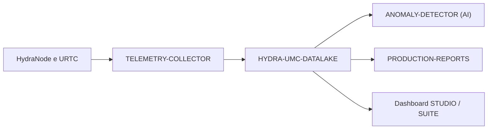

<!-- =============================================================================
HYDRA-UMC-DATALAKE - Time-series data lake
Copyright (C) JuanenRac (Electro Hobby 3D) <electrohobby3d@gmail.com>
GPL-3.0-or-later - see LICENSE
============================================================================= -->

<p align="center">
  
</p>

# 🗄️ HYDRA-UMC-DATALAKE

<p align="center"><a href="README.md">🇺🇸 English</a> | <a href="README_spa.md">🇪🇸 Español</a> | <a href="README_fra.md">🇫🇷 Français</a> | 🇮🇹 <b>Italiano</b> | <a href="README_deu.md">🇩🇪 Deutsch</a> | <a href="README_zho.md">🇨🇳 简体中文</a> | <a href="README_jpn.md">🇯🇵 日本語</a> | <a href="README_por.md">🇵🇹 Português</a></p>

### 📊 Archiviazione scalabile di serie temporali per dati robotici industriali

<p align="center">
  
  
  
  
  
  
</p>

---

> **Stato di sicurezza (safety e security):** questo ecosistema non è un sistema di sicurezza certificato. Non esiste ancora un percorso E-STOP hardware, né limiti o interblocchi imposti dal firmware, né un comando di movimento verificato; le immagini firmware sono controllate con CRC-32 e una firma Ed25519, e una compilazione di rilascio rifiuta le chiavi di sviluppo pubblicate (le teste utensile e le schede di espansione dietro il relè usano ancora i bootloader di URTC, che accettano un HMAC-SHA256 a chiave condivisa invece di una firma); TLS e TLS reciproco sono opzionali e disattivati per impostazione predefinita; nessuna scheda propria è stata ancora assemblata o provata. Leggi la [base di sicurezza](https://github.com/JuanenRac/HYDRA-UMC-DOCS/blob/main/docs/SECURITY_BASELINE.md) e il [modello delle minacce](https://github.com/JuanenRac/HYDRA-UMC-DOCS/blob/main/docs/THREAT_MODEL.md) prima di fidarti di qualsiasi affermazione qui per la sicurezza di una persona.

---

## 📋 In breve

| | |
|---|---|
| Versione | `0.2.0` |
| Maturità | Funzionale |
| Test | 128 (`python -m pytest -q tests`) |
| Tecnologia | Python / sqlite3 / http.server (ThreadingHTTPServer) / pytest |
| Destinazione | Il Raspberry Pi CM5 di una cella HYDRA-UMC |
| Su hardware reale | Non ancora: per questa versione non risulta alcuna esecuzione su hardware reale |

**Vai a:** [Panoramica](#-panoramica) · [Architettura](#-architettura) · [Funzionalità](#-funzionalità) · [Sicurezza e protezione](#-sicurezza-e-protezione) · [Interfacce](#-interfacce) · [Configurazione](#-configurazione) · [Avvio rapido](#-avvio-rapido) · [Test](#-test) · [Risoluzione dei problemi](#-risoluzione-dei-problemi) · [Struttura del repository](#-struttura-del-repository) · [Progetti correlati](#-progetti-correlati)

## 🚦 Stato del progetto

Ogni riga è una parte di questo repository e il semaforo dice a che punto è oggi. È scritta in base a ciò che il repository può mostrare (test, compilazioni, esecuzioni), non a ciò che è previsto.

🟢 Fatto e verificato · 🟡 Funziona, con limiti noti · 🟠 Fatto a metà o non ancora verificato · 🔴 Non fatto o non funzionante

| Area | Stato | Cosa significa qui |
|---|---|---|
| Software | 🟡 | Funziona per il suo scopo principale; la verifica di onestà qui sopra elenca ciò che manca ancora |
| Test | 🟢 | 128 test automatici, eseguiti a ogni modifica |
| Hardware reale | 🔴 | Non ancora: per questa versione non risulta alcuna esecuzione su hardware reale |
| Documentazione | 🟢 | README in otto lingue, verificato rispetto al manifesto a ogni modifica |

## 🎯 Panoramica

**HYDRA-UMC-DATALAKE** è l'archivio attuale di serie temporali della fabbrica. Fornisce un repository reale basato su SQLite per la telemetria normalizzata generata dall'ecosistema, comprese correnti del motore, angoli dei giunti, letture dei sensori e log di inferenza AI.

È la base software per analisi, manutenzione predittiva e report di produzione. L'implementazione SQLite attuale è testata localmente; un deployment esterno InfluxDB/TimescaleDB resta una futura decisione infrastrutturale, non una funzionalità dichiarata già in esecuzione.

## 🧩 Ruolo in HYDRA-UMC

**HYDRA-UMC-DATALAKE** è il luogo in cui si conserva la telemetria dell'ecosistema: il collettore vi scrive e il rilevatore di anomalie, i rapporti di produzione e le dashboard vi leggono. Non ha logica robotica propria e non comanda mai una macchina.

## 🏛️ Architettura

<p align="center">
  
</p>

<details>
<summary>Versione testuale del diagramma (Mermaid)</summary>



</details>

**Perché è fatto così**

* **Perché è il genitore di integrazione, non un pari, dei suoi 3 figli.** HYDRA-UMC-TELEMETRY-COLLECTOR, HYDRA-UMC-ANOMALY-DETECTOR e HYDRA-UMC-PRODUCTION-REPORTS leggono/scrivono tutti sullo STESSO archivio di serie temporali sottostante - possedere quell'archivio in un unico posto (questo repo) evita 3 decisioni di schema indipendenti e potenzialmente divergenti.
* **Perché sqlite3 oggi, non ancora InfluxDB/TimescaleDB.** Un database esterno resta una possibile scelta di deployment a lungo termine, ma gestirlo è vero lavoro di infrastruttura e non qualcosa da dichiarare o aggiungere senza richiesta. Il `TimeSeriesStore` di `src/hydra_umc_datalake/store.py` è oggi un archivio di serie temporali reale, ACID e interrogabile (`sqlite3` della stdlib Python), non un placeholder, e resta dietro la propria classe affinché un backend futuro possa sostituirlo senza riscrivere il contratto HTTP.
* **Perché un'unica tabella "lunga" e stretta (source/kind/field/timestamp/value), non una colonna per campo di telemetria.** Il `Sample.Fields` proprio di HYDRA-UMC-TELEMETRY-COLLECTOR è aperto (qualsiasi nome di campo, qualsiasi fonte può segnalarne di nuovi) - uno schema stretto li accetta tutti senza una migrazione, al costo reale di una riga per campo per campione invece di una riga per campione.
* **Perché `aggregate()` fa un vero bucketing SQL per tempo, non solo `query()` grezza.** Una dashboard o un report che chiede "temperatura media del motore al minuto nell'ultima settimana" su milioni di righe grezze ha bisogno di un vero downsampling fatto dal database, non recuperato grezzo e mediato nel codice applicativo - i confini dei bucket di `aggregate()` sono deterministici (allineati al `start` della query stessa), quindi la stessa query sugli stessi dati traccia sempre gli stessi confini di bucket.
* **Come si inserisce nel resto dell'ecosistema.** Il genitore integratore della famiglia Data & Analytics. HYDRA-UMC-TELEMETRY-COLLECTOR vi scrive ciò che i produttori inviano al collector (per ora nulla nell'ecosistema invia dati, quindi l'archivio di un vero deployment parte vuoto), e HYDRA-UMC-ANOMALY-DETECTOR e HYDRA-UMC-PRODUCTION-REPORTS rileggono la telemetria memorizzata.
* **Perché il versionamento dello schema usa il `PRAGMA user_version` proprio di SQLite, non una tabella fatta a mano.** SQLite fornisce già esattamente questo meccanismo reale (un intero nell'header del file) - una tabella di contabilità parallela sarebbe solo una seconda fonte di verità, potenzialmente divergente, per lo stesso fatto.
* **Perché la retention è opt-in per `(kind, field)`, non un default globale.** Un archivio con decine di serie di telemetria reali non dovrebbe avere l'assunzione di retention di un operatore applicata silenziosamente a ogni serie - `apply_retention()` tocca sempre e solo una serie a cui è stata esplicitamente assegnata una policy tramite `set_retention_policy()`/`POST /retention`.
* **Perché l'identità di retry è `(source, kind, field, timestamp)`.** Il contratto di telemetria normalizzato non possiede un ID di sequenza/evento; un punto esattamente ripetuto viene quindi trattato come un retry di rete incerto e consolidato con il comportamento deterministico dell'ultima scrittura. Ciò evita che righe duplicate distorcano conteggi e aggregati senza eseguire una pulizia distruttiva globale dei dati storici. Quando il produttore invia una `sequence` (il collettore di telemetria lo fa), questa fa parte dell'identità, `(source, kind, field, timestamp, sequence)`: due letture diverse dello stesso millisecondo sono due punti, e solo un retry della stessa sequenza sostituisce se stesso.
* **Perché `/stats/range` è un nuovo endpoint invece di estendere `/stats`.** La forma esistente di `/stats`, `{"sampleCount": <int>}`, è già reale e testata - aggiungervi campi sarebbe un cambiamento reale e distruttivo senza motivo, quando un secondo endpoint additivo non costa nulla.

## ✨ Funzionalità

* 🗄️ **Archiviazione basata su SQLite:** Archiviazione di serie temporali reale, ACID e su disco con `sqlite3` della stdlib Python. *(implementato)*
* 📊 **Schema dati unificato:** Telemetria normalizzata in formato lungo (`source/kind/field/timestamp/value`) per fonti HYDRA-UMC e URTC. *(implementato)*
* 🔍 **Query deterministiche:** I risultati sono ordinati per timestamp e spareggi stabili; le letture limitate rifiutano limiti non positivi. *(implementato)*
* 🔁 **Gestione idempotente dei retry:** La nuova consegna di un punto `(source, kind, field, timestamp)` sostituisce il valore (ultima scrittura vince), evitando che i retry gonfino i duplicati. *(implementato)*
* 🧬 **Migrazioni di Schema Reversibili:** `migrate_up()`/`migrate_down()` reali e testate, tracciate tramite il `PRAGMA user_version` proprio di SQLite - mai modificare una migrazione già rilasciata, aggiungerne una nuova. *(implementato)*
* 🕐 **Timestamp UTC Espliciti:** `GET /stats/range` riporta i dati reali più vecchi/recenti sia come ms grezzi sia come stringhe ISO 8601 UTC esplicite. *(implementato)*
* 🗑️ **Retention Validata:** Finestre di retention per serie, opt-in (`GET`/`POST /retention`, `POST /retention/apply`) - una finestra non positiva viene rifiutata categoricamente. *(implementato)*
* 🔐 **Controllo degli accessi e letture limitate:** token bearer opzionali per ruolo (`ingest`, `admin` per le rotte di retention che cancellano la storia, `read`); un bind non locale viene rifiutato senza i primi due. Una query è limitata (`limit` al massimo 200000, un'aggregazione al massimo 100000 bucket), un timestamp in secondi o dal futuro viene rifiutato, e la storia di una serie senza una politica di retention propria può essere gestita da una politica predefinita. *(implementato)*
* 📚 **Pagine, lotti, catalogo e copia di sicurezza:** una cronologia lunga si legge pagina per pagina (`cursor`, annunciato nell'intestazione `X-Next-Cursor`), una finestra `[start, before)` non conta due volte il suo punto limite, `POST /ingest/batch` salva molti campioni in una sola transazione, `GET /series` elenca ciò che è memorizzato e `hydra-umc-datalake backup` scrive una copia coerente e conserva le più recenti. *(implementato)*

## 🔒 Sicurezza e protezione

| Minaccia | Difesa | Dove |
|---|---|---|
| Scritture anonime | Tre ruoli di token (`ingest`, `admin`, `read`) confrontati in tempo costante (`hmac.compare_digest`), almeno 16 caratteri; un ruolo senza token è aperto solo su un indirizzo loopback e un indirizzo non loopback senza token richiede `--allow-anonymous` | `api.py`, `main.py` |
| Un corpo enorme, un lotto enorme, un client lento | Un corpo oltre 1 MiB riceve `413`, un lotto contiene al massimo 1000 campioni (`--max-batch-samples`) e una richiesta viene letta per al massimo 15 secondi | `api.py` |
| Un disco pieno e timestamp assurdi | Le scritture si fermano con un `507` onesto sotto 64 MiB liberi (mai un `500`); un timestamp precedente a 100 000 000 000 ms o oltre 5 minuti nel futuro viene rifiutato (`--max-future-skew-seconds`, `0` lo disattiva) | `api.py` |
| Una query che divora la memoria | Al massimo 200 000 righe per query, 100 000 bucket per aggregazione e 100 000 serie | `store.py` |

**Cosa non fa mai:** non comanda mai un robot, e acquisizione e analisi vivono in altri repository.

## 🔌 Interfacce

Un'interfaccia JSON/HTTP semplice (il `http.server` della libreria standard, senza framework) su `127.0.0.1:8095` per impostazione predefinita. Il riferimento completo è `docs/API.md`.

| Topic o rotta | Cosa porta |
|---|---|
| `POST /ingest`, `POST /ingest/batch` | scrivere un campione o un lotto (ruolo `ingest`) |
| `GET /query`, `/aggregate`, `/series`, `/stats`, `/stats/range` | leggere campioni, aggregati, l'elenco delle serie e le statistiche (ruolo `read`) |
| `GET /history` | una serie per un client historian: in entrambi gli ordini, con cursore di pagina e, con `bounds=1`, i valori appena fuori dalla finestra (ruolo `read`) |
| `GET /retention`, `POST /retention`, `POST /retention/apply` | leggere, impostare e applicare la politica di conservazione (ruolo `admin`) |
| `GET /health` | il servizio è vivo |

## ⚙️ Configurazione

| Variabile | Predefinito | Cosa imposta |
|---|---|---|
| `--db` | `datalake.sqlite3` | il file SQLite (`:memory:` non è durevole) |
| `--addr`, `--port` | `127.0.0.1`, `8095` | dove ascoltare |
| `--token`, `HYDRA_UMC_DATALAKE_TOKEN` | nessun token | un token per ogni ruolo, almeno 16 caratteri |
| `HYDRA_UMC_DATALAKE_INGEST_TOKEN`, `_ADMIN_TOKEN`, `_READ_TOKEN` | non impostato | sostituiscono il token condiviso per un ruolo |
| `--allow-anonymous` | no | obbligatorio per un indirizzo non loopback senza token |
| `--default-retention-days`, `--max-future-skew-seconds`, `--max-batch-samples` | `0`, `300`, `1000` | conservazione predefinita (`0` = nessuna), scarto nel futuro in secondi (`0` = spento), campioni per lotto |

Lo stack di container (`docker-compose.yml`) chiama i token in modo diverso (per esempio `DATALAKE_TOKEN`); nel container diventano la variabile qui sopra.

## 🚀 Avvio rapido

Richiede Python 3.10 o successivo; il codice usa solo la libreria standard.

```bash
bash run.sh        # Linux, macOS (run.bat on Windows)
python -m hydra_umc_datalake.main --db datalake.sqlite3 --token "$(openssl rand -hex 16)"
curl http://127.0.0.1:8095/health
```

Copia il database con il comando `backup`, per esempio `hydra-umc-datalake backup --dest /backups --keep 7` (`--keep 0` conserva tutte le copie).

## 🧪 Test

128 test automatici si eseguono con `python -m pytest -q tests`; `python tools/build_test.py` compila soltanto ogni modulo. Usano un vero file SQLite e un vero server HTTP locale, senza hardware né rete esterna.

| File di test | Test | Cosa copre |
|---|---|---|
| `test_store.py`, `test_migrations.py`, `test_sequence_identity.py`, `test_pages_batch_backup.py` | - | l'archivio, le migrazioni di schema, sequenze, pagine, lotti e backup |
| `test_api.py`, `test_access_and_limits.py`, `test_history.py` | - | le rotte su HTTP reale, i ruoli dei token e ogni limite |

La CI esegue `HYDRA_UMC_CI=1 python tools/ci_validate.py`, che controlla il manifesto, i documenti, gli otto README e le immagini.

## 🏗️ Compilazione e rilascio

Richiede Python >= 3.10. Un vero archivio di serie temporali interrogabile
con API HTTP, non solo uno scheletro che si importa.

```bash
# Linux/macOS
./build.sh
./run.sh --port 8095

# Windows
build.bat
run.bat --port 8095
```

`build` crea/attiva un `.venv` locale, installa il pacchetto (editable, con
gli extra di dev) al suo interno, verifica l'import, ed esegue la vera
suite di test (`pytest`). `run` avvia l'API HTTP e inoltra qualsiasi flag
(`--addr`, `--port`, `--db`).

```bash
# Ingerire un campione (stessa forma normalizzata del Sample di HYDRA-UMC-TELEMETRY-COLLECTOR)
curl -X POST localhost:8095/ingest \
  -d '{"sourceId":"robot-1","kind":"motor_temp","timestamp":1700000000000,"fields":{"value":42.5}}'

# Interrogarlo di nuovo
curl "localhost:8095/query?sourceId=robot-1"

# Sottocampionare in bucket da 1 minuto su un intervallo di tempo reale
curl "localhost:8095/aggregate?kind=motor_temp&field=value&bucketMs=60000&start=0&end=1800000000000&agg=avg"

curl localhost:8095/stats
```

```bash
python -m pytest tests/ -v   # store.py (insert/query/aggregate, incluso
                              # calcolo di bucketing verificabile a mano)
                              # e api.py (round-trip HTTP reali contro un
                              # vero ThreadingHTTPServer su una porta
                              # effimera)
```

Per avviare questo progetto insieme ai suoi tre figli (Telemetry-Collector, Anomaly-Detector, Production-Reports) come directory gemelle:

```bash
TELEMETRY_COLLECTOR_TOKEN='a-secret-of-16-or-more-characters' \
DATALAKE_TOKEN='another-secret-of-16-or-more-characters' \
ANOMALY_TOKEN='a-third-secret-of-16-or-more-characters' docker compose up --build
```

Il file compose avvia davvero i quattro servizi (ciascuno con un comando esplicito), pubblica ogni porta solo su `127.0.0.1` e rifiuta di partire senza `TELEMETRY_COLLECTOR_TOKEN`, `DATALAKE_TOKEN` o `ANOMALY_TOKEN` (segreti di almeno 16 caratteri, che richiedono allora le rotte di ingestione del collector, quelle di scrittura e amministrazione del datalake e quelle del rilevatore). I dati vivono in volumi con nome, quindi `docker compose down` li conserva. `python tools/verify_compose.py` verifica la struttura del file senza Docker.

## 🩺 Risoluzione dei problemi

| Vedi | Perché | Fai |
|---|---|---|
| `401` / `403` | Il token manca, è troppo corto o è del ruolo sbagliato | Invia il token del ruolo giusto (`ingest` scrive, `read` legge, `admin` fa tutto) |
| `413` | Il corpo supera 1 MiB | Invia lotti più piccoli (`--max-batch-samples`) |
| `507` | Restano meno di 64 MiB liberi su disco | Libera spazio o applica la politica di conservazione (`POST /retention/apply`) |
| a time stamp is refused | È precedente a 100 000 000 000 ms o supera l'orologio di oltre 5 minuti | Correggi l'orologio del mittente o alza `--max-future-skew-seconds` |

## 📂 Struttura del repository

<p align="center">
  
</p>

<details>
<summary>Versione testuale dell'albero</summary>

```text
HYDRA-UMC-DATALAKE/
├── src/hydra_umc_datalake/
│   ├── store.py                                 l'archivio di serie temporali SQLite su disco
│   ├── api.py                                   l'interfaccia JSON/HTTP, ruoli, limiti
│   └── main.py                                  punto di ingresso e comando `backup`
├── tests/                                       128 test, con migrazioni e limiti
├── docs/                                        il riferimento dell'API
├── systemd/                                     unità di servizio per la CM5
├── tools/                                       esecutore di build e test, aumento di versione, validatore CI, generatori e controlli di README e immagini
├── images/                                      banner e immagini del README
├── .github/                                     workflow CI e modelli di segnalazione
├── pyproject.toml                               metadati del pacchetto e dipendenze
├── hydra-umc.project.json                       manifesto: versione, maturità, famiglia
├── CHANGELOG.md                                 cosa è cambiato in ogni versione
├── build.sh build.bat                           script di build (non cambiano mai la versione)
├── build-test.sh build-test.bat                 script di build (non cambiano mai la versione)
├── test.sh test.bat                             eseguono i test
├── bump_version.py / bump_manifest_version.py   aumento di versione esplicito
├── docker-compose.yml                           stack di container
├── run.sh run.bat                               avviare il servizio
└── SECURITY.md SUPPORT.md CONTRIBUTING.md CODE_OF_CONDUCT.md LICENSE LICENSE.md
```

</details>

## 🗺️ Roadmap e limiti noti

**Limiti noti oggi**

* **Fase 1:** Ingestione ad alto throughput del Datalake e indicizzazione per l'analisi storica.
* **Fase 2:** Compressione edge del collettore di telemetria e protocolli di trasmissione sicuri.
* **Fase 3:** Rilevamento delle anomalie tramite apprendimento non supervisionato e analisi delle vibrazioni del motore.
* **Fase 4:** Integrazione con Grafana per la visualizzazione avanzata in tempo reale e l'automazione dei report di produzione.

## 🌍 Lingue

Questo README e i documenti del repository esistono in otto lingue: inglese, spagnolo, tedesco, francese, italiano, giapponese, cinese e portoghese (Portogallo). Sono scritti insieme e la CI verifica che gli otto file abbiano le stesse sezioni e gli stessi link. Questo repository non ha uno schermo né un catalogo di messaggi propri, quindi non ci sono stringhe di interfaccia da tradurre.

## 🔗 Progetti correlati

Questo progetto fa parte dell'ecosistema robotico HYDRA-UMC dello stesso autore (JuanenRac / Electro Hobby 3D). Vale la pena conoscerlo, poiché una richiesta potrebbe in realtà riguardare uno di questi invece di questo repository.

**Progetti Figli** — ciascuno scrive o legge dal proprio archivio di questo data lake
- **[HYDRA-UMC-TELEMETRY-COLLECTOR](https://github.com/JuanenRac/HYDRA-UMC-TELEMETRY-COLLECTOR)** — vera pipeline di ingestione CAN/WebSocket verso DATALAKE, con deduplicazione per sequenza.
- **[HYDRA-UMC-ANOMALY-DETECTOR](https://github.com/JuanenRac/HYDRA-UMC-ANOMALY-DETECTOR)** — vero rilevatore di anomalie FFT + baseline statistica, con monitoraggio della deriva.
- **[HYDRA-UMC-PRODUCTION-REPORTS](https://github.com/JuanenRac/HYDRA-UMC-PRODUCTION-REPORTS)** — vero calcolo OEE/disponibilità sullo storico di DATALAKE, con esportazione CSV riproducibile.

**Direttamente Correlati**
- **[HYDRA-UMC-SERVER](https://github.com/JuanenRac/HYDRA-UMC-SERVER)** — il vero backend headless (REST/WebSocket) con cui parla davvero ogni client di controllo; la fonte dei log/telemetria che questo progetto ingerisce.
- **[HYDRA-UMC-DASHBOARD-AI](https://github.com/JuanenRac/HYDRA-UMC-DASHBOARD-AI)** — pannelli Smart Summaries e Anomaly Highlighting su DATALAKE/ANOMALY-DETECTOR, con un fallback statistico onesto; calcola i suoi Riepiloghi Intelligenti direttamente dalla propria cronologia di query/aggregati di questo data lake.

**Fa Anche Parte dell'Ecosistema**

*Hardware e Piattaforma di Base*
- **[HYDRA-UMC](https://github.com/JuanenRac/HYDRA-UMC)** — il progetto della scheda madre del braccio robotico: host CM5 + coprocessore STM32H745 dual-core, pensato per coordinare fino a 8 bracci utensile via CAN-OTA/SPI-OTA (firmware in fase iniziale; nessuna scheda assemblata per ora).
- **[HYDRA-UMC-OS](https://github.com/JuanenRac/HYDRA-UMC-OS)** — livello prodotto riproducibile su Raspberry Pi OS per il CM5: agente in sola lettura, config/profili validati, provisioning WiFi al primo contatto.
- **[HYDRA-UMC-SDK](https://github.com/JuanenRac/HYDRA-UMC-SDK)** — il contratto JSON-Schema condiviso e la barriera software di controllo dei job contro cui ogni bridge valida i propri comandi (non è una funzione di sicurezza certificata).
- **[HYDRA-UMC-CONNECTOR-HUB](https://github.com/JuanenRac/HYDRA-UMC-CONNECTOR-HUB)** — registro dichiarativo e validatore di manifesti adattatore per connettori di macchine esterne; estende la propria idea di contratto dell'SDK alle macchine esterne senza sostituire i progetti di gateway industriale.

*Backend Centrale e Client*
- **[HYDRA-UMC-STUDIO](https://github.com/JuanenRac/HYDRA-UMC-STUDIO)** — dashboard di controllo web con visualizzazione 3D multi-robot in tempo reale.
- **[HYDRA-UMC-SUITE](https://github.com/JuanenRac/HYDRA-UMC-SUITE)** — centro di comando sciame desktop (PySide6) per più server contemporaneamente, pacchettizzato come eseguibile standalone.
- **[HYDRA-UMC-ANDROID-CONTROL](https://github.com/JuanenRac/HYDRA-UMC-ANDROID-CONTROL)** — app di controllo nativa per Android con login biometrico e un companion Wear OS abbinato.
- **[HYDRA-UMC-IOS-CONTROL](https://github.com/JuanenRac/HYDRA-UMC-IOS-CONTROL)** — app di controllo per iOS/iPadOS (Flutter) con sincronizzazione WebSocket in tempo reale.
- **[HYDRA-UMC-DSI](https://github.com/JuanenRac/HYDRA-UMC-DSI)** — interfaccia touch nativa per il touchscreen DSI da 7" a bordo, incorporata direttamente nel CM5.
- **[HYDRA-UMC-EDITOR-URDF](https://github.com/JuanenRac/HYDRA-UMC-EDITOR-URDF)** — creatore/editor grafico desktop di URDF che invia i modelli finiti al catalogo di STUDIO.
- **[HYDRA-UMC-EDITOR-STL](https://github.com/JuanenRac/HYDRA-UMC-EDITOR-STL)** — editor desktop di modelli STL, che trasforma/sostituisce/rimuove/aggiunge veri pezzi nello stesso catalogo di modelli modificato anche da HYDRA-UMC-EDITOR-URDF.
- **[HYDRA-UMC-BRIDGE-AMR](https://github.com/JuanenRac/HYDRA-UMC-BRIDGE-AMR)** — barriera di coordinamento per flotte AGV/AMR tramite un publisher MQTT VDA 5050 (testato solo contro una flotta emulata).
- **[HYDRA-UMC-BRIDGE-CNC](https://github.com/JuanenRac/HYDRA-UMC-BRIDGE-CNC)** — coordinatore ad alto livello per celle CNC con accesso a stato/byte di controllo GRBL (testato solo contro un emulatore).
- **[HYDRA-UMC-BRIDGE-DROIDS](https://github.com/JuanenRac/HYDRA-UMC-BRIDGE-DROIDS)** — barriera di coordinamento per droidi con zampe/umanoidi, con un mittente di comandi per Boston Dynamics Spot (testato solo contro un emulatore).
- **[HYDRA-UMC-BRIDGE-LASER](https://github.com/JuanenRac/HYDRA-UMC-BRIDGE-LASER)** — coordinatore per celle laser che legge 3 segnali GPIO di chiave/involucro/interblocco (testato solo contro un chip simulato; non può armare né far partire un laser).
- **[HYDRA-UMC-BRIDGE-OPENPNP](https://github.com/JuanenRac/HYDRA-UMC-BRIDGE-OPENPNP)** — coordinatore ad alto livello sicuro per il flusso schede del pick-and-place OpenPnP.
- **[HYDRA-UMC-BRIDGE-PRINTER3D](https://github.com/JuanenRac/HYDRA-UMC-BRIDGE-PRINTER3D)** — barriera di coordinamento sicura per stampanti 3D Moonraker/Klipper, con comandi di lavoro reali e controllati.
- **[HYDRA-UMC-BRIDGE-ROS2](https://github.com/JuanenRac/HYDRA-UMC-BRIDGE-ROS2)** — coordinatore con un trasporto ROS 2 rclpy importato in modo lazy (non ancora eseguito contro un'installazione ROS 2).
- **[HYDRA-UMC-BRIDGE-UAV](https://github.com/JuanenRac/HYDRA-UMC-BRIDGE-UAV)** — barriera di coordinamento per UAV dotati di fotocamera, con un mittente di comandi MAVLink (testato solo contro un emulatore).

*Piattaforma Strumenti URTC*
- **[URTC](https://github.com/JuanenRac/URTC)** — firmware per la scheda fisica dell'Universal Robot Tool Controller, oltre 25 profili utensile su bus CAN.
- **[URTC-FLASHER](https://github.com/JuanenRac/URTC-FLASHER)** — strumento desktop con GUI per il flashing delle schede URTC, CAN-OTA più SWD/JTAG a chip intero.
- **[URTC-TESTER](https://github.com/JuanenRac/URTC-TESTER)** — strumento desktop di diagnostica CAN-bus dal vivo per schede URTC, un pannello per profilo utensile.
- **[URTC-WEB-STUDIO](https://github.com/JuanenRac/URTC-WEB-STUDIO)** — alternativa basata su browser a URTC-TESTER tramite la Web Serial API, senza installazione locale.
- **[URTC-GATEWAY](https://github.com/JuanenRac/URTC-GATEWAY)** — gateway davanti al bus CAN di URTC: elenco di identificatori consentiti, limite di frequenza e chiave di sessione; software provato su computer, non ancora su un bus reale.

*Nodo IA Visione (Hailo-8)*
- **[HYDRA-UMC-VISION-NODE](https://github.com/JuanenRac/HYDRA-UMC-VISION-NODE)** — hub di integrazione per la pipeline di visione Hailo-8, con un vero controllo di prontezza hardware per fase.
- **[HYDRA-UMC-DETECTION-HEF](https://github.com/JuanenRac/HYDRA-UMC-DETECTION-HEF)** — registro reale di modelli compilati con verifica di caricamento sicuro per architettura Hailo/checksum.
- **[HYDRA-UMC-VISION-STREAMER](https://github.com/JuanenRac/HYDRA-UMC-VISION-STREAMER)** — generatore reale di pipeline GStreamer + config MediaMTX, con una vera barriera di integrazione HailoRT.
- **[HYDRA-UMC-VISUAL-SERVOING-API](https://github.com/JuanenRac/HYDRA-UMC-VISUAL-SERVOING-API)** — legge di correzione Position-Based Visual Servoing con autorizzazione condizionata allo stato di zona; ancora nessuna stima di posa da telecamera.
- **[HYDRA-UMC-SAFETY-ZONES](https://github.com/JuanenRac/HYDRA-UMC-SAFETY-ZONES)** — logica v0 di violazione zona, freschezza di calibrazione e richiesta E-STOP che legge le posizioni degli oggetti da un file; nessun rilevatore la alimenta e nessun E-STOP fisico è ancora collegato.

*Nodo IA Cognitivo (Hailo-10)*
- **[HYDRA-UMC-COGNITIVE-NODE](https://github.com/JuanenRac/HYDRA-UMC-COGNITIVE-NODE)** — hub di integrazione per la pipeline cognitiva Hailo-10 (orchestrazione LLM/VLA/voce).
- **[HYDRA-UMC-VLA-ENGINE](https://github.com/JuanenRac/HYDRA-UMC-VLA-ENGINE)** — vera codifica/decodifica di token d'azione e generazione di traiettoria per un modello Vision-Language-Action.
- **[HYDRA-UMC-VOICE-UI](https://github.com/JuanenRac/HYDRA-UMC-VOICE-UI)** — vero front-end vocale (VAD + parser di intenti) con un relay verso Watch limitato e soggetto a conferma.
- **[HYDRA-UMC-SEMANTIC-PLANNER](https://github.com/JuanenRac/HYDRA-UMC-SEMANTIC-PLANNER)** — vera scomposizione dei task basata su regole e recupero semantico degli errori sui codici errore MCU.
- **[HYDRA-UMC-DOCS-QA](https://github.com/JuanenRac/HYDRA-UMC-DOCS-QA)** — vera ricerca documentale TF-IDF (solo libreria standard) sui documenti Markdown di questo ecosistema.
- **[HYDRA-UMC-LOCAL-TECHNICIAN](https://github.com/JuanenRac/HYDRA-UMC-LOCAL-TECHNICIAN)** — tecnico di manutenzione IA locale e con cancelli di policy per l'ecosistema stesso - osserva, diagnostica e propone correzioni; i due livelli di rischio più alti non sono deliberatamente ancora implementati.

*Orchestrazione e Sciame*
- **[HYDRA-UMC-ORCHESTRATOR](https://github.com/JuanenRac/HYDRA-UMC-ORCHESTRATOR)** — hub di integrazione con un vero contratto di health-report gRPC/Protobuf e una macchina a stati di missione.
- **[HYDRA-UMC-JOB-DISPATCHER](https://github.com/JuanenRac/HYDRA-UMC-JOB-DISPATCHER)** — vera coda di lavori basata su priorità con deduplicazione, su una vera API HTTP.
- **[HYDRA-UMC-NODE-HEALING](https://github.com/JuanenRac/HYDRA-UMC-NODE-HEALING)** — vero watchdog di salute della flotta basato su gRPC, con retry/backoff e rilevamento di discrepanza d'identità.
- **[HYDRA-UMC-PATH-PLANNER-3D](https://github.com/JuanenRac/HYDRA-UMC-PATH-PLANNER-3D)** — vero pianificatore di percorsi 3D basato su RRT, con vera validazione delle collisioni ostacolo/spazio di lavoro.
- **[HYDRA-UMC-SWARM-SYNC](https://github.com/JuanenRac/HYDRA-UMC-SWARM-SYNC)** — vera sincronizzazione di stato CRDT LWW-Element-Map, con property test per la convergenza multi-cella.

*Gemello Digitale e Simulazione*
- **[HYDRA-UMC-TWIN](https://github.com/JuanenRac/HYDRA-UMC-TWIN)** — hub di integrazione per il motore di gemello digitale, con un vero contratto di sincronizzazione per compatibilità di versione.
- **[HYDRA-UMC-HIL-BRIDGE](https://github.com/JuanenRac/HYDRA-UMC-HIL-BRIDGE)** — router hardware-in-the-loop con un interblocco software di collisione tra simulazione e hardware reale (testato senza hardware reale).
- **[HYDRA-UMC-PHYSICS-REPLICA](https://github.com/JuanenRac/HYDRA-UMC-PHYSICS-REPLICA)** — vera cinematica diretta e validazione dei limiti articolari su un vero sottoinsieme URDF.
- **[HYDRA-UMC-SYNTHETIC-DATA-GEN](https://github.com/JuanenRac/HYDRA-UMC-SYNTHETIC-DATA-GEN)** — vero generatore procedurale di scene 2D con esportazione di annotazioni YOLO/COCO.

*Gateway Industriale*
- **[HYDRA-UMC-GATEWAY-INDUSTRIAL](https://github.com/JuanenRac/HYDRA-UMC-GATEWAY-INDUSTRIAL)** — hub di integrazione che inoltra ai protocolli industriali, con un vero livello di allowlist dei comandi/backpressure.
- **[HYDRA-UMC-OPCUA-SERVER](https://github.com/JuanenRac/HYDRA-UMC-OPCUA-SERVER)** — vero spazio di indirizzi OPC-UA, verificato con una vera sessione client del protocollo binario.
- **[HYDRA-UMC-MQTT-BROKER](https://github.com/JuanenRac/HYDRA-UMC-MQTT-BROKER)** — vero broker MQTT con autenticazione opzionale per client e ACL sui topic.
- **[HYDRA-UMC-MTCONNECT-ADAPTER](https://github.com/JuanenRac/HYDRA-UMC-MTCONNECT-ADAPTER)** — veri endpoint XML `/probe` e `/current` di MTConnect, con output in modalità degradata.

*Strumenti Complementari e Operazioni dell'Ecosistema*
- **[HYDRA-UMC-TOOL-CLI](https://github.com/JuanenRac/HYDRA-UMC-TOOL-CLI)** — CLI di flotta con un vero e stabile contratto di exit-code, un client live reale della stessa API di HYDRA-UMC-SERVER.
- **[HYDRA-UMC-WATCH](https://github.com/JuanenRac/HYDRA-UMC-WATCH)** — app companion WearOS con schemi di avviso aptico e un relay vocale verso il telefono abbinato (non ancora eseguita su un orologio fisico).
- **[URTC-SMART-RACK](https://github.com/JuanenRac/URTC-SMART-RACK)** — firmware per un rack di montaggio schede con decodifica reale dell'ID utensile e logica di preriscaldamento Smart Idle.
- **[URTC-VISION-TOOL](https://github.com/JuanenRac/URTC-VISION-TOOL)** — firmware più un vero companion di visione Python per una testa utensile di ispezione termica/RGB.
- **[HYDRA-UMC-UPDATER](https://github.com/JuanenRac/HYDRA-UMC-UPDATER)** — strumento amministrativo desktop che scopre, clona e aggiorna ogni repository di questo ecosistema.
- **[HYDRA-UMC-OS-REBUILDER](https://github.com/JuanenRac/HYDRA-UMC-OS-REBUILDER)** — strumento desktop Windows/Linux che costruisce un'immagine della CM5 pronta da scrivere, precaricata con le versioni più aggiornate dell'ecosistema, con configurazione di primo avvio Wi-Fi/utente/SSH in stile Raspberry Pi Imager.
- **[HYDRA-UMC-OPS-AGENT](https://github.com/JuanenRac/HYDRA-UMC-OPS-AGENT)** — coordinatore di incidenti di manutenzione: un ruolo edge a basso privilegio raccoglie uno snapshot di inventario/salute sanificato, un ruolo control-plane lo rende in sola lettura e chiede a un provider di IA di suggerire una diagnosi - non applica mai una patch né distribuisce nulla.
- **[HYDRA-UMC-DEV-SERVER](https://github.com/JuanenRac/HYDRA-UMC-DEV-SERVER)** — host di sviluppo riproducibile (Raspberry Pi 5 / CM5) che conserva il codice sorgente dell'ecosistema ed esegue attività delimitate di build/test tramite una coda durevole; un ruolo di sviluppo dedicato, esplicitamente distinto da un CM5 operativo.

## 📚 Documentazione

Dove leggere di più:

* [docs/API.md](docs/API.md) - ogni rotta, il suo ruolo, i suoi limiti e i suoi errori
* [Base di sicurezza dell'ecosistema](https://github.com/JuanenRac/HYDRA-UMC-DOCS/blob/main/docs/SECURITY_BASELINE.md)
* [Modello delle minacce dell'ecosistema](https://github.com/JuanenRac/HYDRA-UMC-DOCS/blob/main/docs/THREAT_MODEL.md)
* [Registro delle modifiche di questo repository](CHANGELOG.md)
* [Licenza di questo repository](LICENSE.md)

## 🤝 Contribuire e comunità

* Prima di una pull request esegui `HYDRA_UMC_CI=1 py -3 tools/ci_validate.py` (oppure `HYDRA_UMC_CI=1 python3 tools/ci_validate.py`): deve stampare `CI_VALIDATION=PASS`. Non eseguire `build.sh` né `build.bat` per questa verifica; compilare non è verificare.
* I otto README sono scritti da un'unica fonte in HYDRA-UMC-DOCS; non modificarli a mano. Cambia la fonte e riscrivili con `tools/make_readmes.py`.
* Non affermare in un README ciò che non è stato eseguito: scrivi «simulato» o «non provato su hardware» quando è la verità.
* Vedi [CONTRIBUTING.md](CONTRIBUTING.md), il [codice di condotta](CODE_OF_CONDUCT.md), [SECURITY.md](SECURITY.md) e [SUPPORT.md](SUPPORT.md).

## 👤 AUTORE

**JuanenRac (Electro Hobby 3D)** · electrohobby3d@gmail.com

## 📜 LICENZA

GPL-3.0-or-later - [LICENSE](LICENSE).
