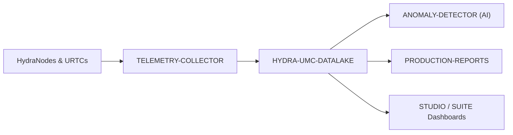

<!-- =============================================================================
HYDRA-UMC-DATALAKE - Time-series data lake
Copyright (C) JuanenRac (Electro Hobby 3D) <electrohobby3d@gmail.com>
GPL-3.0-or-later - see LICENSE
============================================================================= -->

<p align="center">
  
</p>

# 🗄️ HYDRA-UMC-DATALAKE

<p align="center"><a href="README.md">🇺🇸 English</a> | <a href="README_spa.md">🇪🇸 Español</a> | <a href="README_fra.md">🇫🇷 Français</a> | <a href="README_ita.md">🇮🇹 Italiano</a> | <a href="README_deu.md">🇩🇪 Deutsch</a> | <a href="README_zho.md">🇨🇳 简体中文</a> | 🇯🇵 <b>日本語</b> | <a href="README_por.md">🇵🇹 Português</a></p>

### 📊 産業用ロボットデータのためのスケーラブルな時系列ストレージ

<p align="center">
  
  
  
  
  
  
</p>

---

> **安全性とセキュリティの現状:** このエコシステムは認証された安全システムではありません。ハードウェアの E-STOP 経路、ファームウェアが強制する制限やインターロック、検証済みの動作コマンドはまだありません。ファームウェアイメージは CRC-32 と Ed25519 署名で検査し、リリースビルドは公開済みの開発用鍵を拒否します(リレーの先のツールヘッドと拡張ボードは引き続き URTC のブートローダーを使い、署名ではなく共有鍵の HMAC-SHA256 を使います)。TLS と相互 TLS は任意で、既定では無効です。独自基板はまだ実装も試験もされていません。ここに書かれた内容を人の安全のために頼る前に、[セキュリティベースライン](https://github.com/JuanenRac/HYDRA-UMC-DOCS/blob/main/docs/SECURITY_BASELINE.md)と[脅威モデル](https://github.com/JuanenRac/HYDRA-UMC-DOCS/blob/main/docs/THREAT_MODEL.md)をお読みください。

---

## 📋 ひと目で

| | |
|---|---|
| バージョン | `0.1.9` |
| 成熟度 | 機能する |
| テスト | 118 (`python -m pytest -q tests`) |
| 技術 | Python / sqlite3 / http.server (ThreadingHTTPServer) / pytest |
| 対象 | HYDRA-UMC セルの Raspberry Pi CM5 |
| 実機での確認 | まだです：このバージョンについて実機での動作記録はありません |

**移動：** [概要](#-概要) · [アーキテクチャ](#-アーキテクチャ) · [機能](#-機能) · [セキュリティと安全](#-セキュリティと安全) · [インターフェース](#-インターフェース) · [設定](#-設定) · [クイックスタート](#-クイックスタート) · [テスト](#-テスト) · [トラブルシューティング](#-トラブルシューティング) · [リポジトリの構成](#-リポジトリの構成) · [関連プロジェクト](#-関連プロジェクト)

## 🚦 プロジェクトの状況

各行はこのリポジトリの一部分で、信号は今日どこまで進んでいるかを示します。計画ではなく、リポジトリが示せるもの（テスト、ビルド、実行）に基づいて書かれています。

🟢 完了・検証済み · 🟡 動作する（既知の制限あり） · 🟠 一部のみ、または未検証 · 🔴 未実装または動作しない

| 領域 | 状態 | ここでの意味 |
|---|---|---|
| ソフトウェア | 🟡 | 主な目的では動作します。足りない点は上の正直さの確認に書かれています |
| テスト | 🟢 | 自動テスト 118 件。変更のたびに実行されます |
| 実機 | 🔴 | まだです：このバージョンについて実機での動作記録はありません |
| ドキュメント | 🟢 | 8 言語の README。変更のたびにマニフェストと照合されます |

## 🎯 概要

**HYDRA-UMC-DATALAKE** は、工場の現在の時系列ストアです。モーター電流、
関節角度、センサー読み取り値、AI 推論ログを含む、エコシステムが生成する
正規化テレメトリのための実際の SQLite ベースのリポジトリを提供します。

分析、予測保守、生産レポートのソフトウェア基盤として機能します。現在の
SQLite 実装はローカルでテスト済みです。外部の InfluxDB/TimescaleDB 配備は、
すでに稼働している機能として主張するものではなく、将来のインフラ判断です。

## 🧩 HYDRA-UMC での役割

**HYDRA-UMC-DATALAKE** はエコシステムのテレメトリを保管する場所です。コレクターが書き込み、異常検知、生産レポート、ダッシュボードが読み出します。ロボット制御のロジックは持たず、機械に指令を出すこともありません。

## 🏛️ アーキテクチャ

<p align="center">
  
</p>

<details>
<summary>図のテキスト版（Mermaid）</summary>



</details>

**この作りにした理由**

* **本プロジェクトが 3 つの子プロジェクトの統合親プロジェクトであり、対等な関係ではない理由。** HYDRA-UMC-TELEMETRY-COLLECTOR、HYDRA-UMC-ANOMALY-DETECTOR、HYDRA-UMC-PRODUCTION-REPORTS はすべて*同一*の基盤となる時系列ストアを読み書きします——そのストアの所有権を一か所（本リポジトリ）に集約することで、3 つの独立した、互いに食い違う可能性のあるスキーマ決定を避けられます。
* **なぜ今日は sqlite3 であり、まだ InfluxDB/TimescaleDB ではないのか。** 外部データベースは長期的なデプロイ選択肢として残りますが、その運用は実際のインフラ作業であり、依頼なしに主張または追加すべきものではありません。`src/hydra_umc_datalake/store.py` の `TimeSeriesStore` は今日、本当に実在し、ACID 準拠でクエリ可能な時系列ストア（Python 標準ライブラリの `sqlite3`）であり、プレースホルダーではありません。将来のバックエンドが HTTP 契約を書き直さずに置き換えられるよう、独自クラスの背後に保持されています。
* **テレメトリフィールドごとに 1 列ではなく、1 つの狭い「ロング」テーブル(source/kind/field/timestamp/value)である理由。** HYDRA-UMC-TELEMETRY-COLLECTOR 自身の `Sample.Fields` はオープンエンドです(どんなフィールド名でも、どんなソースでも新しいものを報告できます)——狭いスキーマはマイグレーションなしにそれらすべてを受け入れます。実際のコストはサンプルごとに 1 行ではなく、サンプルごと・フィールドごとに 1 行になることです。
* **`aggregate()` が生の `query()` だけでなく、本物の SQL による時間バケット化を行う理由。** 「先週の 1 分ごとの平均モーター温度」を数百万の生の行に対して尋ねるダッシュボードやレポートには、アプリケーションコードで生データを取得して平均するのではなく、データベース自身による本物のダウンサンプリングが必要です——`aggregate()` のバケット境界は決定論的です(クエリ自身の `start` に整列している)。そのため、同じデータに対する同じクエリは常に同じバケット境界を描きます。
* **エコシステムの他の部分との関係。** Data & Analytics ファミリーの統合親です。HYDRA-UMC-TELEMETRY-COLLECTOR は、プロデューサーがコレクターに送ったものをここへ書き込みます（現時点でエコシステム内にデータを送るものはないため、実際の導入ではストアは空の状態から始まります）。HYDRA-UMC-ANOMALY-DETECTOR と HYDRA-UMC-PRODUCTION-REPORTS は保存されたテレメトリを読み戻します。
* **なぜスキーマのバージョン管理に、独自のテーブルではなく SQLite 自身の `PRAGMA user_version` を使うのか。** SQLite はすでにまさにこの本物の仕組み（ファイルヘッダー内の整数）を提供しています——並行する記帳用テーブルは、同じ事実に対する第二の、食い違う可能性のある真実の源になるだけです。
* **なぜ保持ポリシーはグローバルなデフォルトではなく、`(kind, field)` ごとのオプトインなのか。** 数十の本物のテレメトリシリーズを持つストアでは、ある運用者の保持ポリシーの前提を、すべてのシリーズに黙って適用すべきではありません——`apply_retention()` は、`set_retention_policy()`/`POST /retention` を通じて明示的にポリシーが設定されたシリーズにのみ作用します。
* **なぜリトライ識別子が `(source, kind, field, timestamp)` なのか。** 正規化テレメトリ契約にはシーケンス/イベント ID がないため、完全に同一のポイントは不確実なネットワークリトライとして扱われ、決定論的な最後の書き込み優先で統合されます。これは履歴データをグローバルに破壊的に整理せず、重複行がカウントや集計を歪めることを防ぎます。 プロデューサーが `sequence` を送る場合（テレメトリコレクターは送ります）、それも識別子の一部になり、`(source, kind, field, timestamp, sequence)` となります。同じミリ秒の異なる 2 つの読み取りは 2 つのポイントになり、同じシーケンスの再送だけが自分自身を置き換えます。
* **なぜ `/stats/range` は `/stats` を拡張するのではなく、新しいエンドポイントなのか。** `/stats` の既存の `{"sampleCount": <int>}` 形式はすでに本物でテスト済みです——理由もなくフィールドを追加することは本物の破壊的変更になりますが、付加的な第二のエンドポイントを設けるコストはゼロです。

## ✨ 機能

* 🗄️ **SQLite ベースのストレージ：** Python 標準ライブラリの `sqlite3` を使った、実際の ACID 準拠オンディスク時系列ストレージ。*（実装済み）*
* 📊 **統一データスキーマ：** HYDRA-UMC と URTC ソース向けの正規化されたロング形式テレメトリ（`source/kind/field/timestamp/value`）。*（実装済み）*
* 🔍 **決定論的クエリ：** 結果はタイムスタンプと安定したタイブレークで順序付けられ、制限付き読み取りは非正の limit を拒否します。*（実装済み）*
* 🔁 **冪等なリトライ処理：** `(source, kind, field, timestamp)` ポイントの再送は値を置換し（最後の書き込みが勝つ）、リトライによる重複の増加を防ぎます。*（実装済み）*
* 🧬 **可逆的なスキーママイグレーション：** SQLite 自身の `PRAGMA user_version` で追跡される、本物のテスト済み `migrate_up()`/`migrate_down()`——リリース済みのマイグレーションは決して編集せず、新しいものを追加します。*(実装済み)*
* 🕐 **明示的な UTC タイムスタンプ：** `GET /stats/range` は、実際の最古/最新データを生のミリ秒値と明示的な UTC ISO 8601 文字列の両方で報告します。*(実装済み)*
* 🗑️ **検証済みの保持ポリシー：** シリーズごとにオプトインできる保持期間（`GET`/`POST /retention`、`POST /retention/apply`）——非正の期間は即座に拒否されます。*(実装済み)*
* 🔐 **アクセス制御と制限付きの読み取り：** ロールごとの任意のベアラートークン（`ingest`、履歴を削除する保持ルート用の `admin`、`read`）。ループバック以外へのバインドは、最初の 2 つがないと拒否されます。クエリには上限があり（`limit` は最大 200000、集計は最大 100000 バケット）、秒単位または未来のタイムスタンプは拒否され、独自の保持ポリシーを持たない系列の履歴は既定ポリシーで管理できます。*(実装済み)*
* 📚 **ページ送り・一括投入・カタログ・バックアップ:** 長い履歴はページ単位で読み込めます(`cursor`、`X-Next-Cursor` ヘッダーで通知)。`[start, before)` の区間は境界の点を二重に数えません。`POST /ingest/batch` は多数のサンプルを 1 回のトランザクションで保存し、`GET /series` は保存されている内容を一覧し、`hydra-umc-datalake backup` は整合したコピーを書き出して新しいものだけを残します。 *(実装済み)*

## 🔒 セキュリティと安全

| 脅威 | 防御 | 場所 |
|---|---|---|
| 匿名での書き込み | 3 つのトークンロール（`ingest`・`admin`・`read`）を定数時間で比較（`hmac.compare_digest`）し、16 文字以上。トークンのないロールはループバックアドレスでのみ開放され、ループバック以外でトークンなしにするには `--allow-anonymous` が必要です | `api.py`, `main.py` |
| 巨大なボディ、巨大なバッチ、遅いクライアント | 1 MiB を超えるボディは `413`、バッチは最大 1000 サンプル（`--max-batch-samples`）、リクエストの読み取りは最長 15 秒です | `api.py` |
| ディスクの空き不足と不正なタイムスタンプ | 空きが 64 MiB を下回ると書き込みは正直な `507` で止まります（`500` にはしません）。100 000 000 000 ms より前、または 5 分より先の未来のタイムスタンプは拒否されます（`--max-future-skew-seconds`、`0` で無効） | `api.py` |
| メモリを食いつぶすクエリ | クエリごとに最大 200 000 行、集計ごとに 100 000 バケット、100 000 系列 | `store.py` |

**絶対にしないこと：** ロボットに指令を出すことはなく、取り込みと分析は別のリポジトリにあります。

## 🔌 インターフェース

素朴な JSON/HTTP の窓口（標準ライブラリの `http.server`、フレームワークなし）で、既定は `127.0.0.1:8095`。詳しくは `docs/API.md` を参照してください。

| トピックまたはルート | 内容 |
|---|---|
| `POST /ingest`, `POST /ingest/batch` | サンプルまたはバッチを書き込む（ロール `ingest`） |
| `GET /query`, `/aggregate`, `/series`, `/stats`, `/stats/range` | サンプル、集計、系列一覧、統計を読む（ロール `read`） |
| `GET /retention`, `POST /retention`, `POST /retention/apply` | 保持ポリシーの参照・設定・適用（ロール `admin`） |
| `GET /health` | サービスは動作中か |

## ⚙️ 設定

| 変数 | 既定値 | 設定する内容 |
|---|---|---|
| `--db` | `datalake.sqlite3` | SQLite ファイル（`:memory:` は永続しません） |
| `--addr`, `--port` | `127.0.0.1`, `8095` | 待ち受け先 |
| `--token`, `HYDRA_UMC_DATALAKE_TOKEN` | トークンなし | 全ロール共通のトークン（16 文字以上） |
| `HYDRA_UMC_DATALAKE_INGEST_TOKEN`, `_ADMIN_TOKEN`, `_READ_TOKEN` | 未設定 | 1 つのロールについて共通トークンを置き換える |
| `--allow-anonymous` | なし | ループバック以外のアドレスでトークンなしにするとき必須 |
| `--default-retention-days`, `--max-future-skew-seconds`, `--max-batch-samples` | `0`, `300`, `1000` | 既定の保持日数（`0` = なし）、未来方向の許容秒数（`0` = 無効）、バッチあたりのサンプル数 |

コンテナ構成（`docker-compose.yml`）ではトークンの名前が異なります（例：`DATALAKE_TOKEN`）。コンテナ内で上の変数になります。

## 🚀 クイックスタート

Python 3.10 以上が必要です。コードは標準ライブラリだけを使います。

```bash
bash run.sh        # Linux, macOS (run.bat on Windows)
python -m hydra_umc_datalake.main --db datalake.sqlite3 --token "$(openssl rand -hex 16)"
curl http://127.0.0.1:8095/health
```

`backup` コマンドでデータベースをコピーします。例：`hydra-umc-datalake backup --dest /backups --keep 7`（`--keep 0` はすべて残す）。

## 🧪 テスト

`python -m pytest -q tests` で自動テスト 118 件を実行します。`python tools/build_test.py` は各モジュールのコンパイルだけを行います。実際の SQLite ファイルとローカルの HTTP サーバーを使い、ハードウェアも外部ネットワークも不要です。

| テストファイル | テスト数 | 対象 |
|---|---|---|
| `test_store.py`, `test_migrations.py`, `test_sequence_identity.py`, `test_pages_batch_backup.py` | - | ストア、スキーママイグレーション、シーケンス、ページ、バッチ、バックアップ |
| `test_api.py`, `test_access_and_limits.py` | - | 実際の HTTP 上のルート、トークンのロール、各制限 |

CI は `HYDRA_UMC_CI=1 python tools/ci_validate.py` を実行し、マニフェスト、文書、8 つの README、図を検査します。

## 🏗️ ビルドとリリース

Python >= 3.10 が必要です。コンパイルできるだけの骨組みではなく、
HTTP API を備えた本物のクエリ可能な時系列ストアです。

```bash
# Linux/macOS
./build.sh
./run.sh --port 8095

# Windows
build.bat
run.bat --port 8095
```

`build` はローカルの `.venv` を作成/アクティブ化し、パッケージを
(editable、dev 拡張込みで) その中にインストールし、インポートを検証し、
本物のテストスイート(`pytest`)を実行します。`run` は HTTP API を起動し、
すべてのフラグ(`--addr`、`--port`、`--db`)をそのまま渡します。

```bash
# サンプルを取り込む(HYDRA-UMC-TELEMETRY-COLLECTOR 自身の Sample と同じ正規化された形)
curl -X POST localhost:8095/ingest \
  -d '{"sourceId":"robot-1","kind":"motor_temp","timestamp":1700000000000,"fields":{"value":42.5}}'

# それをクエリで取り出す
curl "localhost:8095/query?sourceId=robot-1"

# 実際の時間範囲を 1 分間隔のバケットにダウンサンプリングする
curl "localhost:8095/aggregate?kind=motor_temp&field=value&bucketMs=60000&start=0&end=1800000000000&agg=avg"

curl localhost:8095/stats
```

```bash
python -m pytest tests/ -v   # store.py(挿入/クエリ/集計、手計算で
                              # 検証可能なバケット化の数学を含む)、
                              # および api.py(一時ポート上の本物の
                              # ThreadingHTTPServer に対する本物の
                              # HTTP 往復テスト)
```

本プロジェクトをその 3 つの子プロジェクト（Telemetry-Collector、
Anomaly-Detector、Production-Reports、兄弟ディレクトリとしてチェック
アウト）とともに立ち上げるには：

```bash
TELEMETRY_COLLECTOR_TOKEN='a-secret-of-16-or-more-characters' \
DATALAKE_TOKEN='another-secret-of-16-or-more-characters' \
ANOMALY_TOKEN='a-third-secret-of-16-or-more-characters' docker compose up --build
```

この compose ファイルは4つのサービスを実際に起動し（それぞれ明示的なコマンド付き）、すべてのポートをホストの `127.0.0.1` にのみ公開し、`TELEMETRY_COLLECTOR_TOKEN`、`DATALAKE_TOKEN`、`ANOMALY_TOKEN`（いずれも16文字以上のシークレット。コレクターの取り込みルート、データレイクの書き込み・管理ルート、検知器のルートがそれぞれ要求する）がなければ起動を拒否します。データは名前付きボリュームにあるため、`docker compose down` でも保持されます。`python tools/verify_compose.py` は Docker なしでファイルの構造を検査します。

## 🩺 トラブルシューティング

| 表示 | 原因 | 対処 |
|---|---|---|
| `401` / `403` | トークンがない、短すぎる、またはロールが違います | 正しいロールのトークンを送ります（`ingest` は書き込み、`read` は読み取り、`admin` はすべて） |
| `413` | ボディが 1 MiB を超えています | バッチを小さくします（`--max-batch-samples`） |
| `507` | ディスクの空きが 64 MiB 未満です | 空きを作るか、保持ポリシーを適用します（`POST /retention/apply`） |
| a time stamp is refused | 100 000 000 000 ms より前、または時計より 5 分以上先です | 送信側の時計を直すか `--max-future-skew-seconds` を上げます |

## 📂 リポジトリの構成

<p align="center">
  
</p>

<details>
<summary>ツリーのテキスト版</summary>

```text
HYDRA-UMC-DATALAKE/
├── src/hydra_umc_datalake/
│   ├── store.py                                 ディスク上の SQLite 時系列ストア
│   ├── api.py                                   JSON/HTTP の窓口、ロール、制限
│   └── main.py                                  エントリーポイントと `backup` コマンド
├── tests/                                       118 件（マイグレーションと制限を含む）
├── docs/                                        API リファレンス
├── systemd/                                     CM5 用のサービスユニット
├── tools/                                       ビルド・テスト実行、バージョン引き上げ、CI 検証、README と図の生成・検査
├── images/                                      バナーと README の図
├── .github/                                     CI ワークフローと Issue テンプレート
├── pyproject.toml                               パッケージのメタデータと依存関係
├── hydra-umc.project.json                       マニフェスト：バージョン・成熟度・ファミリー
├── CHANGELOG.md                                 各バージョンの変更点
├── build.sh build.bat                           ビルドスクリプト（バージョンは変えません）
├── build-test.sh build-test.bat                 ビルドスクリプト（バージョンは変えません）
├── test.sh test.bat                             テストを実行
├── bump_version.py / bump_manifest_version.py   明示的なバージョン引き上げ
├── docker-compose.yml                           コンテナ構成
├── run.sh run.bat                               サービスを起動
└── SECURITY.md SUPPORT.md CONTRIBUTING.md CODE_OF_CONDUCT.md LICENSE LICENSE.md
```

</details>

## 🗺️ ロードマップと既知の制限

**現時点の既知の制限**

* **フェーズ 1：** 履歴分析のためのデータレイクの高スループット取り込みとインデックス作成。
* **フェーズ 2：** テレメトリコレクターのエッジ圧縮と安全な送信プロトコル。
* **フェーズ 3：** 教師なし学習とモーター振動分析を用いた異常検知。
* **フェーズ 4：** 高度なリアルタイム可視化のための Grafana との統合と生産レポートの自動化。

## 🌍 言語

この README とリポジトリの文書は、英語・スペイン語・ドイツ語・フランス語・イタリア語・日本語・中国語・ポルトガル語（ポルトガル）の 8 言語で提供されています。8 つのファイルは同時に書かれ、同じ節と同じリンクを持つことを CI が確認します。 このリポジトリには独自の画面もメッセージカタログもないため、翻訳すべきインターフェース文字列はありません。

## 🔗 関連プロジェクト

本プロジェクトは、同じ作者(JuanenRac / Electro Hobby 3D)による HYDRA-UMC ロボティクスエコシステムの一部です。リクエストが実はこの中のどれかについてのものである可能性があるため、知っておく価値があります。

**子プロジェクト** —— いずれも、本データレイク自身のストアに書き込むか、そこから読み取ります
- **[HYDRA-UMC-TELEMETRY-COLLECTOR](https://github.com/JuanenRac/HYDRA-UMC-TELEMETRY-COLLECTOR)** — シーケンス重複排除機能を備えた、DATALAKE への実際の CAN/WebSocket 取り込みパイプライン。
- **[HYDRA-UMC-ANOMALY-DETECTOR](https://github.com/JuanenRac/HYDRA-UMC-ANOMALY-DETECTOR)** — ドリフト監視を備えた、実際の FFT + 統計ベースラインによる異常検知器。
- **[HYDRA-UMC-PRODUCTION-REPORTS](https://github.com/JuanenRac/HYDRA-UMC-PRODUCTION-REPORTS)** — DATALAKE の履歴に対する実際の OEE/稼働率計算、再現可能な CSV エクスポート付き。

**直接関連**
- **[HYDRA-UMC-SERVER](https://github.com/JuanenRac/HYDRA-UMC-SERVER)** — すべての制御クライアントが実際に通信する、本物のヘッドレスバックエンド(REST/WebSocket)。本プロジェクトが取り込むログ/テレメトリの出所。
- **[HYDRA-UMC-DASHBOARD-AI](https://github.com/JuanenRac/HYDRA-UMC-DASHBOARD-AI)** — 誠実な統計フォールバックを備えた、DATALAKE/ANOMALY-DETECTOR 上のスマートサマリーと異常ハイライトパネル。本データレイク自身のクエリ/集計履歴から直接スマートサマリーを計算する。

**エコシステムの他のプロジェクト**

*コアハードウェア&プラットフォーム*
- **[HYDRA-UMC](https://github.com/JuanenRac/HYDRA-UMC)** — ロボットアームのマザーボードの設計——CM5 ホスト + デュアルコア STM32H745、CAN-OTA/SPI-OTA 経由で最大 8 本のツールアームを統括することを目指す(ファームウェアは初期段階で、実装済みの基板はまだない)。
- **[HYDRA-UMC-OS](https://github.com/JuanenRac/HYDRA-UMC-OS)** — CM5 向けの再現可能な Raspberry Pi OS プロダクト層——読み取り専用エージェント、検証済み設定/プロファイル、WiFi 初回接続プロビジョニング。
- **[HYDRA-UMC-SDK](https://github.com/JuanenRac/HYDRA-UMC-SDK)** — すべてのブリッジが自身のコマンドを検証する共有 JSON-Schema 契約とソフトウェアのジョブゲート境界(認証済みの安全機能ではない)。
- **[HYDRA-UMC-CONNECTOR-HUB](https://github.com/JuanenRac/HYDRA-UMC-CONNECTOR-HUB)** — 外部マシン用コネクタのための宣言的アダプターマニフェストのレジストリとバリデーター。SDK 自身の契約という発想を外部マシンにまで拡張し、産業用ゲートウェイ系のプロジェクトを置き換えることはありません。

*コアバックエンド&クライアント*
- **[HYDRA-UMC-STUDIO](https://github.com/JuanenRac/HYDRA-UMC-STUDIO)** — リアルタイムのマルチロボット 3D 可視化を備えたウェブ制御ダッシュボード。
- **[HYDRA-UMC-SUITE](https://github.com/JuanenRac/HYDRA-UMC-SUITE)** — 複数のサーバーを同時に扱えるデスクトップ(PySide6)スウォームコマンドセンター、スタンドアロン実行ファイルとしてパッケージ化。
- **[HYDRA-UMC-ANDROID-CONTROL](https://github.com/JuanenRac/HYDRA-UMC-ANDROID-CONTROL)** — 生体認証ログインとペアリングされた Wear OS コンパニオンを備えたネイティブ Android 制御アプリ。
- **[HYDRA-UMC-IOS-CONTROL](https://github.com/JuanenRac/HYDRA-UMC-IOS-CONTROL)** — リアルタイム WebSocket 同期を備えた iOS/iPadOS 制御アプリ(Flutter)。
- **[HYDRA-UMC-DSI](https://github.com/JuanenRac/HYDRA-UMC-DSI)** — 本体搭載の 7 インチ DSI タッチスクリーン向けネイティブタッチ UI、CM5 自体に組み込み。
- **[HYDRA-UMC-EDITOR-URDF](https://github.com/JuanenRac/HYDRA-UMC-EDITOR-URDF)** — 完成したモデルを STUDIO 自身のカタログへ送信するデスクトップ用グラフィカル URDF 作成/編集ツール。
- **[HYDRA-UMC-EDITOR-STL](https://github.com/JuanenRac/HYDRA-UMC-EDITOR-STL)** — HYDRA-UMC-EDITOR-URDF も編集する同じモデルカタログ内で、実在するパーツを変換/置換/削除/追加するデスクトップ STL モデルエディタ。
- **[HYDRA-UMC-BRIDGE-AMR](https://github.com/JuanenRac/HYDRA-UMC-BRIDGE-AMR)** — VDA 5050 MQTT パブリッシャーによる AGV/AMR フリートの調整境界(エミュレートしたフリートに対してのみテスト済み)。
- **[HYDRA-UMC-BRIDGE-CNC](https://github.com/JuanenRac/HYDRA-UMC-BRIDGE-CNC)** — GRBL ステータス/制御バイトへのアクセスを持つ、CNC セルの高レベルコーディネーター(エミュレーターに対してのみテスト済み)。
- **[HYDRA-UMC-BRIDGE-DROIDS](https://github.com/JuanenRac/HYDRA-UMC-BRIDGE-DROIDS)** — Boston Dynamics Spot コマンド送信機能を持つ、脚型/ヒューマノイドドロイドの調整境界(エミュレーターに対してのみテスト済み)。
- **[HYDRA-UMC-BRIDGE-LASER](https://github.com/JuanenRac/HYDRA-UMC-BRIDGE-LASER)** — キー/筐体/インターロックの GPIO 信号 3 系統を読み取るレーザーセルのコーディネーター(模擬チップに対してのみテスト済み。レーザーの武装や発射はできない)。
- **[HYDRA-UMC-BRIDGE-OPENPNP](https://github.com/JuanenRac/HYDRA-UMC-BRIDGE-OPENPNP)** — OpenPnP ピックアンドプレースの基板フローを安全に統括する高レベルコーディネーター。
- **[HYDRA-UMC-BRIDGE-PRINTER3D](https://github.com/JuanenRac/HYDRA-UMC-BRIDGE-PRINTER3D)** — 実際にゲート制御されたジョブコマンドを持つ、Moonraker/Klipper 3D プリンター向けの安全な調整境界。
- **[HYDRA-UMC-BRIDGE-ROS2](https://github.com/JuanenRac/HYDRA-UMC-BRIDGE-ROS2)** — 遅延インポートの rclpy ROS 2 トランスポートを持つコーディネーター(ROS 2 環境ではまだ実行していない)。
- **[HYDRA-UMC-BRIDGE-UAV](https://github.com/JuanenRac/HYDRA-UMC-BRIDGE-UAV)** — MAVLink コマンド送信機能を持つ、カメラ搭載 UAV の調整境界(エミュレーターに対してのみテスト済み)。

*URTC ツールプラットフォーム*
- **[URTC](https://github.com/JuanenRac/URTC)** — 物理的な Universal Robot Tool Controller 基板向けファームウェア、CAN バス経由の 25 以上のツールプロファイル。
- **[URTC-FLASHER](https://github.com/JuanenRac/URTC-FLASHER)** — URTC 基板用のデスクトップ GUI 書き込みツール、CAN-OTA およびフルチップ SWD/JTAG。
- **[URTC-TESTER](https://github.com/JuanenRac/URTC-TESTER)** — URTC 基板向けのデスクトップ CAN バスライブ診断ツール、ツールプロファイルごとに 1 パネル。
- **[URTC-WEB-STUDIO](https://github.com/JuanenRac/URTC-WEB-STUDIO)** — Web Serial API を使ったブラウザベースの URTC-TESTER の代替、ローカルインストール不要。
- **[URTC-GATEWAY](https://github.com/JuanenRac/URTC-GATEWAY)** — URTC の CAN バスの前に置くゲートウェイ：許可する識別子のリスト、レート制限、セッション鍵。コンピューター上でテスト済みで、実際のバスではまだ試していません。

*ビジョン AI ノード(Hailo-8)*
- **[HYDRA-UMC-VISION-NODE](https://github.com/JuanenRac/HYDRA-UMC-VISION-NODE)** — Hailo-8 ビジョンパイプラインの統合ハブ、段階ごとの実際のハードウェア準備状況チェック付き。
- **[HYDRA-UMC-DETECTION-HEF](https://github.com/JuanenRac/HYDRA-UMC-DETECTION-HEF)** — Hailo アーキテクチャ/チェックサムによる安全読み込み検証を備えた、実際のコンパイル済みモデルレジストリ。
- **[HYDRA-UMC-VISION-STREAMER](https://github.com/JuanenRac/HYDRA-UMC-VISION-STREAMER)** — 実際の HailoRT 統合境界を持つ、実際の GStreamer パイプライン + MediaMTX 設定生成器。
- **[HYDRA-UMC-VISUAL-SERVOING-API](https://github.com/JuanenRac/HYDRA-UMC-VISUAL-SERVOING-API)** — ゾーン状態を条件に承認する Position-Based Visual Servoing 補正則。カメラによる姿勢推定はまだない。
- **[HYDRA-UMC-SAFETY-ZONES](https://github.com/JuanenRac/HYDRA-UMC-SAFETY-ZONES)** — ファイルから物体位置を受け取る、ゾーン侵入・キャリブレーション鮮度・E-STOP 要求の v0 ロジック。検出器は接続されておらず、物理 E-STOP もまだ配線されていない。

*コグニティブ AI ノード(Hailo-10)*
- **[HYDRA-UMC-COGNITIVE-NODE](https://github.com/JuanenRac/HYDRA-UMC-COGNITIVE-NODE)** — Hailo-10 コグニティブパイプライン(LLM/VLA/音声オーケストレーション)の統合ハブ。
- **[HYDRA-UMC-VLA-ENGINE](https://github.com/JuanenRac/HYDRA-UMC-VLA-ENGINE)** — Vision-Language-Action モデル向けの、実際のアクショントークンのエンコード/デコードと軌道生成。
- **[HYDRA-UMC-VOICE-UI](https://github.com/JuanenRac/HYDRA-UMC-VOICE-UI)** — 確認ゲート付きの限定的な Watch リレーを備えた、実際の音声フロントエンド(VAD + 意図解析)。
- **[HYDRA-UMC-SEMANTIC-PLANNER](https://github.com/JuanenRac/HYDRA-UMC-SEMANTIC-PLANNER)** — MCU エラーコードに対する、実際のルールベースのタスク分解と意味的エラー復旧。
- **[HYDRA-UMC-DOCS-QA](https://github.com/JuanenRac/HYDRA-UMC-DOCS-QA)** — このエコシステム自身の Markdown ドキュメントに対する、標準ライブラリのみの実際の TF-IDF 文書検索。
- **[HYDRA-UMC-LOCAL-TECHNICIAN](https://github.com/JuanenRac/HYDRA-UMC-LOCAL-TECHNICIAN)** — エコシステム自身のための、ローカルでポリシーゲート付きのAIメンテナンス技術者 — 観察、診断し、修正を提案する;最上位の2つのリスクレベルは意図的にまだ実装されていない。

*オーケストレーション&スウォーム*
- **[HYDRA-UMC-ORCHESTRATOR](https://github.com/JuanenRac/HYDRA-UMC-ORCHESTRATOR)** — 実際の gRPC/Protobuf ヘルスレポート契約とミッションステートマシンを持つ統合ハブ。
- **[HYDRA-UMC-JOB-DISPATCHER](https://github.com/JuanenRac/HYDRA-UMC-JOB-DISPATCHER)** — 実際の HTTP API 上に構築された、優先度ベースの実際のジョブキュー(重複排除付き)。
- **[HYDRA-UMC-NODE-HEALING](https://github.com/JuanenRac/HYDRA-UMC-NODE-HEALING)** — リトライ/バックオフとアイデンティティ不一致検出を備えた、実際の gRPC ベースのフリートヘルスウォッチドッグ。
- **[HYDRA-UMC-PATH-PLANNER-3D](https://github.com/JuanenRac/HYDRA-UMC-PATH-PLANNER-3D)** — 実際の障害物/ワークスペース衝突検証を備えた、実際の RRT ベースの 3D 経路プランナー。
- **[HYDRA-UMC-SWARM-SYNC](https://github.com/JuanenRac/HYDRA-UMC-SWARM-SYNC)** — 複数セルの収束についてプロパティテストされた、実際の CRDT LWW-Element-Map 状態同期。

*デジタルツイン&シミュレーション*
- **[HYDRA-UMC-TWIN](https://github.com/JuanenRac/HYDRA-UMC-TWIN)** — 実際のバージョン互換性同期契約を持つ、デジタルツインエンジンの統合ハブ。
- **[HYDRA-UMC-HIL-BRIDGE](https://github.com/JuanenRac/HYDRA-UMC-HIL-BRIDGE)** — シミュレーションと実機の間にソフトウェアの衝突インターロックを備えたハードウェア・イン・ザ・ループのルーター(実機なしでテスト済み)。
- **[HYDRA-UMC-PHYSICS-REPLICA](https://github.com/JuanenRac/HYDRA-UMC-PHYSICS-REPLICA)** — 実際の URDF サブセットに対する、実際の順運動学と関節限界検証。
- **[HYDRA-UMC-SYNTHETIC-DATA-GEN](https://github.com/JuanenRac/HYDRA-UMC-SYNTHETIC-DATA-GEN)** — YOLO/COCO アノテーションのエクスポート機能を持つ、実際のプロシージャル 2D シーンジェネレーター。

*産業用ゲートウェイ*
- **[HYDRA-UMC-GATEWAY-INDUSTRIAL](https://github.com/JuanenRac/HYDRA-UMC-GATEWAY-INDUSTRIAL)** — 実際のコマンド許可リスト/バックプレッシャー層を持つ、産業用プロトコルへ中継する統合ハブ。
- **[HYDRA-UMC-OPCUA-SERVER](https://github.com/JuanenRac/HYDRA-UMC-OPCUA-SERVER)** — 実際のバイナリプロトコルクライアントセッションで検証された、実際の OPC-UA アドレス空間。
- **[HYDRA-UMC-MQTT-BROKER](https://github.com/JuanenRac/HYDRA-UMC-MQTT-BROKER)** — クライアント単位のオプション認証とトピック ACL を備えた、実際の MQTT ブローカー。
- **[HYDRA-UMC-MTCONNECT-ADAPTER](https://github.com/JuanenRac/HYDRA-UMC-MTCONNECT-ADAPTER)** — 縮退モード出力を備えた、実際の MTConnect `/probe` および `/current` XML エンドポイント。

*補完ツール&エコシステム運用*
- **[HYDRA-UMC-TOOL-CLI](https://github.com/JuanenRac/HYDRA-UMC-TOOL-CLI)** — 実際の安定した終了コード契約を持つフリート CLI、HYDRA-UMC-SERVER 自身の API の本物のライブクライアント。
- **[HYDRA-UMC-WATCH](https://github.com/JuanenRac/HYDRA-UMC-WATCH)** — 触覚アラートのパターンとペアリング済みスマートフォンへの音声リレーを備えた WearOS コンパニオンアプリ(物理的なウォッチではまだ実行していない)。
- **[URTC-SMART-RACK](https://github.com/JuanenRac/URTC-SMART-RACK)** — 実際の工具 ID デコードと Smart Idle 予熱ロジックを備えた、基板搭載ラック用ファームウェア。
- **[URTC-VISION-TOOL](https://github.com/JuanenRac/URTC-VISION-TOOL)** — サーマル/RGB 検査ツールヘッド向けの、ファームウェアと実際の Python ビジョンコンパニオン。
- **[HYDRA-UMC-UPDATER](https://github.com/JuanenRac/HYDRA-UMC-UPDATER)** — このエコシステム内のすべてのリポジトリを検出・クローン・更新する、管理用デスクトップツール。
- **[HYDRA-UMC-OS-REBUILDER](https://github.com/JuanenRac/HYDRA-UMC-OS-REBUILDER)** — エコシステムの最新バージョンをプリロードした、書き込み可能なCM5イメージを構築するWindows/Linuxデスクトップツール。Raspberry Pi Imager方式の初回起動Wi-Fi/ユーザー/SSH設定を備える。
- **[HYDRA-UMC-OPS-AGENT](https://github.com/JuanenRac/HYDRA-UMC-OPS-AGENT)** — 保守インシデントコーディネーター: 低権限のエッジ役割がサニタイズされたインベントリ/ヘルスのスナップショットを収集し、コントロールプレーン役割がそれを読み取り専用でレンダリングして AI プロバイダーに診断の提案を依頼します - パッチを適用することも、何かをデプロイすることも決してありません。
- **[HYDRA-UMC-DEV-SERVER](https://github.com/JuanenRac/HYDRA-UMC-DEV-SERVER)** — 再現可能な開発ホスト（Raspberry Pi 5 / CM5）。エコシステムのソースコードを保管し、永続キューのもとで境界の明確なビルド/テストタスクを実行する。運用中の CM5 とは明確に異なる、開発専用の役割。

## 📚 ドキュメント

さらに読むには：

* [docs/API.md](docs/API.md) - 各ルート、そのロール、制限、エラー
* [エコシステムのセキュリティ基準](https://github.com/JuanenRac/HYDRA-UMC-DOCS/blob/main/docs/SECURITY_BASELINE.md)
* [エコシステムの脅威モデル](https://github.com/JuanenRac/HYDRA-UMC-DOCS/blob/main/docs/THREAT_MODEL.md)
* [このリポジトリの変更履歴](CHANGELOG.md)
* [このリポジトリのライセンス](LICENSE.md)

## 🤝 コントリビュートとコミュニティ

* プルリクエストの前に `HYDRA_UMC_CI=1 py -3 tools/ci_validate.py`（または `HYDRA_UMC_CI=1 python3 tools/ci_validate.py`）を実行してください。`CI_VALIDATION=PASS` と表示される必要があります。この確認に `build.sh` や `build.bat` は使わないでください。ビルドは検査ではありません。
* 8 つの README は HYDRA-UMC-DOCS の 1 つのソースから書かれます。手で編集しないでください。ソースを変更し、`tools/make_readmes.py` で書き直します。
* 実行していないことを README に書かないでください。事実であれば「シミュレーションのみ」「実機では未確認」と書きます。
* [CONTRIBUTING.md](CONTRIBUTING.md)、[行動規範](CODE_OF_CONDUCT.md)、[SECURITY.md](SECURITY.md)、[SUPPORT.md](SUPPORT.md) を参照してください。

## 👤 作者

**JuanenRac (Electro Hobby 3D)** · electrohobby3d@gmail.com

## 📜 ライセンス

GPL-3.0-or-later - [LICENSE](LICENSE).
