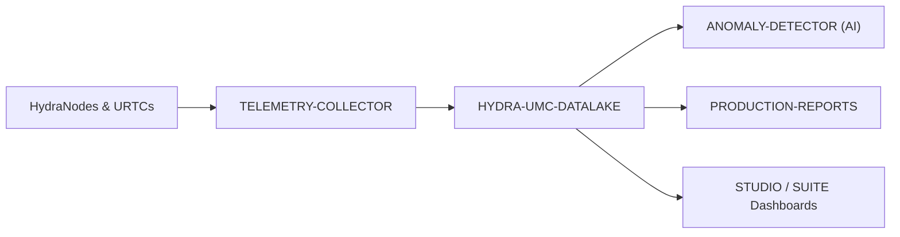

<p align="center">
  
</p>

# 🗄️ HYDRA-UMC-DATALAKE

<p align="center"><a href="README.md">🇺🇸 English</a> | <a href="README_spa.md">🇪🇸 Español</a> | <a href="README_fra.md">🇫🇷 Français</a> | <a href="README_ita.md">🇮🇹 Italiano</a> | <a href="README_deu.md">🇩🇪 Deutsch</a> | <a href="README_zho.md">🇨🇳 简体中文</a> | <a href="README_jpn.md">🇯🇵 日本語</a> | 🇵🇹 <b>Português</b></p>

### 📊 Armazenamento escalável de séries temporais para dados robóticos industriais

<p align="center">
  
  
  
</p>

---

**Verificação de honestidade - o que realmente funciona hoje:** o `TimeSeriesStore` (`src/hydra_umc_datalake/store.py`) é armazenamento real, em disco e ACID sobre o `sqlite3` da biblioteca padrão do Python - `insert()`, `query()`, `aggregate()` (agrupamento temporal real em SQL), `migrate_up()`/`migrate_down()` (acompanhados através do `PRAGMA user_version`) e as políticas de retenção por série (`set_retention_policy()`/`apply_retention()`) são todos reais e exercitados pela suite de testes (94 testes a passar: `tests/test_store.py`, `tests/test_migrations.py`, `tests/test_api.py`). Os handlers HTTP do `api.py` (`/ingest`, `/query`, `/aggregate`, `/stats`, `/stats/range`, `/retention*`) e a ligação do servidor no `main.py` são também reais e testados de ponta a ponta contra um `ThreadingHTTPServer` genuíno numa porta efémera - não simulados. O que genuinamente não está construído: um back-end externo InfluxDB/TimescaleDB é apenas uma opção futura de implementação documentada, com zero código por detrás hoje; o `docker-compose.yml` com os seus 3 repositórios irmãos (TELEMETRY-COLLECTOR, ANOMALY-DETECTOR, PRODUCTION-REPORTS) nunca foi construído num ambiente com Docker: os seus quatro comandos foram executados diretamente como um único stack (collector, datalake, detetor, relatórios) e verificados de ponta a ponta à mão, e o `tools/verify_compose.py` verifica a estrutura do ficheiro, mas nenhum stack corre dentro da suite de testes deste próprio repositório - cada lado é testado de forma independente. Veja o `CHANGELOG.md` para saber exatamente o que foi entregue até agora.

---

> **Estado de segurança (safety e security):** este ecossistema não é um sistema de segurança certificado. Ainda não existe um caminho de E-STOP por hardware, nem limites ou interlocks impostos pelo firmware, nem um comando de movimento verificado; as imagens de firmware são verificadas com CRC32 e um HMAC-SHA256 de chave partilhada, não com uma assinatura assimétrica; TLS e TLS mútuo são opcionais e estão desativados por defeito; nenhuma placa própria foi ainda montada ou testada. Leia a [base de segurança](https://github.com/JuanenRac/HYDRA-UMC-DOCS/blob/main/docs/SECURITY_BASELINE.md) e o [modelo de ameaças](https://github.com/JuanenRac/HYDRA-UMC-DOCS/blob/main/docs/THREAT_MODEL.md) antes de confiar em qualquer afirmação aqui para a segurança de uma pessoa.

## 📋 Num relance

| | |
|---|---|
| Versão | `0.1.8` |
| Maturidade | Funcional |
| Testes | 94 |
| Tecnologia | Python / sqlite3 / http.server (ThreadingHTTPServer) / pytest |
| Destino | O Raspberry Pi CM5 de uma célula HYDRA-UMC |
| Em hardware real | Ainda não: não há registo de execução em hardware real para esta versão |

## 1. 🛠️ VISÃO TÉCNICA GERAL

O **HYDRA-UMC-DATALAKE** é o armazém atual de séries temporais da fábrica. Fornece um repositório real apoiado em SQLite para a telemetria normalizada gerada pelo ecossistema, incluindo correntes de motores, ângulos de juntas, leituras de sensores e registos de inferência de IA.

É a base de software para a análise, a manutenção preditiva e os relatórios de produção. A sua implementação atual em SQLite está testada localmente; uma implementação externa em InfluxDB/TimescaleDB continua a ser uma decisão futura de infraestrutura, e não uma funcionalidade dada como já em execução.

### Funcionalidades principais:
* 🗄️ **Armazenamento em SQLite:** armazenamento real de séries temporais, ACID e em disco, com o `sqlite3` da biblioteca padrão do Python. *(implementado)*
* 📊 **Esquema de dados unificado:** telemetria normalizada em formato longo (`source/kind/field/timestamp/value`) para fontes do HYDRA-UMC e do URTC. *(implementado)*
* 🔍 **Consultas determinísticas:** os resultados em bruto são ordenados por marca temporal e por critérios de desempate estáveis; as leituras limitadas rejeitam limites não positivos. *(implementado)*
* 🔁 **Tratamento idempotente de repetições:** reenviar um mesmo ponto `(source, kind, field, timestamp)` substitui o seu valor (a última escrita prevalece), evitando a inflação por repetições duplicadas. *(implementado)*
* 🧬 **Migrações de esquema reversíveis:** `migrate_up()`/`migrate_down()` reais e testados, acompanhados pelo próprio `PRAGMA user_version` do SQLite - nunca edite uma migração já publicada, acrescente uma nova. *(implementado)*
* 🕐 **Marcas temporais UTC explícitas:** o `GET /stats/range` reporta os dados reais mais antigos/mais recentes tanto em ms em bruto como em cadeias UTC ISO 8601 explícitas. *(implementado)*
* 🗑️ **Retenção validada:** janelas de retenção por série e de adesão voluntária (`GET`/`POST /retention`, `POST /retention/apply`) - uma janela não positiva é rejeitada de imediato. *(implementado)*
* 🔐 **Controlo de acesso e leituras limitadas:** tokens bearer opcionais por papel (`ingest`, `admin` para as rotas de retenção que apagam histórico, `read`); um bind fora do loopback é recusado sem os dois primeiros. Uma consulta é limitada (`limit` no máximo 200000, um agregado no máximo 100000 baldes), um carimbo temporal em segundos ou do futuro é recusado, e o histórico de uma série sem política de retenção própria pode ser gerido por uma política por defeito. *(implementado)*

---

## 2. 🔄 ARQUITETURA DE DADOS



---

## 3. 🧱 ARQUITETURA E DECISÕES DE DESENHO

* **Porque é o pai de integração, e não um par, dos seus 3 filhos.** O HYDRA-UMC-TELEMETRY-COLLECTOR, o HYDRA-UMC-ANOMALY-DETECTOR e o HYDRA-UMC-PRODUCTION-REPORTS leem/escrevem todos o MESMO armazém de séries temporais subjacente - ter esse armazém num só sítio (este repositório) evita 3 decisões de esquema independentes e potencialmente divergentes.
* **Porque sqlite3 hoje e ainda não InfluxDB/TimescaleDB.** Uma base de dados externa continua a ser uma possível escolha de implementação a longo prazo, mas montar uma é trabalho de infraestrutura real (um serviço para implementar e operar), não algo a afirmar ou acrescentar sem que o peçam. O `TimeSeriesStore` do `src/hydra_umc_datalake/store.py` é hoje um armazém de séries temporais genuinamente real, ACID e consultável (o `sqlite3` da biblioteca padrão do Python) - não um marcador de posição - e fica atrás da sua própria classe para que um back-end futuro o possa substituir sem reescrever o contrato HTTP.
* **Porque uma tabela "longa" e estreita (source/kind/field/timestamp/value) e não uma coluna por campo de telemetria.** O próprio `Sample.Fields` do HYDRA-UMC-TELEMETRY-COLLECTOR é aberto (qualquer nome de campo, qualquer fonte pode reportar novos) - um esquema estreito aceita qualquer um deles sem uma migração, ao custo real de uma linha por campo por amostra em vez de uma linha por amostra.
* **Porque o `aggregate()` faz agrupamento temporal real em SQL e não apenas um `query()` em bruto.** Um painel ou relatório que pede "a temperatura média do motor por minuto na última semana" sobre milhões de linhas em bruto precisa de uma redução de amostragem real feita pela base de dados, e não de as obter em bruto e calcular a média no código da aplicação - os limites dos grupos do `aggregate()` são determinísticos (alinhados com o próprio `start` da consulta), pelo que a mesma consulta sobre os mesmos dados traça sempre as mesmas linhas de grupos.
* **Como se encaixa no resto do ecossistema.** O pai integrador da família Data & Analytics. O HYDRA-UMC-TELEMETRY-COLLECTOR escreve nele o que os produtores enviam ao collector (nada no ecossistema envia dados ainda, pelo que o armazém de uma instalação real começa vazio), e o HYDRA-UMC-ANOMALY-DETECTOR e o HYDRA-UMC-PRODUCTION-REPORTS leem de volta a sua telemetria armazenada.
* **Porque o versionamento do esquema usa o próprio `PRAGMA user_version` do SQLite e não uma tabela feita à mão.** O SQLite já fornece exatamente este mecanismo real (um inteiro no cabeçalho do ficheiro) - uma tabela de contabilidade paralela seria apenas uma segunda fonte de verdade, potencialmente divergente, para o mesmo facto.
* **Porque a retenção é de adesão voluntária por `(kind, field)` e não um valor global por omissão.** Um armazém com dezenas de séries de telemetria reais não deve ter a suposição de retenção de um operador aplicada em silêncio a todas as séries - o `apply_retention()` só toca numa série a que foi explicitamente atribuída uma política através do `set_retention_policy()`/`POST /retention`.
* **Porque a identidade de repetição é `(source, kind, field, timestamp)`.** O contrato de telemetria normalizada não tem identificador de sequência/evento, pelo que um ponto exato repetido é tratado como uma repetição de rede incerta e é fundido com um comportamento determinístico de a última escrita prevalecer. Isto impede que linhas duplicadas distorçam contagens e agregados sem executar em silêncio uma limpeza destrutiva sobre os dados históricos.
* **Porque o `/stats/range` é um endpoint novo em vez de estender o `/stats`.** A forma `{"sampleCount": <int>}` do `/stats` já é real e testada - acrescentar-lhe campos seria uma alteração real e incompatível sem motivo, quando um segundo endpoint aditivo não custa nada.

---

## 📂 ESTRUTURA DE DIRETÓRIOS

Serviço só de software (integrador de ingestão/análise) - sem hardware, firmware nem sistema operativo próprios; essas pastas são omitidas por política de estrutura do repositório.

```text
HYDRA-UMC-DATALAKE/
├── src/hydra_umc_datalake/  # Código-fonte
│   ├── __init__.py          # Versão do pacote
│   ├── store.py             # TimeSeriesStore: ingestão/consulta/agregação reais sobre sqlite3
│   ├── api.py                # Handlers JSON/HTTP limitados que envolvem o armazém
│   └── main.py               # Ponto de entrada: liga o armazém e a API e arranca o servidor HTTP
├── tests/                   # pytest - lógica do armazém, migrações reais, idas e voltas HTTP reais
├── docs/
│   └── API.md               # Referência real dos endpoints HTTP (pedidos, respostas, códigos de estado)
├── images/                  # Multimédia e diagramas
├── systemd/
│   └── hydra-umc-datalake.service # Unidade systemd da API local de ingestão/análise do CM5
├── tools/
│   ├── build_test.py        # Verificação de compilação sem subir a versão
│   ├── ci_validate.py       # Validação de manifesto/CHANGELOG/documentação usada pelo CI
│   └── verify_compose.py   # Verificação estática do docker-compose.yml (sem precisar de Docker)
├── build/                   # Saída da compilação (ignorada pelo git)
├── pyproject.toml           # Metadados do pacote, versão, dependências
├── bump_version.py          # Subida de versão ao estilo conta-quilómetros (executada só pelo comando `bump` explícito)
├── bump_manifest_version.py # Sincroniza a versão do hydra-umc.project.json com a nativa (--sync)
├── docker-compose.yml       # Integra TELEMETRY-COLLECTOR / ANOMALY-DETECTOR / PRODUCTION-REPORTS
├── build.sh / build.bat     # Compilação real: venv + instalação editável + testes
├── run.sh / run.bat         # Execução real: arranca a API HTTP
└── README.md
```

Retirado do modelo original: `hardware/`, `firmware/` e `os/` —
este é um serviço só de software (pacote Python) sem hardware nem
firmware dedicados e sem imagem de sistema operativo para manter. Veja
[`docs/API.md`](docs/API.md) para a referência completa dos endpoints HTTP.

---

## 4. ⚙️ GUIA DE COMPILAÇÃO E EXECUÇÃO

Requer o Python >= 3.10. Um armazém de séries temporais real e consultável com uma API
HTTP, não apenas um esqueleto que importa.

```bash
# Linux/macOS
./build.sh
./run.sh --port 8095

# Windows
build.bat
run.bat --port 8095
```

O `build` cria/ativa um `.venv` local, instala o pacote (editável,
com os extras de desenvolvimento), verifica a importação e executa a suite de
testes real (`pytest`). O `run` arranca a API HTTP e reencaminha quaisquer opções para ela
(`--addr`, `--port`, `--db`).

```bash
# Ingerir uma amostra (a mesma forma normalizada do próprio Sample do HYDRA-UMC-TELEMETRY-COLLECTOR)
curl -X POST localhost:8095/ingest \
  -d '{"sourceId":"robot-1","kind":"motor_temp","timestamp":1700000000000,"fields":{"value":42.5}}'

# Consultá-la de volta
curl "localhost:8095/query?sourceId=robot-1"

# Reduzir a amostragem para grupos de 1 minuto num intervalo de tempo real
curl "localhost:8095/aggregate?kind=motor_temp&field=value&bucketMs=60000&start=0&end=1800000000000&agg=avg"

curl localhost:8095/stats
```

```bash
python -m pytest tests/ -v   # store.py (inserção/consulta/agregação, incluindo
                              # matemática de agrupamento verificável à mão) e api.py
                              # (idas e voltas HTTP reais contra um
                              # ThreadingHTTPServer genuíno numa porta efémera)
```

Para pôr este projeto a funcionar em conjunto com os seus três filhos (Telemetry-Collector, Anomaly-Detector, Production-Reports) clonados como diretórios irmãos:

```bash
TELEMETRY_COLLECTOR_TOKEN='a-secret-of-16-or-more-characters' docker compose up --build
```

O compose arranca de verdade os quatro serviços (cada um com um comando explícito), publica cada porta apenas em `127.0.0.1` e recusa-se a arrancar sem `TELEMETRY_COLLECTOR_TOKEN` (um segredo de pelo menos 16 caracteres, que as rotas de ingestão do collector passam então a exigir). Os dados vivem em volumes com nome, pelo que o `docker compose down` os conserva. O `python tools/verify_compose.py` verifica a estrutura do ficheiro sem Docker.

---

## 🚀 ROTEIRO
* **Fase 1:** ingestão de alto débito do Datalake e indexação para análise histórica.
* **Fase 2:** compressão na periferia do telemetry collector e protocolos de transmissão seguros.
* **Fase 3:** deteção de anomalias com aprendizagem não supervisionada e análise de vibração de motores.
* **Fase 4:** integração com o Grafana para visualização avançada em tempo real e automatização de relatórios de produção.

---

## 🔗 Projetos relacionados

Este projeto faz parte do ecossistema de robótica HYDRA-UMC do mesmo autor (JuanenRac / Electro Hobby 3D). Vale a pena conhecê-los, porque um pedido pode ser, na verdade, sobre um destes e não sobre este repositório.

**Projetos filhos** — cada um escreve no armazém deste data lake ou lê dele
- **[HYDRA-UMC-TELEMETRY-COLLECTOR](https://github.com/JuanenRac/HYDRA-UMC-TELEMETRY-COLLECTOR)** — pipeline real de ingestão CAN/WebSocket para o DATALAKE, com deduplicação por sequência.
- **[HYDRA-UMC-ANOMALY-DETECTOR](https://github.com/JuanenRac/HYDRA-UMC-ANOMALY-DETECTOR)** — detetor real de anomalias por FFT e linha de base estatística, com monitorização de deriva.
- **[HYDRA-UMC-PRODUCTION-REPORTS](https://github.com/JuanenRac/HYDRA-UMC-PRODUCTION-REPORTS)** — cálculo real de OEE/disponibilidade sobre o histórico do DATALAKE, com exportação CSV reprodutível.

**Diretamente relacionados**
- **[HYDRA-UMC-SERVER](https://github.com/JuanenRac/HYDRA-UMC-SERVER)** — o back-end headless real (REST/WebSocket) com que todos os clientes de controlo realmente comunicam; a origem dos registos/telemetria que este projeto ingere.
- **[HYDRA-UMC-DASHBOARD-AI](https://github.com/JuanenRac/HYDRA-UMC-DASHBOARD-AI)** — painéis de Resumos Inteligentes e de Realce de Anomalias sobre o DATALAKE/ANOMALY-DETECTOR, com um recurso estatístico honesto; calcula os seus Resumos Inteligentes diretamente a partir do histórico de consulta/agregação do próprio data lake.

**Também fazem parte do ecossistema**

*Hardware e plataforma centrais*
- **[HYDRA-UMC](https://github.com/JuanenRac/HYDRA-UMC)** — o desenho da placa-mãe do braço robótico: anfitrião CM5 + STM32H745 de dois núcleos, pensado para orquestrar até 8 braços de ferramenta por CAN-OTA/SPI-OTA (firmware numa fase inicial; ainda sem placa montada).
- **[HYDRA-UMC-OS](https://github.com/JuanenRac/HYDRA-UMC-OS)** — camada de produto reproduzível do Raspberry Pi OS para o CM5: agente só de leitura, configuração/perfis validados, aprovisionamento Wi-Fi de primeiro contacto.
- **[HYDRA-UMC-SDK](https://github.com/JuanenRac/HYDRA-UMC-SDK)** — o contrato JSON-Schema partilhado e a fronteira de software de controlo de trabalhos contra a qual cada bridge valida os seus comandos (não é uma função de segurança certificada).
- **[HYDRA-UMC-CONNECTOR-HUB](https://github.com/JuanenRac/HYDRA-UMC-CONNECTOR-HUB)** — registo declarativo de manifestos de adaptador e validador para conectores de máquinas externas; estende a ideia de contrato do SDK a máquinas externas sem substituir os projetos de gateway industrial.

*Backend central e clientes*
- **[HYDRA-UMC-STUDIO](https://github.com/JuanenRac/HYDRA-UMC-STUDIO)** — painel web de controlo com visualização 3D em tempo real de vários robôs.
- **[HYDRA-UMC-SUITE](https://github.com/JuanenRac/HYDRA-UMC-SUITE)** — centro de comando de enxame para desktop (PySide6) para vários servidores ao mesmo tempo, empacotado como executável independente.
- **[HYDRA-UMC-ANDROID-CONTROL](https://github.com/JuanenRac/HYDRA-UMC-ANDROID-CONTROL)** — aplicação Android nativa de controlo, com início de sessão biométrico e um companheiro Wear OS emparelhado.
- **[HYDRA-UMC-IOS-CONTROL](https://github.com/JuanenRac/HYDRA-UMC-IOS-CONTROL)** — aplicação de controlo para iOS/iPadOS (Flutter) com sincronização WebSocket em tempo real.
- **[HYDRA-UMC-DSI](https://github.com/JuanenRac/HYDRA-UMC-DSI)** — interface tátil nativa para o ecrã tátil DSI de 7" integrado, executada no próprio CM5.
- **[HYDRA-UMC-EDITOR-URDF](https://github.com/JuanenRac/HYDRA-UMC-EDITOR-URDF)** — criador/editor gráfico de URDF para desktop que envia os modelos concluídos para o catálogo do STUDIO.
- **[HYDRA-UMC-EDITOR-STL](https://github.com/JuanenRac/HYDRA-UMC-EDITOR-STL)** — editor de modelos STL para desktop que transforma/substitui/remove/adiciona peças reais no mesmo catálogo de modelos que o HYDRA-UMC-EDITOR-URDF também edita.
- **[HYDRA-UMC-BRIDGE-AMR](https://github.com/JuanenRac/HYDRA-UMC-BRIDGE-AMR)** — fronteira de coordenação para frotas AGV/AMR através de um publicador MQTT VDA 5050 (testado apenas contra uma frota emulada).
- **[HYDRA-UMC-BRIDGE-CNC](https://github.com/JuanenRac/HYDRA-UMC-BRIDGE-CNC)** — coordenador de células CNC de alto nível com acesso ao estado GRBL e aos bytes de controlo (testado apenas contra um emulador).
- **[HYDRA-UMC-BRIDGE-DROIDS](https://github.com/JuanenRac/HYDRA-UMC-BRIDGE-DROIDS)** — fronteira de coordenação para droides com patas/humanoides, com um emissor de comandos para o Boston Dynamics Spot (testado apenas contra um emulador).
- **[HYDRA-UMC-BRIDGE-LASER](https://github.com/JuanenRac/HYDRA-UMC-BRIDGE-LASER)** — coordenador de células laser que lê 3 sinais GPIO (chave, caixa e interlock) (testado apenas contra um chip simulado; não pode armar nem disparar um laser).
- **[HYDRA-UMC-BRIDGE-OPENPNP](https://github.com/JuanenRac/HYDRA-UMC-BRIDGE-OPENPNP)** — coordenador seguro de fluxo de placa de alto nível para pick-and-place com OpenPnP.
- **[HYDRA-UMC-BRIDGE-PRINTER3D](https://github.com/JuanenRac/HYDRA-UMC-BRIDGE-PRINTER3D)** — fronteira de coordenação segura para impressoras 3D Moonraker/Klipper, com comandos de trabalho reais protegidos por portas.
- **[HYDRA-UMC-BRIDGE-ROS2](https://github.com/JuanenRac/HYDRA-UMC-BRIDGE-ROS2)** — coordenador com um transporte ROS 2 baseado em rclpy importado sob demanda (ainda não executado contra uma instalação ROS 2).
- **[HYDRA-UMC-BRIDGE-UAV](https://github.com/JuanenRac/HYDRA-UMC-BRIDGE-UAV)** — fronteira de coordenação para UAV com câmara, com um emissor de comandos MAVLink (testado apenas contra um emulador).

*Plataforma de ferramentas URTC*
- **[URTC](https://github.com/JuanenRac/URTC)** — firmware da placa física Universal Robot Tool Controller, mais de 25 perfis de ferramenta por barramento CAN.
- **[URTC-FLASHER](https://github.com/JuanenRac/URTC-FLASHER)** — ferramenta gráfica de gravação para desktop das placas URTC, por CAN-OTA e também SWD/JTAG de chip completo.
- **[URTC-TESTER](https://github.com/JuanenRac/URTC-TESTER)** — ferramenta de diagnóstico CAN em tempo real para desktop das placas URTC, com um painel por perfil de ferramenta.
- **[URTC-WEB-STUDIO](https://github.com/JuanenRac/URTC-WEB-STUDIO)** — alternativa no navegador ao URTC-TESTER através da Web Serial API, sem instalação local.

*Nó de IA de visão (Hailo-8)*
- **[HYDRA-UMC-VISION-NODE](https://github.com/JuanenRac/HYDRA-UMC-VISION-NODE)** — centro de integração do pipeline de visão Hailo-8, com uma verificação real de prontidão de hardware por fase.
- **[HYDRA-UMC-DETECTION-HEF](https://github.com/JuanenRac/HYDRA-UMC-DETECTION-HEF)** — registo real de modelos compilados com verificação segura de carga por arquitetura Hailo e soma de verificação.
- **[HYDRA-UMC-VISION-STREAMER](https://github.com/JuanenRac/HYDRA-UMC-VISION-STREAMER)** — pipeline GStreamer real e gerador de configuração MediaMTX com uma fronteira de integração HailoRT real.
- **[HYDRA-UMC-VISUAL-SERVOING-API](https://github.com/JuanenRac/HYDRA-UMC-VISUAL-SERVOING-API)** — lei de correção de servovisão baseada em posição com autorização condicionada ao estado da zona; ainda sem estimativa de pose por câmara.
- **[HYDRA-UMC-SAFETY-ZONES](https://github.com/JuanenRac/HYDRA-UMC-SAFETY-ZONES)** — lógica v0 de violação de zonas, atualidade da calibração e pedido de E-STOP que lê as posições dos objetos de um ficheiro; nenhum detetor a alimenta e ainda não há E-STOP físico ligado.

*Nó de IA cognitiva (Hailo-10)*
- **[HYDRA-UMC-COGNITIVE-NODE](https://github.com/JuanenRac/HYDRA-UMC-COGNITIVE-NODE)** — centro de integração do pipeline cognitivo do Hailo-10 (orquestração de LLM/VLA/voz).
- **[HYDRA-UMC-VLA-ENGINE](https://github.com/JuanenRac/HYDRA-UMC-VLA-ENGINE)** — codificação/descodificação real de tokens de ação e geração de trajetórias para um modelo Visão-Linguagem-Ação.
- **[HYDRA-UMC-VOICE-UI](https://github.com/JuanenRac/HYDRA-UMC-VOICE-UI)** — front-end de voz real (VAD + analisador de intenções) com um relé para o relógio limitado e protegido por confirmação.
- **[HYDRA-UMC-SEMANTIC-PLANNER](https://github.com/JuanenRac/HYDRA-UMC-SEMANTIC-PLANNER)** — decomposição real de tarefas baseada em regras e recuperação semântica de erros sobre os códigos de erro do MCU.
- **[HYDRA-UMC-DOCS-QA](https://github.com/JuanenRac/HYDRA-UMC-DOCS-QA)** — pesquisa real de documentos TF-IDF só com a biblioteca padrão sobre a documentação Markdown deste ecossistema.
- **[HYDRA-UMC-LOCAL-TECHNICIAN](https://github.com/JuanenRac/HYDRA-UMC-LOCAL-TECHNICIAN)** — técnico de manutenção de IA local, protegido por políticas, para o próprio ecossistema: observa, diagnostica e propõe correções; os dois níveis de maior risco não estão implementados de propósito.

*Orquestração e enxame*
- **[HYDRA-UMC-ORCHESTRATOR](https://github.com/JuanenRac/HYDRA-UMC-ORCHESTRATOR)** — centro de integração com um contrato real de relatório de saúde gRPC/Protobuf e uma máquina de estados de missões.
- **[HYDRA-UMC-JOB-DISPATCHER](https://github.com/JuanenRac/HYDRA-UMC-JOB-DISPATCHER)** — fila real de trabalhos por prioridade com deduplicação, sobre uma API HTTP real.
- **[HYDRA-UMC-NODE-HEALING](https://github.com/JuanenRac/HYDRA-UMC-NODE-HEALING)** — vigilante real de saúde da frota por gRPC com repetição/recuo e deteção de identidade incoerente.
- **[HYDRA-UMC-PATH-PLANNER-3D](https://github.com/JuanenRac/HYDRA-UMC-PATH-PLANNER-3D)** — planeador real de trajetórias 3D baseado em RRT com validação real de colisões com obstáculos e espaço de trabalho.
- **[HYDRA-UMC-SWARM-SYNC](https://github.com/JuanenRac/HYDRA-UMC-SWARM-SYNC)** — sincronização real de estado CRDT LWW-Element-Map, testada por propriedades para a convergência de várias células.

*Gémeo digital e simulação*
- **[HYDRA-UMC-TWIN](https://github.com/JuanenRac/HYDRA-UMC-TWIN)** — centro de integração do motor de gémeo digital, com um contrato real de sincronização de compatibilidade de versões.
- **[HYDRA-UMC-HIL-BRIDGE](https://github.com/JuanenRac/HYDRA-UMC-HIL-BRIDGE)** — encaminhador hardware-in-the-loop com um interlock de software de colisão entre a simulação e o hardware real (testado sem hardware real).
- **[HYDRA-UMC-PHYSICS-REPLICA](https://github.com/JuanenRac/HYDRA-UMC-PHYSICS-REPLICA)** — cinemática direta real e validação de limites de juntas sobre um subconjunto real de URDF.
- **[HYDRA-UMC-SYNTHETIC-DATA-GEN](https://github.com/JuanenRac/HYDRA-UMC-SYNTHETIC-DATA-GEN)** — gerador procedural real de cenas 2D com exportação de anotações YOLO/COCO.

*Gateway industrial*
- **[HYDRA-UMC-GATEWAY-INDUSTRIAL](https://github.com/JuanenRac/HYDRA-UMC-GATEWAY-INDUSTRIAL)** — centro de integração que retransmite para protocolos industriais, com uma camada real de lista de comandos permitidos e contrapressão.
- **[HYDRA-UMC-OPCUA-SERVER](https://github.com/JuanenRac/HYDRA-UMC-OPCUA-SERVER)** — espaço de endereços OPC-UA real, verificado com uma sessão de cliente real do protocolo binário.
- **[HYDRA-UMC-MQTT-BROKER](https://github.com/JuanenRac/HYDRA-UMC-MQTT-BROKER)** — broker MQTT real com autenticação opcional por cliente e ACL de tópicos.
- **[HYDRA-UMC-MTCONNECT-ADAPTER](https://github.com/JuanenRac/HYDRA-UMC-MTCONNECT-ADAPTER)** — endpoints XML MTConnect `/probe` e `/current` reais com saída em modo degradado.

*Ferramentas complementares e operações do ecossistema*
- **[HYDRA-UMC-TOOL-CLI](https://github.com/JuanenRac/HYDRA-UMC-TOOL-CLI)** — CLI da frota com um contrato de códigos de saída real e estável, um cliente vivo genuíno da API do HYDRA-UMC-SERVER.
- **[HYDRA-UMC-WATCH](https://github.com/JuanenRac/HYDRA-UMC-WATCH)** — aplicação companheira WearOS com padrões de alerta tátil e um relé de voz para o telemóvel emparelhado (ainda não executada num relógio físico).
- **[URTC-SMART-RACK](https://github.com/JuanenRac/URTC-SMART-RACK)** — firmware de um rack de montagem de placas com descodificação real do ID da ferramenta e lógica de pré-aquecimento Smart Idle.
- **[URTC-VISION-TOOL](https://github.com/JuanenRac/URTC-VISION-TOOL)** — firmware mais um companheiro de visão em Python real para uma cabeça de ferramenta de inspeção térmica/RGB.
- **[HYDRA-UMC-UPDATER](https://github.com/JuanenRac/HYDRA-UMC-UPDATER)** — ferramenta administrativa de desktop que descobre, clona e atualiza todos os repositórios deste ecossistema.
- **[HYDRA-UMC-OS-REBUILDER](https://github.com/JuanenRac/HYDRA-UMC-OS-REBUILDER)** — ferramenta de desktop para Windows/Linux que constrói uma imagem do CM5 pronta a gravar com as versões mais recentes do ecossistema, com configuração de primeiro arranque de Wi-Fi/utilizador/SSH ao estilo do Raspberry Pi Imager.
- **[HYDRA-UMC-OPS-AGENT](https://github.com/JuanenRac/HYDRA-UMC-OPS-AGENT)** — coordenador de incidentes de manutenção: um papel de borda de poucos privilégios recolhe um inventário/estado higienizado, um papel de plano de controlo mostra-o só de leitura e pede a um fornecedor de IA que sugira um diagnóstico; nunca aplica um patch nem implanta nada.
- **[HYDRA-UMC-DEV-SERVER](https://github.com/JuanenRac/HYDRA-UMC-DEV-SERVER)** — anfitrião de desenvolvimento reproduzível (Raspberry Pi 5 / CM5) que guarda o código-fonte do ecossistema e executa tarefas limitadas de compilação/teste numa fila durável; um papel de desenvolvimento dedicado, explicitamente não um CM5 operacional.

---

## 📚 Documentação e comunidade

- **[CONTRIBUTING.md](CONTRIBUTING.md)** — pilha tecnológica e diretrizes de código para um pull request.
- **[CODE_OF_CONDUCT.md](CODE_OF_CONDUCT.md)** — as normas de comportamento esperadas nesta comunidade.
- **[SECURITY.md](SECURITY.md)** — como comunicar uma vulnerabilidade e as áreas de segurança em que este projeto se concentra.
- **[SUPPORT.md](SUPPORT.md)** — onde fazer perguntas e comunicar erros.
- **[LICENSE.md](LICENSE.md)** — a licença deste projeto.

## 👤 AUTOR
**JuanenRac** (Electro Hobby 3D)
📧 electrohobby3d@gmail.com
📺 [youtube.com/@electrohobby3d](https://youtube.com/@electrohobby3d)

## 📜 LICENÇA
GPL-3.0-or-later - consulte LICENSE para mais detalhes.

