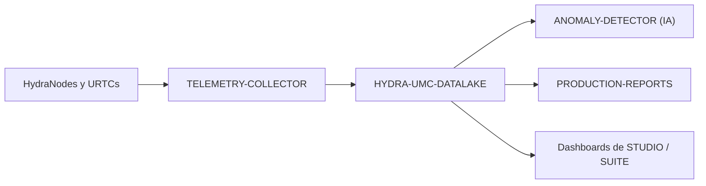

<!-- =============================================================================
HYDRA-UMC-DATALAKE - Time-series data lake
Copyright (C) JuanenRac (Electro Hobby 3D) <electrohobby3d@gmail.com>
GPL-3.0-or-later - see LICENSE
============================================================================= -->

<p align="center">
  
</p>

# 🗄️ HYDRA-UMC-DATALAKE

<p align="center"><a href="README.md">🇺🇸 English</a> | 🇪🇸 <b>Español</b> | <a href="README_fra.md">🇫🇷 Français</a> | <a href="README_ita.md">🇮🇹 Italiano</a> | <a href="README_deu.md">🇩🇪 Deutsch</a> | <a href="README_zho.md">🇨🇳 简体中文</a> | <a href="README_jpn.md">🇯🇵 日本語</a> | <a href="README_por.md">🇵🇹 Português</a></p>

### 📊 Almacenamiento de Series Temporales Escalable para Datos Robóticos Industriales

<p align="center">
  
  
  
  
  
  
</p>

---

> **Estado de seguridad física y de ciberseguridad:** este ecosistema no es un sistema de seguridad certificado. Todavía no existe una ruta de E-STOP por hardware, ni límites ni enclavamientos aplicados por el firmware, ni un comando de movimiento verificado; las imágenes de firmware se comprueban con CRC-32 y una firma Ed25519, y una compilación de versión rechaza las claves de desarrollo publicadas (los cabezales de herramienta y las placas de expansión detrás del relé siguen con cargadores de URTC, que usan un HMAC-SHA256 de clave compartida en lugar de una firma); TLS y TLS mutuo son opcionales y están desactivados por defecto; aún no se ha poblado ni probado ninguna placa propia. Lee la [línea base de seguridad](https://github.com/JuanenRac/HYDRA-UMC-DOCS/blob/main/docs/SECURITY_BASELINE.md) y el [modelo de amenazas](https://github.com/JuanenRac/HYDRA-UMC-DOCS/blob/main/docs/THREAT_MODEL.md) antes de fiarte de cualquier afirmación de aquí para la seguridad de una persona.

---

## 📋 De un vistazo

| | |
|---|---|
| Versión | `0.2.0` |
| Madurez | Funcional |
| Tests | 118 (`python -m pytest -q tests`) |
| Tecnología | Python / sqlite3 / http.server (ThreadingHTTPServer) / pytest |
| Destino | La Raspberry Pi CM5 de una celda HYDRA-UMC |
| En hardware real | Todavía no: no consta ninguna ejecución en hardware real para esta versión |

**Ir a:** [Resumen](#-resumen) · [Arquitectura](#-arquitectura) · [Funciones](#-funciones) · [Seguridad y protección](#-seguridad-y-protección) · [Interfaces](#-interfaces) · [Configuración](#-configuración) · [Inicio rápido](#-inicio-rápido) · [Pruebas](#-pruebas) · [Resolución de problemas](#-resolución-de-problemas) · [Estructura del repositorio](#-estructura-del-repositorio) · [Proyectos relacionados](#-proyectos-relacionados)

## 🚦 Estado del proyecto

Cada línea es una parte de este repositorio y la luz dice hasta dónde llega hoy. Se escribe con lo que el repositorio puede demostrar (pruebas, compilaciones, ejecuciones), no con lo previsto.

🟢 Hecho y verificado · 🟡 Funciona, con límites conocidos · 🟠 Hecho a medias o sin verificar · 🔴 Sin hacer o sin funcionar

| Área | Estado | Qué significa aquí |
|---|---|---|
| Software | 🟡 | Funciona para su propósito principal; la comprobación de honestidad de arriba lista lo que aún falta |
| Pruebas | 🟢 | 118 pruebas automáticas, ejecutadas en cada cambio |
| Hardware real | 🔴 | Todavía no: no consta ninguna ejecución en hardware real para esta versión |
| Documentación | 🟢 | README en ocho idiomas, comprobado contra el manifiesto en cada cambio |

## 🎯 Resumen

**HYDRA-UMC-DATALAKE** es el almacén actual de series temporales de la fábrica. Proporciona un repositorio real respaldado por SQLite para la telemetría normalizada generada por el ecosistema, incluyendo corrientes de motores, ángulos de articulación, lecturas de sensores y logs de inferencia de IA.

Es la base de software para analítica, mantenimiento predictivo e informes de producción. Su implementación SQLite actual está probada localmente; un despliegue externo con InfluxDB/TimescaleDB sigue siendo una decisión futura de infraestructura, no una función que se afirme ya operativa.

## 🧩 Papel en HYDRA-UMC

**HYDRA-UMC-DATALAKE** es donde se guarda la telemetría del ecosistema: el recolector escribe en él y el detector de anomalías, los informes de producción y los paneles leen de él. No tiene lógica de robots propia y nunca manda a una máquina.

## 🏛️ Arquitectura

<p align="center">
  
</p>

<details>
<summary>Versión en texto del diagrama (Mermaid)</summary>



</details>

**Por qué está hecho así**

* **Por qué es el padre de integración, no un par, de sus 3 hijos.** HYDRA-UMC-TELEMETRY-COLLECTOR, HYDRA-UMC-ANOMALY-DETECTOR y HYDRA-UMC-PRODUCTION-REPORTS leen/escriben el MISMO almacén de series temporales subyacente - poseer ese almacén en un solo sitio (este repo) evita 3 decisiones de esquema independientes y potencialmente divergentes.
* **Por qué sqlite3 hoy, no InfluxDB/TimescaleDB todavía.** Una base externa sigue siendo una posible decisión de despliegue a largo plazo, pero levantarla es infraestructura real (un servicio que desplegar y operar), no algo que afirmar o añadir sin pedirlo. El `TimeSeriesStore` de `src/hydra_umc_datalake/store.py` es hoy un almacén de series temporales real, ACID y consultable (`sqlite3` de la biblioteca estándar de Python), no un placeholder, y queda tras su propia clase para que un backend futuro pueda sustituirlo sin reescribir el contrato HTTP.
* **Por qué una única tabla "larga" y estrecha (source/kind/field/timestamp/value), no una columna por campo de telemetría.** El propio `Sample.Fields` de HYDRA-UMC-TELEMETRY-COLLECTOR es abierto (cualquier nombre de campo, cualquier fuente puede reportar campos nuevos) - un esquema estrecho acepta cualquiera de ellos sin una migración, al coste real de una fila por campo por muestra en vez de una fila por muestra.
* **Por qué `aggregate()` hace un bucketing SQL real por tiempo, no solo `query()` en crudo.** Un panel o informe que pregunte "temperatura media del motor por minuto en la última semana" sobre millones de filas crudas necesita un submuestreo real hecho por la base de datos, no traído en crudo y promediado en el código de la aplicación - los límites de los buckets de `aggregate()` son deterministas (alineados al propio `start` de la consulta), asi que la misma consulta contra los mismos datos siempre traza las mismas fronteras de bucket.
* **Cómo encaja en el resto del ecosistema.** El padre integrador de la familia Data & Analytics. HYDRA-UMC-TELEMETRY-COLLECTOR escribe en él lo que los productores envían al collector (nada en el ecosistema envía datos todavía, así que el almacén de un despliegue real empieza vacío), y HYDRA-UMC-ANOMALY-DETECTOR y HYDRA-UMC-PRODUCTION-REPORTS leen de vuelta su telemetría almacenada.
* **Por qué el versionado de esquema usa el propio `PRAGMA user_version` de SQLite, no una tabla hecha a mano.** SQLite ya provee exactamente este mecanismo real (un entero en la cabecera del archivo) - una tabla de contabilidad paralela solo sería una segunda fuente de verdad, potencialmente divergente, para el mismo hecho.
* **Por qué la retención es opt-in por `(kind, field)`, no un valor por defecto global.** Un almacén con docenas de series de telemetría reales no debería tener la suposición de retención de un operador aplicada silenciosamente a todas las series - `apply_retention()` solo toca una serie que recibió explícitamente una política vía `set_retention_policy()`/`POST /retention`.
* **Por qué la identidad de reintento es `(source, kind, field, timestamp)`.** El contrato de telemetría normalizado no tiene identificador de secuencia/evento, por lo que un punto exactamente repetido se trata como un reintento de red incierto y se compacta con una regla determinista de última escritura. Esto evita que filas duplicadas distorsionen recuentos y agregados sin ejecutar una limpieza destructiva sobre datos históricos. Cuando el productor envía una `sequence` (el colector de telemetría lo hace), forma parte de la identidad, `(source, kind, field, timestamp, sequence)`: dos lecturas distintas del mismo milisegundo son dos puntos, y solo el reintento de la misma secuencia se reemplaza a sí mismo.
* **Por qué `/stats/range` es un endpoint nuevo en vez de extender `/stats`.** La forma existente de `/stats`, `{"sampleCount": <int>}`, ya es real y está probada - añadirle campos sería un cambio real y disruptivo sin motivo, cuando un segundo endpoint aditivo no cuesta nada.

## ✨ Funciones

* 🗄️ **Almacenamiento con SQLite:** Almacenamiento real, ACID y en disco mediante `sqlite3` de la biblioteca estándar de Python. *(implementado)*
* 📊 **Esquema de Datos Unificado:** Telemetría normalizada de formato largo (`source/kind/field/timestamp/value`) para fuentes HYDRA-UMC y URTC. *(implementado)*
* 🔍 **Consultas Deterministas:** Los resultados se ordenan por timestamp y desempates estables; las lecturas acotadas rechazan límites no positivos. *(implementado)*
* 🔁 **Reintentos Idempotentes:** Reentregar un punto `(source, kind, field, timestamp)` reemplaza su valor (la última escritura gana), evitando que un reintento infle duplicados. *(implementado)*
* 🧬 **Migraciones de Esquema Reversibles:** `migrate_up()`/`migrate_down()` reales y probadas, rastreadas vía el propio `PRAGMA user_version` de SQLite - nunca editar una migración ya publicada, añadir una nueva. *(implementado)*
* 🕐 **Timestamps UTC Explícitos:** `GET /stats/range` reporta los datos reales más antiguos/recientes tanto en ms crudos como en cadenas ISO 8601 UTC explícitas. *(implementado)*
* 🗑️ **Retención Validada:** Ventanas de retención por serie, opt-in (`GET`/`POST /retention`, `POST /retention/apply`) - una ventana no positiva se rechaza de plano. *(implementado)*
* 🔐 **Control de acceso y lecturas acotadas:** tokens bearer opcionales por rol (`ingest`, `admin` para las rutas de retención que borran historia, `read`); se rechaza un bind no local sin los dos primeros. Una consulta está acotada (`limit` como mucho 200000, un agregado como mucho 100000 buckets), se rechaza una marca de tiempo en segundos o del futuro, y la historia de una serie sin política de retención propia puede conservarse con una política por defecto. *(implementado)*
* 📚 **Páginas, lotes, catálogo y copia de seguridad:** un historial largo se lee página a página (`cursor`, anunciado en la cabecera `X-Next-Cursor`), una ventana `[start, before)` no cuenta dos veces su punto límite, `POST /ingest/batch` guarda muchas muestras en una sola transacción, `GET /series` lista lo almacenado y `hydra-umc-datalake backup` escribe una copia coherente y conserva las más recientes. *(implementado)*

## 🔒 Seguridad y protección

| Amenaza | Defensa | Dónde |
|---|---|---|
| Escrituras anónimas | Tres roles de token (`ingest`, `admin`, `read`) comparados en tiempo constante (`hmac.compare_digest`), de 16 caracteres como mínimo; un rol sin token solo está abierto en una dirección loopback y una dirección que no sea loopback sin tokens exige `--allow-anonymous` | `api.py`, `main.py` |
| Un cuerpo enorme, un lote enorme, un cliente lento | Un cuerpo de más de 1 MiB recibe `413`, un lote admite como máximo 1000 muestras (`--max-batch-samples`) y una petición se lee durante 15 segundos como máximo | `api.py` |
| Un disco lleno y marcas de tiempo absurdas | Las escrituras se detienen con un `507` honesto con menos de 64 MiB libres (nunca un `500`); una marca de tiempo anterior a 100 000 000 000 ms o más de 5 minutos en el futuro se rechaza (`--max-future-skew-seconds`, `0` lo desactiva) | `api.py` |
| Una consulta que se come la memoria | Como máximo 200 000 filas por consulta, 100 000 cubos por agregación y 100 000 series | `store.py` |

**Lo que nunca hace:** nunca manda a un robot, y la ingesta y el análisis viven en otros repositorios.

## 🔌 Interfaces

Una interfaz JSON/HTTP sencilla (el `http.server` de la biblioteca estándar, sin framework) en `127.0.0.1:8095` por defecto. La referencia completa es `docs/API.md`.

| Topic o ruta | Qué lleva |
|---|---|
| `POST /ingest`, `POST /ingest/batch` | escribir una muestra o un lote (rol `ingest`) |
| `GET /query`, `/aggregate`, `/series`, `/stats`, `/stats/range` | leer muestras, agregados, la lista de series y estadísticas (rol `read`) |
| `GET /retention`, `POST /retention`, `POST /retention/apply` | leer, fijar y aplicar la política de retención (rol `admin`) |
| `GET /health` | ¿está vivo el servicio? |

## ⚙️ Configuración

| Variable | Por defecto | Qué fija |
|---|---|---|
| `--db` | `datalake.sqlite3` | el fichero SQLite (`:memory:` no es duradero) |
| `--addr`, `--port` | `127.0.0.1`, `8095` | dónde escuchar |
| `--token`, `HYDRA_UMC_DATALAKE_TOKEN` | sin token | un token para todos los roles, de 16 caracteres como mínimo |
| `HYDRA_UMC_DATALAKE_INGEST_TOKEN`, `_ADMIN_TOKEN`, `_READ_TOKEN` | sin definir | sustituyen el token compartido para un rol |
| `--allow-anonymous` | no | obligatorio para una dirección no loopback sin tokens |
| `--default-retention-days`, `--max-future-skew-seconds`, `--max-batch-samples` | `0`, `300`, `1000` | retención por defecto (`0` = ninguna), desfase al futuro en segundos (`0` = apagado), muestras por lote |

La pila de contenedores (`docker-compose.yml`) nombra sus tokens de otra manera (por ejemplo `DATALAKE_TOKEN`); dentro del contenedor se convierten en la variable de arriba.

## 🚀 Inicio rápido

Requiere Python 3.10 o superior; el código usa solo la biblioteca estándar.

```bash
bash run.sh        # Linux, macOS (run.bat on Windows)
python -m hydra_umc_datalake.main --db datalake.sqlite3 --token "$(openssl rand -hex 16)"
curl http://127.0.0.1:8095/health
```

Copia la base de datos con la orden `backup`, por ejemplo `hydra-umc-datalake backup --dest /backups --keep 7` (`--keep 0` conserva todas las copias).

## 🧪 Pruebas

118 pruebas automáticas se ejecutan con `python -m pytest -q tests`; `python tools/build_test.py` solo compila cada módulo. Usan un fichero SQLite real y un servidor HTTP local real, sin hardware ni red externa.

| Fichero de pruebas | Pruebas | Qué cubre |
|---|---|---|
| `test_store.py`, `test_migrations.py`, `test_sequence_identity.py`, `test_pages_batch_backup.py` | - | el almacén, las migraciones de esquema, secuencias, páginas, lotes y copias |
| `test_api.py`, `test_access_and_limits.py` | - | las rutas sobre HTTP real, los roles de token y cada límite |

El CI ejecuta `HYDRA_UMC_CI=1 python tools/ci_validate.py`, que comprueba el manifiesto, los documentos, los ocho README y las imágenes.

## 🏗️ Compilación y publicación

Requiere Python >= 3.10. Un almacén de series temporales real y consultable
con API HTTP, no solo un esqueleto que importa.

```bash
# Linux/macOS
./build.sh
./run.sh --port 8095

# Windows
build.bat
run.bat --port 8095
```

`build` crea/activa un `.venv` local, instala el paquete (editable, con
extras de dev) en el, verifica la importación, y corre la suite de tests
real (`pytest`). `run` arranca la API HTTP y reenvía cualquier flag
(`--addr`, `--port`, `--db`).

```bash
# Ingerir una muestra (misma forma normalizada que el Sample de HYDRA-UMC-TELEMETRY-COLLECTOR)
curl -X POST localhost:8095/ingest \
  -d '{"sourceId":"robot-1","kind":"motor_temp","timestamp":1700000000000,"fields":{"value":42.5}}'

# Consultarla de vuelta
curl "localhost:8095/query?sourceId=robot-1"

# Submuestrear a buckets de 1 minuto sobre un rango de tiempo real
curl "localhost:8095/aggregate?kind=motor_temp&field=value&bucketMs=60000&start=0&end=1800000000000&agg=avg"

curl localhost:8095/stats
```

```bash
python -m pytest tests/ -v   # store.py (insert/query/aggregate, incluyendo
                              # matemática de bucketing verificable a mano)
                              # y api.py (round-trips HTTP reales contra un
                              # ThreadingHTTPServer real en un puerto efímero)
```

Para levantar este proyecto junto con sus tres hijos (Telemetry-Collector, Anomaly-Detector, Production-Reports) como directorios hermanos:

```bash
TELEMETRY_COLLECTOR_TOKEN='a-secret-of-16-or-more-characters' \
DATALAKE_TOKEN='another-secret-of-16-or-more-characters' \
ANOMALY_TOKEN='a-third-secret-of-16-or-more-characters' docker compose up --build
```

El compose arranca de verdad los cuatro servicios (cada uno con un comando explícito), publica todos los puertos solo en `127.0.0.1` y se niega a arrancar sin `TELEMETRY_COLLECTOR_TOKEN`, `DATALAKE_TOKEN` o `ANOMALY_TOKEN` (secretos de al menos 16 caracteres, que exigen entonces las rutas de ingesta del collector, las de escritura y administración del datalake y las del detector). Los datos viven en volúmenes con nombre, así que `docker compose down` los conserva. `python tools/verify_compose.py` comprueba la estructura del archivo sin Docker.

## 🩺 Resolución de problemas

| Ves | Porque | Haz |
|---|---|---|
| `401` / `403` | El token falta, es demasiado corto o es del rol equivocado | Envía el token del rol correcto (`ingest` escribe, `read` lee, `admin` lo hace todo) |
| `413` | El cuerpo supera 1 MiB | Envía lotes más pequeños (`--max-batch-samples`) |
| `507` | Quedan menos de 64 MiB libres en disco | Libera espacio o aplica la política de retención (`POST /retention/apply`) |
| a time stamp is refused | Es anterior a 100 000 000 000 ms o va más de 5 minutos por delante del reloj | Corrige el reloj del emisor o sube `--max-future-skew-seconds` |

## 📂 Estructura del repositorio

<p align="center">
  
</p>

<details>
<summary>Versión en texto del árbol</summary>

```text
HYDRA-UMC-DATALAKE/
├── src/hydra_umc_datalake/
│   ├── store.py                                 el almacén de series temporales SQLite en disco
│   ├── api.py                                   la interfaz JSON/HTTP, roles, límites
│   └── main.py                                  punto de entrada y orden `backup`
├── tests/                                       118 pruebas, con migraciones y límites
├── docs/                                        la referencia de la API
├── systemd/                                     unidad de servicio para la CM5
├── tools/                                       ejecutor de compilación y pruebas, subida de versión, validador de CI, generadores y comprobaciones de README e imágenes
├── images/                                      banner y las imágenes del README
├── .github/                                     flujo de CI y plantillas de incidencias
├── pyproject.toml                               metadatos del paquete y dependencias
├── hydra-umc.project.json                       manifiesto: versión, madurez, familia
├── CHANGELOG.md                                 qué cambió en cada versión
├── build.sh build.bat                           scripts de compilación (nunca cambian la versión)
├── build-test.sh build-test.bat                 scripts de compilación (nunca cambian la versión)
├── test.sh test.bat                             ejecutan las pruebas
├── bump_version.py / bump_manifest_version.py   subida de versión explícita
├── docker-compose.yml                           pila de contenedores
├── run.sh run.bat                               arrancar el servicio
└── SECURITY.md SUPPORT.md CONTRIBUTING.md CODE_OF_CONDUCT.md LICENSE LICENSE.md
```

</details>

## 🗺️ Hoja de ruta y límites conocidos

**Límites conocidos hoy**

* **Fase 1:** Ingesta de alto rendimiento e indexación del Datalake para análisis histórico.
* **Fase 2:** Compresión en el borde del colector de telemetría y protocolos de transmisión seguros.
* **Fase 3:** Detección de anomalías mediante aprendizaje no supervisado y análisis de vibración de motores.
* **Fase 4:** Integración con Grafana para visualización avanzada en tiempo real y automatización de informes de producción.

## 🌍 Idiomas

Este README y los documentos del repositorio existen en ocho idiomas: inglés, español, alemán, francés, italiano, japonés, chino y portugués (Portugal). Se escriben a la vez y el CI comprueba que los ocho ficheros tengan las mismas secciones y los mismos enlaces. Este repositorio no tiene pantalla ni catálogo de mensajes propios, así que no hay cadenas de interfaz que traducir.

## 🔗 Proyectos relacionados

Este proyecto es parte del ecosistema de robótica HYDRA-UMC del mismo autor (JuanenRac / Electro Hobby 3D). Vale la pena conocerlo, ya que una petición podría en realidad ser sobre alguno de estos en vez de sobre este repositorio.

**Proyectos Hijos** — cada uno escribe en o lee del propio almacén de este data lake
- **[HYDRA-UMC-TELEMETRY-COLLECTOR](https://github.com/JuanenRac/HYDRA-UMC-TELEMETRY-COLLECTOR)** — pipeline real de ingesta CAN/WebSocket hacia DATALAKE, con deduplicación por secuencia.
- **[HYDRA-UMC-ANOMALY-DETECTOR](https://github.com/JuanenRac/HYDRA-UMC-ANOMALY-DETECTOR)** — detector de anomalías real basado en FFT + línea base estadística, con monitorización de deriva.
- **[HYDRA-UMC-PRODUCTION-REPORTS](https://github.com/JuanenRac/HYDRA-UMC-PRODUCTION-REPORTS)** — cálculo real de OEE/disponibilidad sobre el histórico de DATALAKE, con exportación CSV reproducible.

**Directamente Relacionados**
- **[HYDRA-UMC-SERVER](https://github.com/JuanenRac/HYDRA-UMC-SERVER)** — el backend headless real (REST/WebSocket) con el que habla de verdad cada cliente de control; la fuente de los logs/telemetría que ingiere este proyecto.
- **[HYDRA-UMC-DASHBOARD-AI](https://github.com/JuanenRac/HYDRA-UMC-DASHBOARD-AI)** — paneles de Resúmenes Inteligentes y Resaltado de Anomalías sobre DATALAKE/ANOMALY-DETECTOR, con un respaldo estadístico honesto; calcula sus Resúmenes Inteligentes directamente a partir del propio historial de consultas/agregados de este data lake.

**También Forma Parte del Ecosistema**

*Hardware y Plataforma Base*
- **[HYDRA-UMC](https://github.com/JuanenRac/HYDRA-UMC)** — el diseño de la placa madre del brazo robótico: host CM5 + coprocesador STM32H745 de doble núcleo, pensado para coordinar hasta 8 brazos herramienta por CAN-OTA/SPI-OTA (firmware en fase temprana; todavía no hay ninguna placa poblada).
- **[HYDRA-UMC-OS](https://github.com/JuanenRac/HYDRA-UMC-OS)** — capa de producto reproducible sobre Raspberry Pi OS para el CM5: agente de solo lectura, config/perfiles validados, aprovisionamiento WiFi de primer contacto.
- **[HYDRA-UMC-SDK](https://github.com/JuanenRac/HYDRA-UMC-SDK)** — el contrato JSON-Schema compartido y la barrera de software de puerta de trabajos contra la que cada bridge valida sus comandos (no es una función de seguridad certificada).
- **[HYDRA-UMC-CONNECTOR-HUB](https://github.com/JuanenRac/HYDRA-UMC-CONNECTOR-HUB)** — registro declarativo y validador de manifiestos de adaptador para conectores de máquinas externas; extiende la propia idea de contrato del SDK a máquinas externas sin sustituir a los proyectos de pasarela industrial.

*Backend Central y Clientes*
- **[HYDRA-UMC-STUDIO](https://github.com/JuanenRac/HYDRA-UMC-STUDIO)** — panel de control web con visualización 3D multi-robot en tiempo real.
- **[HYDRA-UMC-SUITE](https://github.com/JuanenRac/HYDRA-UMC-SUITE)** — centro de mando de enjambre de escritorio (PySide6) para varios servidores a la vez, empaquetado como ejecutable independiente.
- **[HYDRA-UMC-ANDROID-CONTROL](https://github.com/JuanenRac/HYDRA-UMC-ANDROID-CONTROL)** — app nativa de control para Android con inicio de sesión biométrico y un compañero Wear OS emparejado.
- **[HYDRA-UMC-IOS-CONTROL](https://github.com/JuanenRac/HYDRA-UMC-IOS-CONTROL)** — app de control para iOS/iPadOS (Flutter) con sincronización en tiempo real por WebSocket.
- **[HYDRA-UMC-DSI](https://github.com/JuanenRac/HYDRA-UMC-DSI)** — interfaz táctil nativa para la pantalla táctil DSI de 7" a bordo, embebida en el propio CM5.
- **[HYDRA-UMC-EDITOR-URDF](https://github.com/JuanenRac/HYDRA-UMC-EDITOR-URDF)** — creador/editor gráfico de URDF de escritorio que envía los modelos terminados al propio catálogo de STUDIO.
- **[HYDRA-UMC-EDITOR-STL](https://github.com/JuanenRac/HYDRA-UMC-EDITOR-STL)** — editor de escritorio de modelos STL, que transforma/reemplaza/quita/añade piezas reales en el mismo catálogo de modelos que también edita HYDRA-UMC-EDITOR-URDF.
- **[HYDRA-UMC-BRIDGE-AMR](https://github.com/JuanenRac/HYDRA-UMC-BRIDGE-AMR)** — barrera de coordinación para flotas AGV/AMR mediante un publicador MQTT VDA 5050 (probado solo contra una flota emulada).
- **[HYDRA-UMC-BRIDGE-CNC](https://github.com/JuanenRac/HYDRA-UMC-BRIDGE-CNC)** — coordinador de alto nivel para celdas CNC con acceso a estado/bytes de control GRBL (probado solo contra un emulador).
- **[HYDRA-UMC-BRIDGE-DROIDS](https://github.com/JuanenRac/HYDRA-UMC-BRIDGE-DROIDS)** — barrera de coordinación para droides con patas/humanoides, con un emisor de comandos para Boston Dynamics Spot (probado solo contra un emulador).
- **[HYDRA-UMC-BRIDGE-LASER](https://github.com/JuanenRac/HYDRA-UMC-BRIDGE-LASER)** — coordinador de celdas láser que lee 3 señales GPIO de llave/carcasa/enclavamiento (probado solo contra un chip simulado; no puede armar ni disparar un láser).
- **[HYDRA-UMC-BRIDGE-OPENPNP](https://github.com/JuanenRac/HYDRA-UMC-BRIDGE-OPENPNP)** — coordinador de alto nivel seguro para el flujo de placas de pick-and-place OpenPnP.
- **[HYDRA-UMC-BRIDGE-PRINTER3D](https://github.com/JuanenRac/HYDRA-UMC-BRIDGE-PRINTER3D)** — barrera de coordinación segura para impresoras 3D Moonraker/Klipper, con comandos de trabajo reales y controlados.
- **[HYDRA-UMC-BRIDGE-ROS2](https://github.com/JuanenRac/HYDRA-UMC-BRIDGE-ROS2)** — coordinador con un transporte ROS 2 rclpy importado de forma perezosa (todavía no ejecutado contra una instalación de ROS 2).
- **[HYDRA-UMC-BRIDGE-UAV](https://github.com/JuanenRac/HYDRA-UMC-BRIDGE-UAV)** — barrera de coordinación para UAV equipados con cámara, con un emisor de comandos MAVLink (probado solo contra un emulador).

*Plataforma de Herramientas URTC*
- **[URTC](https://github.com/JuanenRac/URTC)** — firmware para la placa física del Universal Robot Tool Controller, más de 25 perfiles de herramienta por bus CAN.
- **[URTC-FLASHER](https://github.com/JuanenRac/URTC-FLASHER)** — herramienta de escritorio con GUI para flashear placas URTC, CAN-OTA más SWD/JTAG de chip completo.
- **[URTC-TESTER](https://github.com/JuanenRac/URTC-TESTER)** — herramienta de escritorio de diagnóstico CAN-bus en vivo para placas URTC, un panel por perfil de herramienta.
- **[URTC-WEB-STUDIO](https://github.com/JuanenRac/URTC-WEB-STUDIO)** — alternativa basada en navegador a URTC-TESTER mediante la Web Serial API, sin instalación local.
- **[URTC-GATEWAY](https://github.com/JuanenRac/URTC-GATEWAY)** — pasarela delante del bus CAN de URTC: lista de identificadores permitidos, límite de tasa y clave de sesión; software probado en ordenador, aún no en un bus real.

*Nodo IA de Visión (Hailo-8)*
- **[HYDRA-UMC-VISION-NODE](https://github.com/JuanenRac/HYDRA-UMC-VISION-NODE)** — nodo de integración para el pipeline de visión Hailo-8, con una comprobación real de disponibilidad de hardware por etapa.
- **[HYDRA-UMC-DETECTION-HEF](https://github.com/JuanenRac/HYDRA-UMC-DETECTION-HEF)** — registro real de modelos compilados con verificación de carga segura por arquitectura Hailo/checksum.
- **[HYDRA-UMC-VISION-STREAMER](https://github.com/JuanenRac/HYDRA-UMC-VISION-STREAMER)** — generador real de pipeline GStreamer + config MediaMTX, con una frontera de integración HailoRT real.
- **[HYDRA-UMC-VISUAL-SERVOING-API](https://github.com/JuanenRac/HYDRA-UMC-VISUAL-SERVOING-API)** — ley de corrección Position-Based Visual Servoing con autorización condicionada al estado de zona; todavía sin estimación de pose por cámara.
- **[HYDRA-UMC-SAFETY-ZONES](https://github.com/JuanenRac/HYDRA-UMC-SAFETY-ZONES)** — lógica v0 de invasión de zona, vigencia de calibración y solicitud de E-STOP que toma las posiciones de los objetos de un fichero; ningún detector la alimenta y todavía no hay un E-STOP físico conectado.

*Nodo IA Cognitivo (Hailo-10)*
- **[HYDRA-UMC-COGNITIVE-NODE](https://github.com/JuanenRac/HYDRA-UMC-COGNITIVE-NODE)** — nodo de integración para el pipeline cognitivo Hailo-10 (orquestación de LLM/VLA/voz).
- **[HYDRA-UMC-VLA-ENGINE](https://github.com/JuanenRac/HYDRA-UMC-VLA-ENGINE)** — codificación/decodificación real de tokens de acción y generación de trayectoria para un modelo Vision-Language-Action.
- **[HYDRA-UMC-VOICE-UI](https://github.com/JuanenRac/HYDRA-UMC-VOICE-UI)** — front-end de voz real (VAD + analizador de intención) con un relé a Watch acotado y con confirmación.
- **[HYDRA-UMC-SEMANTIC-PLANNER](https://github.com/JuanenRac/HYDRA-UMC-SEMANTIC-PLANNER)** — descomposición real de tareas basada en reglas y recuperación semántica de errores sobre códigos de error del MCU.
- **[HYDRA-UMC-DOCS-QA](https://github.com/JuanenRac/HYDRA-UMC-DOCS-QA)** — búsqueda real de documentos TF-IDF (solo librería estándar) sobre los propios documentos Markdown de este ecosistema.
- **[HYDRA-UMC-LOCAL-TECHNICIAN](https://github.com/JuanenRac/HYDRA-UMC-LOCAL-TECHNICIAN)** — técnico de mantenimiento con IA local y con puertas de política para el propio ecosistema - observa, diagnostica y propone arreglos; los dos niveles de riesgo más altos están deliberadamente sin implementar todavía.

*Orquestación y Enjambre*
- **[HYDRA-UMC-ORCHESTRATOR](https://github.com/JuanenRac/HYDRA-UMC-ORCHESTRATOR)** — nodo de integración con un contrato real de informe de salud gRPC/Protobuf y una máquina de estados de misión.
- **[HYDRA-UMC-JOB-DISPATCHER](https://github.com/JuanenRac/HYDRA-UMC-JOB-DISPATCHER)** — cola de trabajos real basada en prioridad con deduplicación, sobre una API HTTP real.
- **[HYDRA-UMC-NODE-HEALING](https://github.com/JuanenRac/HYDRA-UMC-NODE-HEALING)** — watchdog de salud de flota real basado en gRPC, con reintento/backoff y detección de discrepancia de identidad.
- **[HYDRA-UMC-PATH-PLANNER-3D](https://github.com/JuanenRac/HYDRA-UMC-PATH-PLANNER-3D)** — planificador de rutas 3D real basado en RRT, con validación real de colisión de obstáculos/espacio de trabajo.
- **[HYDRA-UMC-SWARM-SYNC](https://github.com/JuanenRac/HYDRA-UMC-SWARM-SYNC)** — sincronización de estado real mediante CRDT LWW-Element-Map, con pruebas de propiedades para convergencia multi-celda.

*Gemelo Digital y Simulación*
- **[HYDRA-UMC-TWIN](https://github.com/JuanenRac/HYDRA-UMC-TWIN)** — nodo de integración para el motor de gemelo digital, con un contrato real de sincronización por compatibilidad de versión.
- **[HYDRA-UMC-HIL-BRIDGE](https://github.com/JuanenRac/HYDRA-UMC-HIL-BRIDGE)** — enrutador hardware-in-the-loop con un enclavamiento de software por colisión entre simulación y hardware real (probado sin hardware real).
- **[HYDRA-UMC-PHYSICS-REPLICA](https://github.com/JuanenRac/HYDRA-UMC-PHYSICS-REPLICA)** — cinemática directa real y validación de límites articulares sobre un subconjunto real de URDF.
- **[HYDRA-UMC-SYNTHETIC-DATA-GEN](https://github.com/JuanenRac/HYDRA-UMC-SYNTHETIC-DATA-GEN)** — generador real de escenas 2D procedurales con exportación de anotaciones YOLO/COCO.

*Pasarela Industrial*
- **[HYDRA-UMC-GATEWAY-INDUSTRIAL](https://github.com/JuanenRac/HYDRA-UMC-GATEWAY-INDUSTRIAL)** — nodo de integración que retransmite a protocolos industriales, con una capa real de lista blanca de comandos/contrapresión.
- **[HYDRA-UMC-OPCUA-SERVER](https://github.com/JuanenRac/HYDRA-UMC-OPCUA-SERVER)** — espacio de direcciones OPC-UA real, verificado con una sesión de cliente real del protocolo binario.
- **[HYDRA-UMC-MQTT-BROKER](https://github.com/JuanenRac/HYDRA-UMC-MQTT-BROKER)** — broker MQTT real con autenticación por cliente opcional y ACL de tópicos.
- **[HYDRA-UMC-MTCONNECT-ADAPTER](https://github.com/JuanenRac/HYDRA-UMC-MTCONNECT-ADAPTER)** — endpoints XML reales `/probe` y `/current` de MTConnect, con salida en modo degradado.

*Herramientas Complementarias y Operaciones del Ecosistema*
- **[HYDRA-UMC-TOOL-CLI](https://github.com/JuanenRac/HYDRA-UMC-TOOL-CLI)** — CLI de flota con un contrato real y estable de códigos de salida, cliente real y en vivo de la propia API de HYDRA-UMC-SERVER.
- **[HYDRA-UMC-WATCH](https://github.com/JuanenRac/HYDRA-UMC-WATCH)** — app compañera de WearOS con patrones de alerta háptica y un relé de voz al teléfono emparejado (todavía no ejecutada en un reloj físico).
- **[URTC-SMART-RACK](https://github.com/JuanenRac/URTC-SMART-RACK)** — firmware para un rack de montaje de placas con decodificación real de ID de herramienta y lógica de precalentamiento Smart Idle.
- **[URTC-VISION-TOOL](https://github.com/JuanenRac/URTC-VISION-TOOL)** — firmware más un compañero de visión real en Python para un cabezal de inspección térmica/RGB.
- **[HYDRA-UMC-UPDATER](https://github.com/JuanenRac/HYDRA-UMC-UPDATER)** — herramienta administrativa de escritorio que descubre, clona y actualiza cada repositorio de este ecosistema.
- **[HYDRA-UMC-OS-REBUILDER](https://github.com/JuanenRac/HYDRA-UMC-OS-REBUILDER)** — herramienta de escritorio Windows/Linux que construye una imagen de la CM5 lista para grabar, precargada con las versiones más actuales del ecosistema, con configuración de primer arranque de Wi-Fi/usuario/SSH al estilo de Raspberry Pi Imager.
- **[HYDRA-UMC-OPS-AGENT](https://github.com/JuanenRac/HYDRA-UMC-OPS-AGENT)** — coordinador de incidencias de mantenimiento: un rol edge de bajo privilegio recopila un snapshot de inventario/salud saneado, un rol control-plane lo renderiza de solo lectura y pide a un proveedor de IA que sugiera un diagnóstico - nunca aplica un parche ni despliega nada.
- **[HYDRA-UMC-DEV-SERVER](https://github.com/JuanenRac/HYDRA-UMC-DEV-SERVER)** — host de desarrollo reproducible (Raspberry Pi 5 / CM5) que almacena el código del ecosistema y ejecuta tareas acotadas de compilación/pruebas bajo una cola duradera; un rol de desarrollo dedicado, explícitamente distinto de un CM5 operativo.

## 📚 Documentación

Dónde leer más:

* [docs/API.md](docs/API.md) - cada ruta, su rol, sus límites y sus errores
* [Base de seguridad del ecosistema](https://github.com/JuanenRac/HYDRA-UMC-DOCS/blob/main/docs/SECURITY_BASELINE.md)
* [Modelo de amenazas del ecosistema](https://github.com/JuanenRac/HYDRA-UMC-DOCS/blob/main/docs/THREAT_MODEL.md)
* [Historial de cambios de este repositorio](CHANGELOG.md)
* [Licencia de este repositorio](LICENSE.md)

## 🤝 Contribuir y comunidad

* Antes de un pull request ejecuta `HYDRA_UMC_CI=1 py -3 tools/ci_validate.py` (o `HYDRA_UMC_CI=1 python3 tools/ci_validate.py`): debe imprimir `CI_VALIDATION=PASS`. No ejecutes `build.sh` ni `build.bat` para esta comprobación; compilar no es comprobar.
* Los ocho README se escriben desde una sola fuente en HYDRA-UMC-DOCS; no los edites a mano. Cambia la fuente y vuelve a escribirlos con `tools/make_readmes.py`.
* No afirmes en un README lo que no se ha ejecutado: di «simulado» o «sin probar en hardware» cuando esa sea la verdad.
* Mira [CONTRIBUTING.md](CONTRIBUTING.md), el [código de conducta](CODE_OF_CONDUCT.md), [SECURITY.md](SECURITY.md) y [SUPPORT.md](SUPPORT.md).

## 👤 AUTOR

**JuanenRac (Electro Hobby 3D)** · electrohobby3d@gmail.com

## 📜 LICENCIA

GPL-3.0-or-later - [LICENSE](LICENSE).
