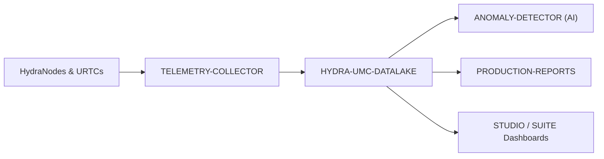

<!-- =============================================================================
HYDRA-UMC-DATALAKE - Time-series data lake
Copyright (C) JuanenRac (Electro Hobby 3D) <electrohobby3d@gmail.com>
GPL-3.0-or-later - see LICENSE
============================================================================= -->

<p align="center">
  
</p>

# 🗄️ HYDRA-UMC-DATALAKE

<p align="center"><a href="README.md">🇺🇸 English</a> | <a href="README_spa.md">🇪🇸 Español</a> | <a href="README_fra.md">🇫🇷 Français</a> | <a href="README_ita.md">🇮🇹 Italiano</a> | <a href="README_deu.md">🇩🇪 Deutsch</a> | 🇨🇳 <b>简体中文</b> | <a href="README_jpn.md">🇯🇵 日本語</a> | <a href="README_por.md">🇵🇹 Português</a></p>

### 📊 面向工业机器人数据的可扩展时序存储系统

<p align="center">
  
  
  
  
  
  
</p>

---

> **安全与安防现状:**本生态系统不是经认证的安全系统。目前尚无硬件 E-STOP 通路,没有由固件强制执行的限位或联锁,也没有经过验证的运动指令;固件映像使用 CRC-32 和 Ed25519 签名校验,发布构建会拒绝已公开的开发密钥(中继之后的工具头和扩展板仍运行 URTC 的引导程序,它们使用共享密钥的 HMAC-SHA256 而不是签名);TLS 与双向 TLS 均为可选项,默认关闭;自制电路板尚未组装或测试。在依赖此处任何说法来保障人身安全之前,请先阅读[安全基线](https://github.com/JuanenRac/HYDRA-UMC-DOCS/blob/main/docs/SECURITY_BASELINE.md)和[威胁模型](https://github.com/JuanenRac/HYDRA-UMC-DOCS/blob/main/docs/THREAT_MODEL.md)。

---

## 📋 速览

| | |
|---|---|
| 版本 | `0.2.1` |
| 成熟度 | 可用 |
| 测试 | 205 (`python -m pytest -q tests`) |
| 技术栈 | Python / sqlite3 / http.server (ThreadingHTTPServer) / pytest |
| 目标 | HYDRA-UMC 工作单元的 Raspberry Pi CM5 |
| 真实硬件 | 尚未：此版本没有在真实硬件上运行的记录 |

**跳转：** [概述](#-概述) · [架构](#-架构) · [功能](#-功能) · [安全与防护](#-安全与防护) · [接口](#-接口) · [配置](#-配置) · [快速开始](#-快速开始) · [测试](#-测试) · [故障排除](#-故障排除) · [仓库结构](#-仓库结构) · [相关项目](#-相关项目)

## 🚦 项目状态

每一行是本仓库的一个部分，灯号表示它今天做到了哪一步。内容依据仓库能够展示的证据（测试、构建、运行），而不是计划。

🟢 已完成并验证 · 🟡 可用，有已知限制 · 🟠 部分完成或尚未验证 · 🔴 未完成或不可用

| 领域 | 状态 | 在这里的含义 |
|---|---|---|
| 软件 | 🟡 | 主要用途可用；上面的诚实性检查列出了仍然缺少的内容 |
| 测试 | 🟢 | 205 项自动测试，每次变更都会运行 |
| 真实硬件 | 🔴 | 尚未：此版本没有在真实硬件上运行的记录 |
| 文档 | 🟢 | 八种语言的 README，每次变更都会与清单核对 |

## 🎯 概述

**HYDRA-UMC-DATALAKE** 是工厂当前的时序存储。它为生态系统产生的规范化
遥测数据提供真实的 SQLite 支持仓库，包括电机电流、关节角度、传感器读数
和 AI 推理日志。

它是分析、预测性维护和生产报告的软件基础。当前 SQLite 实现已在本地测试；
外部 InfluxDB/TimescaleDB 部署仍是未来的基础设施决策，而不是声称已在运行的功能。

## 🧩 在 HYDRA-UMC 中的角色

**HYDRA-UMC-DATALAKE** 是生态系统保存遥测数据的地方：采集器写入，异常检测器、生产报表和仪表板读取。它没有自己的机器人逻辑，也从不指挥机器。

## 🏛️ 架构

<p align="center">
  
</p>

<details>
<summary>图表的文本版本（Mermaid）</summary>



</details>

**为什么这样构建**

* **为何本项目是其 3 个子项目的集成父项目，而非平级项目。** HYDRA-UMC-TELEMETRY-COLLECTOR、HYDRA-UMC-ANOMALY-DETECTOR 和 HYDRA-UMC-PRODUCTION-REPORTS 都读写*同一个*底层时序存储——将该存储的所有权集中于一处（本仓库），可避免出现 3 个独立的、可能相互分歧的模式决策。
* **为何目前是 sqlite3，而不是 InfluxDB/TimescaleDB。** 外部数据库仍是长期部署的可能选择，但其运行是真正的基础设施工作，不应在未要求时声称或加入。`src/hydra_umc_datalake/store.py` 中的 `TimeSeriesStore` 今天是一个真实、符合 ACID、可查询的时序存储（Python 标准库 `sqlite3`），不是占位符；它保持在自身类之后，使未来后端能够在无需重写 HTTP 契约的情况下替换它。
* **为何是一张窄的“长”表（source/kind/field/timestamp/value），而非每个遥测字段一列。** HYDRA-UMC-TELEMETRY-COLLECTOR 自己的 `Sample.Fields` 是开放式的（任何字段名，任何来源都可以上报新字段）——窄表结构可以接受任何字段而无需迁移，其真实代价是每个样本的每个字段占一行，而不是每个样本一行。
* **为何 `aggregate()` 做的是真正的 SQL 按时间分桶，而不只是原始的 `query()`。** 一个仪表盘或报表询问“过去一周每分钟的平均电机温度”，需要在数百万条原始行上由数据库完成真正的降采样，而不是取出原始数据再在应用代码中求平均——`aggregate()` 的桶边界是确定性的（与查询本身的 `start` 对齐），因此同一查询针对同一数据总是画出相同的桶边界。
* **它如何融入生态系统的其余部分。** Data & Analytics 系列的集成父项。HYDRA-UMC-TELEMETRY-COLLECTOR 把生产者推送给采集器的数据写入这里（目前生态系统中没有任何组件推送数据，因此真实部署的存储从空开始），HYDRA-UMC-ANOMALY-DETECTOR 和 HYDRA-UMC-PRODUCTION-REPORTS 则读回其中存储的遥测数据。
* **为何模式版本控制使用 SQLite 自身的 `PRAGMA user_version`，而非手写的表。** SQLite 已经提供了正是这种真实机制（文件头中的一个整数）——一张并行的记账表只会成为同一事实的第二个、可能相互分歧的真相来源。
* **为何保留策略是按 `(kind, field)` 可选启用，而非全局默认值。** 一个拥有数十个真实遥测序列的存储，不应让某个操作员的保留假设悄悄地套用到每一个序列上——`apply_retention()` 只会处理通过 `set_retention_policy()`/`POST /retention` 明确设置了策略的序列。
* **为何重试身份是 `(source, kind, field, timestamp)`。** 规范化遥测契约没有序列/事件 ID，因此完全重复的点被视为不确定的网络重试，并以确定性的最后写入获胜规则合并。这避免重复行扭曲计数和聚合，同时不会对历史数据执行全局破坏性清理。 当生产者发送 `sequence`（遥测收集器会发送）时，它也是身份的一部分，即 `(source, kind, field, timestamp, sequence)`：同一毫秒内的两个不同读数是两个点，只有相同序列的重试才会替换自身。
* **为何 `/stats/range` 是一个新端点，而不是扩展 `/stats`。** `/stats` 现有的 `{"sampleCount": <int>}` 结构已经是真实且经过测试的——毫无理由地为其添加字段将是一次真实的破坏性变更，而增加一个附加的第二端点则不需要任何代价。

## ✨ 功能

* 🗄️ **SQLite 支持的存储：** 使用 Python 标准库 `sqlite3` 的真实、ACID、磁盘时序存储。*(已实现)*
* 📊 **统一数据模式：** 面向 HYDRA-UMC 和 URTC 来源的规范化长格式遥测（`source/kind/field/timestamp/value`）。*(已实现)*
* 🔍 **确定性查询：** 结果按时间戳和稳定的决胜条件排序；受限读取拒绝非正 limit。*(已实现)*
* 🔁 **幂等重试处理：** 重传一个 `(source, kind, field, timestamp)` 点会替换其值（最后写入获胜），避免重试扩大重复数据。*(已实现)*
* 🧬 **可逆的模式迁移：** 真实的、经过测试的 `migrate_up()`/`migrate_down()`，通过 SQLite 自身的 `PRAGMA user_version` 进行跟踪——切勿修改已发布的迁移，而是新增一个。*(已实现)*
* 🕐 **显式 UTC 时间戳：** `GET /stats/range` 以原始毫秒数和显式的 UTC ISO 8601 字符串两种形式，报告真实的最早/最新数据。*(已实现)*
* 🗑️ **经过验证的保留策略：** 按序列、可选启用的保留窗口（`GET`/`POST /retention`、`POST /retention/apply`）——非正数窗口会被直接拒绝。*(已实现)*
* 🔐 **访问控制与有界读取：** 按角色提供可选的 Bearer 令牌（`ingest`、负责删除历史的保留路由所用的 `admin`、`read`）；绑定到非回环地址时，缺少前两个令牌将被拒绝。查询有上限（`limit` 最多 200000，聚合最多 100000 个桶），以秒为单位或来自未来的时间戳会被拒绝，没有自身保留策略的序列的历史可由默认策略管理。*(已实现)*
* 📚 **分页、批量、目录与备份：** 长历史按页读取（`cursor`，通过 `X-Next-Cursor` 响应头告知），窗口 `[start, before)` 不会重复计算边界点，`POST /ingest/batch` 在一个事务中保存多个样本，`GET /series` 列出已存储的内容，`hydra-umc-datalake backup` 写出一致的副本并只保留最新的几份。 *(已实现)*

## 🔒 安全与防护

| 威胁 | 防御 | 位置 |
|---|---|---|
| 匿名写入 | 三种令牌角色（`ingest`、`admin`、`read`）以恒定时间比较（`hmac.compare_digest`），至少 16 个字符；没有令牌的角色只在回环地址上开放，非回环地址且无令牌时需要 `--allow-anonymous` | `api.py`, `main.py` |
| 巨大的请求体、巨大的批量、缓慢的客户端 | 超过 1 MiB 的请求体返回 `413`，一个批量最多 1000 个样本（`--max-batch-samples`），一个请求最多读取 15 秒 | `api.py` |
| 磁盘已满和荒谬的时间戳 | 可用空间低于 64 MiB 时写入以诚实的 `507` 停止（绝不是 `500`）；早于 100 000 000 000 ms 或超前 5 分钟以上的时间戳会被拒绝（`--max-future-skew-seconds`，`0` 关闭） | `api.py` |
| 吃光内存的查询 | 每次查询最多 200 000 行，每次聚合最多 100 000 个桶，最多 100 000 个序列 | `store.py` |

**它绝不做的事：** 它从不指挥机器人，采集和分析位于其他仓库。

## 🔌 接口

简单的 JSON/HTTP 接口（标准库 `http.server`，无框架），默认在 `127.0.0.1:8095`。完整参考见 `docs/API.md`。

| 主题或路由 | 内容 |
|---|---|
| `POST /ingest`, `POST /ingest/batch` | 写入一个样本或一个批量（角色 `ingest`） |
| `GET /query`, `/aggregate`, `/series`, `/stats`, `/stats/range` | 读取样本、聚合、序列列表和统计（角色 `read`） |
| `GET /history` | 面向历史数据客户端的单个序列读取：可升序或降序，带分页游标，使用 `bounds=1` 时还返回窗口外紧邻的值（角色 `read`） |
| `GET /windows`, `GET /rollups`, `GET/POST /downsample`, `POST /downsample/apply` | 可选功能（默认关闭）：按时间窗口的统计量和百分位数，以及降采样（原始点保留一段时间，之后保留聚合；除非另行指定，否则只做试运行）（角色 `read` 和 `admin`） |
| `GET /retention`, `POST /retention`, `POST /retention/apply` | 读取、设置并应用保留策略（角色 `admin`） |
| `GET /health` | 服务是否存活 |

## ⚙️ 配置

| 变量 | 默认值 | 设置内容 |
|---|---|---|
| `--db` | `datalake.sqlite3` | SQLite 文件（`:memory:` 不持久） |
| `--addr`, `--port` | `127.0.0.1`, `8095` | 监听位置 |
| `--token`, `HYDRA_UMC_DATALAKE_TOKEN` | 无令牌 | 所有角色共用的令牌，至少 16 个字符 |
| `HYDRA_UMC_DATALAKE_INGEST_TOKEN`, `_ADMIN_TOKEN`, `_READ_TOKEN` | 未设置 | 为某个角色替代共用令牌 |
| `--allow-anonymous` | 否 | 非回环地址且无令牌时必须 |
| `--default-retention-days`, `--max-future-skew-seconds`, `--max-batch-samples` | `0`, `300`, `1000` | 默认保留天数（`0` = 无）、允许的未来偏差秒数（`0` = 关闭）、每批样本数 |
| `--max-request-body-bytes`, `--request-timeout-seconds` | `1048576`, `15` | 请求体的最大字节数（更大的返回 `413`），读取请求时保持静默连接的秒数 |
| `--enable-window-stats`, `--max-window-points` | 关闭，`1000000` | 开启 `GET /windows`（计数、最小、最大、平均、求和、百分位数）；计算百分位数时最多加载的点数 |
| `--enable-downsampling`, `--downsample-delete`, `--max-downsample-buckets` | 关闭，关闭，`10000` | 开启降采样路由；让未带 `dryRun` 的请求真正删除（否则每次都是试运行）；每次运行最多聚合的桶数 |

容器栈（`docker-compose.yml`）对令牌的命名不同（例如 `DATALAKE_TOKEN`）；在容器内它们会变为上面的变量。

## 🚀 快速开始

需要 Python 3.10 或更高版本；代码只使用标准库。

```bash
bash run.sh        # Linux, macOS (run.bat on Windows)
python -m hydra_umc_datalake.main --db datalake.sqlite3 --token "$(openssl rand -hex 16)"
curl http://127.0.0.1:8095/health
```

用 `backup` 命令复制数据库，例如 `hydra-umc-datalake backup --dest /backups --keep 7`（`--keep 0` 保留全部副本）。

## 🧪 测试

运行 `python -m pytest -q tests` 会执行 205 个自动测试；`python tools/build_test.py` 只编译每个模块。测试使用真实的 SQLite 文件和本地 HTTP 服务器，不需要硬件和外部网络。

| 测试文件 | 测试数 | 覆盖内容 |
|---|---|---|
| `test_store.py`, `test_migrations.py`, `test_sequence_identity.py`, `test_pages_batch_backup.py` | - | 存储、模式迁移、序列、分页、批量和备份 |
| `test_api.py`, `test_access_and_limits.py`, `test_history.py` | - | 真实 HTTP 上的路由、令牌角色和每项限制 |

CI 运行 `HYDRA_UMC_CI=1 python tools/ci_validate.py`，检查清单、文档、八个 README 和图片。

## 🏗️ 构建与发布

需要 Python >= 3.10。一个真实的、可查询的时序存储，带有 HTTP API，
而不只是一个能导入的骨架。

```bash
# Linux/macOS
./build.sh
./run.sh --port 8095

# Windows
build.bat
run.bat --port 8095
```

`build` 创建/激活本地 `.venv`，以可编辑模式（含 dev 附加项）安装该包，
验证导入，并运行真实的测试套件（`pytest`）。`run` 启动 HTTP API，并
转发任何标志（`--addr`、`--port`、`--db`）。

```bash
# 摄取一个样本（与 HYDRA-UMC-TELEMETRY-COLLECTOR 自己的 Sample 相同的归一化形态）
curl -X POST localhost:8095/ingest \
  -d '{"sourceId":"robot-1","kind":"motor_temp","timestamp":1700000000000,"fields":{"value":42.5}}'

# 将其查询回来
curl "localhost:8095/query?sourceId=robot-1"

# 在真实时间范围上降采样为 1 分钟的桶
curl "localhost:8095/aggregate?kind=motor_temp&field=value&bucketMs=60000&start=0&end=1800000000000&agg=avg"

curl localhost:8095/stats
```

```bash
python -m pytest tests/ -v   # store.py（插入/查询/聚合，包括可手工
                              # 验证的分桶数学）以及 api.py（针对真实
                              # ThreadingHTTPServer 在临时端口上的真实
                              # HTTP 往返测试）
```

要将本项目与其 3 个子项目（Telemetry-Collector、Anomaly-Detector、
Production-Reports，作为同级目录检出）一同启动：

```bash
TELEMETRY_COLLECTOR_TOKEN='a-secret-of-16-or-more-characters' \
DATALAKE_TOKEN='another-secret-of-16-or-more-characters' \
ANOMALY_TOKEN='a-third-secret-of-16-or-more-characters' docker compose up --build
```

该 compose 文件会真正启动这四个服务（每个都带有明确的命令），所有端口都只发布在 `127.0.0.1` 上，并且在没有 `TELEMETRY_COLLECTOR_TOKEN`、`DATALAKE_TOKEN` 或 `ANOMALY_TOKEN`（至少 16 个字符的密钥，collector 的摄取路由、datalake 的写入与管理路由以及检测器的路由随后会要求它们）时拒绝启动。数据保存在具名卷中，因此 `docker compose down` 不会丢失它。`python tools/verify_compose.py` 无需 Docker 即可检查该文件的结构。

## 🩺 故障排除

| 你看到 | 原因 | 处理 |
|---|---|---|
| `401` / `403` | 令牌缺失、太短或角色不对 | 发送正确角色的令牌（`ingest` 写，`read` 读，`admin` 全部） |
| `413` | 请求体超过 1 MiB | 发送更小的批量（`--max-batch-samples`） |
| `507` | 磁盘可用空间不足 64 MiB | 释放空间或应用保留策略（`POST /retention/apply`） |
| a time stamp is refused | 早于 100 000 000 000 ms 或比时钟超前 5 分钟以上 | 校正发送方时钟，或调大 `--max-future-skew-seconds` |

## 📂 仓库结构

<p align="center">
  
</p>

<details>
<summary>目录树的文本版本</summary>

```text
HYDRA-UMC-DATALAKE/
├── src/hydra_umc_datalake/
│   ├── store.py                                 磁盘上的 SQLite 时间序列存储
│   ├── windows.py                               窗口统计：百分位数及可请求的统计量
│   ├── api.py                                   JSON/HTTP 接口、角色、限制
│   └── main.py                                  入口和 `backup` 命令
├── tests/                                       192 项测试（含迁移与限制）
├── docs/                                        API 参考和运维指南
├── systemd/                                     CM5 的服务单元
├── tools/                                       构建与测试运行器、版本提升、CI 校验、README 与图片的生成和检查
├── images/                                      横幅图与 README 的图片
├── .github/                                     CI 工作流和 Issue 模板
├── pyproject.toml                               包元数据与依赖
├── hydra-umc.project.json                       清单：版本、成熟度、系列
├── CHANGELOG.md                                 每个版本的变化
├── build.sh build.bat                           构建脚本（从不改变版本）
├── build-test.sh build-test.bat                 构建脚本（从不改变版本）
├── test.sh test.bat                             运行测试
├── bump_version.py / bump_manifest_version.py   显式的版本提升
├── docker-compose.yml                           容器栈
├── run.sh run.bat                               启动服务
└── SECURITY.md SUPPORT.md CONTRIBUTING.md CODE_OF_CONDUCT.md LICENSE LICENSE.md
```

</details>

## 🗺️ 路线图与已知限制

**当前已知限制**

* **第一阶段：** 数据湖的高吞吐量摄取和索引，用于历史分析。
* **第二阶段：** 遥测采集器的边缘压缩和安全传输协议。
* **第三阶段：** 使用无监督学习和电机振动分析进行异常检测。
* **第四阶段：** 与 Grafana 集成，实现高级实时可视化以及生产报告自动化。

## 🌍 语言

本 README 和仓库文档提供八种语言：英语、西班牙语、德语、法语、意大利语、日语、中文和葡萄牙语（葡萄牙）。它们同时编写，并由 CI 检查八个文件拥有相同的章节和相同的链接。 本仓库没有自己的界面或消息目录，因此没有需要翻译的界面文字。

## 🔗 相关项目

本项目是同一作者(JuanenRac / Electro Hobby 3D)打造的 HYDRA-UMC 机器人生态系统的一部分。值得了解,因为某个请求实际上可能是关于这些项目之一,而非本仓库本身。

**子项目** —— 每一个都写入或读取本数据湖自身的存储
- **[HYDRA-UMC-TELEMETRY-COLLECTOR](https://github.com/JuanenRac/HYDRA-UMC-TELEMETRY-COLLECTOR)** —— 面向 DATALAKE 的真实 CAN/WebSocket 数据摄入管道,支持序列去重。
- **[HYDRA-UMC-ANOMALY-DETECTOR](https://github.com/JuanenRac/HYDRA-UMC-ANOMALY-DETECTOR)** —— 具备漂移监测能力的真实 FFT + 统计基线异常检测器。
- **[HYDRA-UMC-PRODUCTION-REPORTS](https://github.com/JuanenRac/HYDRA-UMC-PRODUCTION-REPORTS)** —— 基于 DATALAKE 历史数据的真实 OEE/可用率计算,支持可复现的 CSV 导出。

**直接相关**
- **[HYDRA-UMC-SERVER](https://github.com/JuanenRac/HYDRA-UMC-SERVER)** —— 每个控制客户端真正通信的真实无头后端(REST/WebSocket);本项目所摄入日志/遥测数据的来源。
- **[HYDRA-UMC-DASHBOARD-AI](https://github.com/JuanenRac/HYDRA-UMC-DASHBOARD-AI)** —— 基于 DATALAKE/ANOMALY-DETECTOR 的智能摘要与异常高亮面板,具备诚实的统计回退机制;直接根据本数据湖自身真实的查询/聚合历史计算其智能摘要。

**生态系统中的其他项目**

*核心硬件与平台*
- **[HYDRA-UMC](https://github.com/JuanenRac/HYDRA-UMC)** —— 机器人手臂主板设计——CM5 主机 + 双核 STM32H745,目标是通过 CAN-OTA/SPI-OTA 协调最多 8 条工具臂(固件处于早期阶段,尚无已组装的电路板)。
- **[HYDRA-UMC-OS](https://github.com/JuanenRac/HYDRA-UMC-OS)** —— 面向 CM5 的可复现 Raspberry Pi OS 产品层——只读代理、经过验证的配置/配置文件、WiFi 首次配网。
- **[HYDRA-UMC-SDK](https://github.com/JuanenRac/HYDRA-UMC-SDK)** —— 每个桥接都据此校验自身指令的共享 JSON-Schema 契约与软件作业门限边界(并非经认证的安全功能)。
- **[HYDRA-UMC-CONNECTOR-HUB](https://github.com/JuanenRac/HYDRA-UMC-CONNECTOR-HUB)** — 面向外部机器连接器的声明式适配器清单注册与校验工具；把 SDK 自身的契约理念扩展到外部机器，而不取代工业网关类项目。

*核心后端与客户端*
- **[HYDRA-UMC-STUDIO](https://github.com/JuanenRac/HYDRA-UMC-STUDIO)** —— 具有实时多机器人 3D 可视化的网页控制面板。
- **[HYDRA-UMC-SUITE](https://github.com/JuanenRac/HYDRA-UMC-SUITE)** —— 面向多台服务器的桌面(PySide6)集群指挥中心,打包为独立可执行文件。
- **[HYDRA-UMC-ANDROID-CONTROL](https://github.com/JuanenRac/HYDRA-UMC-ANDROID-CONTROL)** —— 具有生物识别登录和配对 Wear OS 伴侣应用的原生 Android 控制应用。
- **[HYDRA-UMC-IOS-CONTROL](https://github.com/JuanenRac/HYDRA-UMC-IOS-CONTROL)** —— 具有实时 WebSocket 同步的 iOS/iPadOS 控制应用(Flutter)。
- **[HYDRA-UMC-DSI](https://github.com/JuanenRac/HYDRA-UMC-DSI)** —— 面向机载 7 英寸 DSI 触摸屏的原生触控界面,直接嵌入 CM5 本体。
- **[HYDRA-UMC-EDITOR-URDF](https://github.com/JuanenRac/HYDRA-UMC-EDITOR-URDF)** —— 将完成的模型推送到 STUDIO 自身目录的桌面版图形化 URDF 创建/编辑工具。
- **[HYDRA-UMC-EDITOR-STL](https://github.com/JuanenRac/HYDRA-UMC-EDITOR-STL)** — 桌面 STL 模型编辑器，在 HYDRA-UMC-EDITOR-URDF 编辑的同一模型目录中变换/替换/移除/添加真实部件。
- **[HYDRA-UMC-BRIDGE-AMR](https://github.com/JuanenRac/HYDRA-UMC-BRIDGE-AMR)** —— 通过 VDA 5050 MQTT 发布者为 AGV/AMR 车队提供的协调边界(仅针对仿真车队测试)。
- **[HYDRA-UMC-BRIDGE-CNC](https://github.com/JuanenRac/HYDRA-UMC-BRIDGE-CNC)** —— 具备 GRBL 状态/控制字节访问能力的高层 CNC 单元协调器(仅针对模拟器测试)。
- **[HYDRA-UMC-BRIDGE-DROIDS](https://github.com/JuanenRac/HYDRA-UMC-BRIDGE-DROIDS)** —— 面向足式/人形机器人的协调边界,带有 Boston Dynamics Spot 指令发送器(仅针对模拟器测试)。
- **[HYDRA-UMC-BRIDGE-LASER](https://github.com/JuanenRac/HYDRA-UMC-BRIDGE-LASER)** —— 读取 3 路钥匙/外壳/联锁 GPIO 信号的激光单元协调器(仅针对模拟芯片测试;无法使激光器上膛或发射)。
- **[HYDRA-UMC-BRIDGE-OPENPNP](https://github.com/JuanenRac/HYDRA-UMC-BRIDGE-OPENPNP)** —— 面向 OpenPnP 贴片机板级流程的安全高层协调器。
- **[HYDRA-UMC-BRIDGE-PRINTER3D](https://github.com/JuanenRac/HYDRA-UMC-BRIDGE-PRINTER3D)** —— 面向 Moonraker/Klipper 3D 打印机的安全协调边界,具备真实的受控作业指令。
- **[HYDRA-UMC-BRIDGE-ROS2](https://github.com/JuanenRac/HYDRA-UMC-BRIDGE-ROS2)** —— 带有惰性导入 rclpy ROS 2 传输层的协调器(尚未在 ROS 2 环境中运行)。
- **[HYDRA-UMC-BRIDGE-UAV](https://github.com/JuanenRac/HYDRA-UMC-BRIDGE-UAV)** —— 面向搭载摄像头的无人机的协调边界,带有 MAVLink 指令发送器(仅针对模拟器测试)。

*URTC 工具平台*
- **[URTC](https://github.com/JuanenRac/URTC)** —— 面向实体 Universal Robot Tool Controller 板卡的固件,通过 CAN 总线支持 25 种以上工具配置。
- **[URTC-FLASHER](https://github.com/JuanenRac/URTC-FLASHER)** —— 面向 URTC 板卡的桌面图形烧录工具,支持 CAN-OTA 以及全芯片 SWD/JTAG。
- **[URTC-TESTER](https://github.com/JuanenRac/URTC-TESTER)** —— 面向 URTC 板卡的桌面实时 CAN 总线诊断工具,每种工具配置对应一个面板。
- **[URTC-WEB-STUDIO](https://github.com/JuanenRac/URTC-WEB-STUDIO)** —— 通过 Web Serial API 实现的浏览器版 URTC-TESTER 替代方案,无需本地安装。
- **[URTC-GATEWAY](https://github.com/JuanenRac/URTC-GATEWAY)** —— URTC CAN 总线前的网关：允许的标识符列表、速率限制和会话密钥；软件已在计算机上测试，尚未在真实总线上测试。

*视觉 AI 节点(Hailo-8)*
- **[HYDRA-UMC-VISION-NODE](https://github.com/JuanenRac/HYDRA-UMC-VISION-NODE)** —— 面向 Hailo-8 视觉流水线的集成中枢,具备逐阶段的真实硬件就绪检测。
- **[HYDRA-UMC-DETECTION-HEF](https://github.com/JuanenRac/HYDRA-UMC-DETECTION-HEF)** —— 具备 Hailo 架构/校验和安全加载验证的真实编译模型注册表。
- **[HYDRA-UMC-VISION-STREAMER](https://github.com/JuanenRac/HYDRA-UMC-VISION-STREAMER)** —— 具备真实 HailoRT 集成边界的真实 GStreamer 流水线 + MediaMTX 配置生成器。
- **[HYDRA-UMC-VISUAL-SERVOING-API](https://github.com/JuanenRac/HYDRA-UMC-VISUAL-SERVOING-API)** —— 以区域状态为授权条件的 Position-Based Visual Servoing 修正律;尚无摄像头位姿估计。
- **[HYDRA-UMC-SAFETY-ZONES](https://github.com/JuanenRac/HYDRA-UMC-SAFETY-ZONES)** —— 从文件读取物体位置的 v0 区域入侵、校准新鲜度与 E-STOP 请求逻辑;没有检测器为其供数,也尚未连接任何物理 E-STOP。

*认知 AI 节点(Hailo-10)*
- **[HYDRA-UMC-COGNITIVE-NODE](https://github.com/JuanenRac/HYDRA-UMC-COGNITIVE-NODE)** —— 面向 Hailo-10 认知流水线(LLM/VLA/语音编排)的集成中枢。
- **[HYDRA-UMC-VLA-ENGINE](https://github.com/JuanenRac/HYDRA-UMC-VLA-ENGINE)** —— 面向 Vision-Language-Action 模型的真实动作 token 编解码与轨迹生成。
- **[HYDRA-UMC-VOICE-UI](https://github.com/JuanenRac/HYDRA-UMC-VOICE-UI)** —— 具备受限、需确认的 Watch 中继的真实语音前端(VAD + 意图解析)。
- **[HYDRA-UMC-SEMANTIC-PLANNER](https://github.com/JuanenRac/HYDRA-UMC-SEMANTIC-PLANNER)** —— 基于真实规则的任务分解,以及针对 MCU 错误码的语义化错误恢复。
- **[HYDRA-UMC-DOCS-QA](https://github.com/JuanenRac/HYDRA-UMC-DOCS-QA)** —— 面向本生态系统自身 Markdown 文档的真实纯标准库 TF-IDF 文档检索。
- **[HYDRA-UMC-LOCAL-TECHNICIAN](https://github.com/JuanenRac/HYDRA-UMC-LOCAL-TECHNICIAN)** — 面向生态系统自身的本地、按策略门控的 AI 维护技师——观察、诊断并提出修复建议;两个最高风险等级目前特意尚未实现。

*编排与集群*
- **[HYDRA-UMC-ORCHESTRATOR](https://github.com/JuanenRac/HYDRA-UMC-ORCHESTRATOR)** —— 具备真实 gRPC/Protobuf 健康报告契约与任务状态机的集成中枢。
- **[HYDRA-UMC-JOB-DISPATCHER](https://github.com/JuanenRac/HYDRA-UMC-JOB-DISPATCHER)** —— 基于真实 HTTP API 的真实优先级任务队列,支持去重。
- **[HYDRA-UMC-NODE-HEALING](https://github.com/JuanenRac/HYDRA-UMC-NODE-HEALING)** —— 具备重试/退避与身份不匹配检测的真实基于 gRPC 的车队健康看门狗。
- **[HYDRA-UMC-PATH-PLANNER-3D](https://github.com/JuanenRac/HYDRA-UMC-PATH-PLANNER-3D)** —— 具备真实障碍物/工作空间碰撞校验的真实基于 RRT 的三维路径规划器。
- **[HYDRA-UMC-SWARM-SYNC](https://github.com/JuanenRac/HYDRA-UMC-SWARM-SYNC)** —— 经过多单元收敛属性测试的真实 CRDT LWW-Element-Map 状态同步。

*数字孪生与仿真*
- **[HYDRA-UMC-TWIN](https://github.com/JuanenRac/HYDRA-UMC-TWIN)** —— 面向数字孪生引擎的集成中枢,具备真实的版本兼容性同步契约。
- **[HYDRA-UMC-HIL-BRIDGE](https://github.com/JuanenRac/HYDRA-UMC-HIL-BRIDGE)** —— 在仿真与真实硬件之间带有软件碰撞联锁的硬件在环路由器(未在真实硬件上测试)。
- **[HYDRA-UMC-PHYSICS-REPLICA](https://github.com/JuanenRac/HYDRA-UMC-PHYSICS-REPLICA)** —— 面向真实 URDF 子集的真实正向运动学与关节限位校验。
- **[HYDRA-UMC-SYNTHETIC-DATA-GEN](https://github.com/JuanenRac/HYDRA-UMC-SYNTHETIC-DATA-GEN)** —— 具备 YOLO/COCO 标注导出功能的真实程序化 2D 场景生成器。

*工业网关*
- **[HYDRA-UMC-GATEWAY-INDUSTRIAL](https://github.com/JuanenRac/HYDRA-UMC-GATEWAY-INDUSTRIAL)** —— 中继至工业协议的集成中枢,具备真实的指令白名单/背压控制层。
- **[HYDRA-UMC-OPCUA-SERVER](https://github.com/JuanenRac/HYDRA-UMC-OPCUA-SERVER)** —— 经真实二进制协议客户端会话验证的真实 OPC-UA 地址空间。
- **[HYDRA-UMC-MQTT-BROKER](https://github.com/JuanenRac/HYDRA-UMC-MQTT-BROKER)** —— 具备可选按客户端认证与主题 ACL 的真实 MQTT 代理。
- **[HYDRA-UMC-MTCONNECT-ADAPTER](https://github.com/JuanenRac/HYDRA-UMC-MTCONNECT-ADAPTER)** —— 具备降级模式输出的真实 MTConnect `/probe` 与 `/current` XML 端点。

*辅助工具与生态系统运维*
- **[HYDRA-UMC-TOOL-CLI](https://github.com/JuanenRac/HYDRA-UMC-TOOL-CLI)** —— 具备真实、稳定退出码契约的车队 CLI,是 HYDRA-UMC-SERVER 自身 API 的真实在线客户端。
- **[HYDRA-UMC-WATCH](https://github.com/JuanenRac/HYDRA-UMC-WATCH)** —— 带有触觉提醒模式与配对手机语音中继的 WearOS 伴侣应用(尚未在实体手表上运行)。
- **[URTC-SMART-RACK](https://github.com/JuanenRac/URTC-SMART-RACK)** —— 面向板卡安装机架的固件,具备真实的工具 ID 解码与 Smart Idle 预热逻辑。
- **[URTC-VISION-TOOL](https://github.com/JuanenRac/URTC-VISION-TOOL)** —— 面向热成像/RGB 检测工具头的固件及真实 Python 视觉伴侣程序。
- **[HYDRA-UMC-UPDATER](https://github.com/JuanenRac/HYDRA-UMC-UPDATER)** —— 发现、克隆并更新本生态系统中每个仓库的管理类桌面工具。
- **[HYDRA-UMC-OS-REBUILDER](https://github.com/JuanenRac/HYDRA-UMC-OS-REBUILDER)** —— 构建即刻可烧录、预装生态系统最新版本的 CM5 镜像的 Windows/Linux 桌面工具,具备类似 Raspberry Pi Imager 风格的首次启动 Wi-Fi/用户/SSH 配置。
- **[HYDRA-UMC-OPS-AGENT](https://github.com/JuanenRac/HYDRA-UMC-OPS-AGENT)** — 维护事件协调器：一个低权限的边缘角色采集经过脱敏的库存/健康快照，一个控制面角色以只读方式渲染它，并请求某个 AI 提供方给出诊断建议——从不应用补丁，也从不部署任何内容。
- **[HYDRA-UMC-DEV-SERVER](https://github.com/JuanenRac/HYDRA-UMC-DEV-SERVER)** — 可复现的开发主机（Raspberry Pi 5 / CM5），保存整个生态系统的源代码，并在持久队列下运行有界的构建/测试任务；这是专用的开发角色，明确区别于运行中的 CM5。

## 📚 文档

更多阅读：

* [docs/OPERATIONS.md](docs/OPERATIONS.md) - 如何运行可选的窗口统计和降采样，以及它们的限制，还有 systemd 定时器示例（默认空跑）
* [docs/API.md](docs/API.md) - 每条路由、其角色、限制和错误
* [生态系统的安全基线](https://github.com/JuanenRac/HYDRA-UMC-DOCS/blob/main/docs/SECURITY_BASELINE.md)
* [生态系统的威胁模型](https://github.com/JuanenRac/HYDRA-UMC-DOCS/blob/main/docs/THREAT_MODEL.md)
* [本仓库的更新日志](CHANGELOG.md)
* [本仓库的许可证](LICENSE.md)

## 🤝 参与贡献与社区

* 提交 pull request 之前，请运行 `HYDRA_UMC_CI=1 py -3 tools/ci_validate.py`（或 `HYDRA_UMC_CI=1 python3 tools/ci_validate.py`）：它必须输出 `CI_VALIDATION=PASS`。此检查不要运行 `build.sh` 或 `build.bat`；构建不是检查。
* 八个 README 由 HYDRA-UMC-DOCS 中的同一个源生成；请勿手工编辑。修改源文件，再用 `tools/make_readmes.py` 重新生成。
* 不要在 README 中声称尚未运行过的内容：属实时请写“仅模拟”或“尚未在硬件上试过”。
* 请参阅 [CONTRIBUTING.md](CONTRIBUTING.md)、[行为准则](CODE_OF_CONDUCT.md)、[SECURITY.md](SECURITY.md) 和 [SUPPORT.md](SUPPORT.md)。

## 👤 作者

**JuanenRac (Electro Hobby 3D)** · electrohobby3d@gmail.com

## 📜 许可证

GPL-3.0-or-later - [LICENSE](LICENSE).
